# Каталог игры

Всё, что есть в The Rat Race, с картинками и цифрами. Собрано из содержимого и текстов игры (контент 1.52.0) командой `pnpm catalog --locale=ru`: не правь его вручную.

Цены указаны в долларах на начало жизни; в игре они растут вместе с инфляцией.

| Что | Сколько |
| --- | --- |
| [Жизни](#жизни) | 24 |
| [Испытание недели](#испытание-недели) | 10 правил |
| [Карьеры](#карьеры) | 15 |
| [Города](#города) | 10 |
| [Вещи](#вещи) | 67, из них машин: 8 |
| [Недвижимость](#недвижимость) | 26 |
| [Инвестиции](#инвестиции) | 22 |
| [Образ жизни, аренда, страховки и фокус](#образ-жизни-аренда-страховки-и-фокус) | 4 + 2 + 4 + 3 |
| [Карты](#карты) | 338 |
| [Кризисы](#кризисы) | 3 |
| [Значки](#значки) | 63 |

## Жизни

Каждая жизнь нарисована в 22, 32, 45 и 58 лет.

### Медсестра

   

|  |  |
| --- | --- |
| Старт | Мадрид, 3 000 $ |
| Работа | Медсестра (Здравоохранение) |
| Карьерный навык · Финансовая грамотность · Фокус | 0 · 0/3 · 3 |
| Образ жизни | Стандарт |
| На старте | Больше ничего |
| Плюс | Увольнение не грозит, а ночные смены хорошо оплачиваются. |
| Минус | Потолок зарплаты невысок. |
| Чтобы открыть | Доступна с самого начала. |

### Инженер-программист

   

|  |  |
| --- | --- |
| Старт | Токио, 2 000 $ |
| Работа | Младший разработчик (ИТ) |
| Карьерный навык · Финансовая грамотность · Фокус | 0 · 1/3 · 3 |
| Образ жизни | Стандарт |
| На старте | Потребительский кредит: 18 000 $ под 6% |
| Плюс | Хорошая зарплата, акции от компании и фора в финансовой грамотности. |
| Минус | На старте — кредит на учёбу. |
| Чтобы открыть | Доступна с самого начала. |

### Госслужащая

   

|  |  |
| --- | --- |
| Старт | Мадрид, 5 000 $ |
| Работа | Специалист (Госслужба) |
| Карьерный навык · Финансовая грамотность · Фокус | 0 · 0/3 · 3 |
| Образ жизни | Стандарт |
| На старте | Больше ничего |
| Плюс | Работа на всю жизнь и ипотека подешевле. |
| Минус | Прибавок приходится ждать долго. |
| Чтобы открыть | Доступна с самого начала. |

### Курьер

   

|  |  |
| --- | --- |
| Старт | Бангкок, 0 $ |
| Работа | Курьер (Сфера услуг) |
| Карьерный навык · Финансовая грамотность · Фокус | 0 · 0/3 · 4 |
| Образ жизни | Эконом |
| На старте | Больше ничего |
| Плюс | Четыре единицы фокуса на раунд. |
| Минус | Зарплата скачет от раунда к раунду, а сбережений нет. |
| Чтобы открыть | Проживи одну жизнь до конца. |

### Наследник

   

|  |  |
| --- | --- |
| Старт | Дубай, 30 000 $ |
| Работа | Курьер (Сфера услуг) |
| Карьерный навык · Финансовая грамотность · Фокус | 0 · 0/3 · 3 |
| Образ жизни | Комфорт (не ниже уровня «Комфорт») |
| На старте | Квартира в собственности |
| Плюс | На старте — наличные и квартира. |
| Минус | Скромно жить не умеет, и навыков никаких. |
| Чтобы открыть | Доведи чистый капитал до миллиона. |

### Приезжая

   

|  |  |
| --- | --- |
| Старт | Лондон, 3 500 $ |
| Работа | Курьер (Сфера услуг) |
| Карьерный навык · Финансовая грамотность · Фокус | 2 · 0/3 · 4 |
| Образ жизни | Эконом |
| На старте | Постоянный расход: 2 400 $ в год |
| Плюс | Четыре единицы фокуса и второй язык. |
| Минус | Наличных мало, а первые десять лет ещё и перевод домой. |
| Чтобы открыть | Поживи в трёх городах за одну жизнь. |

### Инвестбанкир

   

|  |  |
| --- | --- |
| Старт | Лондон, 4 000 $ |
| Работа | Аналитик (Финансы) |
| Карьерный навык · Финансовая грамотность · Фокус | 0 · 2/3 · 3 |
| Образ жизни | Комфорт (не ниже уровня «Комфорт») |
| На старте | Потребительский кредит: 40 000 $ под 6% |
| Плюс | Самая денежная карьера из всех, и все рынки открыты с первого дня. |
| Минус | Скромно жить не умеет, а на старте — кредит на бизнес-школу. |
| Чтобы открыть | Получи диплом MBA. |

### Врач

   

|  |  |
| --- | --- |
| Старт | Цюрих, 1 000 $ |
| Работа | Ординатор (Медицина) |
| Карьерный навык · Финансовая грамотность · Фокус | 0 · 0/3 · 2 |
| Образ жизни | Стандарт |
| На старте | Потребительский кредит: 90 000 $ под 5% |
| Плюс | Увольнение не грозит, а платить со временем будут очень хорошо. |
| Минус | Две единицы фокуса на раунд и долгий кредит на учёбу. |
| Чтобы открыть | Выйди из крысиных бегов. |

### Второй шанс

   

|  |  |
| --- | --- |
| Старт | Москва, 0 $ |
| Работа | Директор магазина (Сфера услуг) |
| Карьерный навык · Финансовая грамотность · Фокус | 10 · 1/3 · 3 |
| Образ жизни | Эконом |
| На старте | Потребительский кредит: 30 000 $ под 14% |
| Плюс | Годы опыта: старт на две ступени выше. |
| Минус | В банке пусто, и дорогой долг в придачу. |
| Чтобы открыть | Обанкроться в любой жизни. |

### Основательница

   

|  |  |
| --- | --- |
| Старт | Нью-Йорк, 3 000 $ |
| Работа | Курьер (Сфера услуг) |
| Карьерный навык · Финансовая грамотность · Фокус | 0 · 2/3 · 3 |
| Образ жизни | Эконом |
| На старте | Больше ничего |
| Плюс | Небольшой бизнес: приносит доход с первого дня, и его можно продать. |
| Минус | За работу, которая держит его на плаву, платят мало. |
| Чтобы открыть | Построй бизнес и продай его. |

### Дитя крипты

   

|  |  |
| --- | --- |
| Старт | Сингапур, 1 000 $ |
| Работа | Курьер (Сфера услуг) |
| Карьерный навык · Финансовая грамотность · Фокус | 0 · 2/3 · 3 |
| Образ жизни | Эконом |
| На старте | Bitcoin: 20 000 $ |
| Плюс | На старте — 20 000 $ в биткоине и все рынки открыты. |
| Минус | Наличных почти нет, зарплата низкая, а город дорогой. |
| Чтобы открыть | Продержи свои монеты всю криптозиму. |

### Юрист

   

|  |  |
| --- | --- |
| Старт | Нью-Йорк, 1 000 $ |
| Работа | Помощник юриста (Право) |
| Карьерный навык · Финансовая грамотность · Фокус | 0 · 1/3 · 3 |
| Образ жизни | Стандарт |
| На старте | Потребительский кредит: 80 000 $ под 6% |
| Плюс | Самая высокая карьерная лестница в игре: больше не платят никому. |
| Минус | Подъём самый медленный, и начинается он с учебного кредита. |
| Чтобы открыть | Купи первые люксовые часы. |

### Учитель

   

|  |  |
| --- | --- |
| Старт | Сингапур, 4 000 $ |
| Работа | Учитель на замену (Образование) |
| Карьерный навык · Финансовая грамотность · Фокус | 0 · 0/3 · 3 |
| Образ жизни | Стандарт |
| На старте | Больше ничего |
| Плюс | Уволить нельзя, и каждый раунд — лишняя единица фокуса. |
| Минус | Самый низкий потолок зарплаты из всех карьер. |
| Чтобы открыть | Дойди до конца жизни, держа только индексные фонды. |

### Инфлюенсер

   

|  |  |
| --- | --- |
| Старт | Дубай, 500 $ |
| Работа | Начинающий блогер (Блогинг) |
| Карьерный навык · Финансовая грамотность · Фокус | 0 · 0/3 · 3 |
| Образ жизни | Стандарт |
| На старте | Больше ничего |
| Плюс | Статус с первого дня, а вскоре и быстрые деньги. |
| Минус | С 34 лет аудитория уходит, а с ней и доход. |
| Чтобы открыть | Доведи статус до 100. |

### Официант

   

|  |  |
| --- | --- |
| Старт | Бангкок, 800 $ |
| Работа | Официант (Рестораны и отели) |
| Карьерный навык · Финансовая грамотность · Фокус | 0 · 0/3 · 4 |
| Образ жизни | Эконом |
| На старте | Больше ничего |
| Плюс | Четыре единицы фокуса на раунд и лучшие сверхурочные в игре. |
| Минус | Самая низкая стартовая зарплата и долгий путь наверх. |
| Чтобы открыть | Купи первую акцию. |

### Продавец

   

|  |  |
| --- | --- |
| Старт | Мехико, 2 500 $ |
| Работа | Торговый представитель (Продажи) |
| Карьерный навык · Финансовая грамотность · Фокус | 0 · 0/3 · 3 |
| Образ жизни | Стандарт |
| На старте | Больше ничего |
| Плюс | На четверть больше зарплаты, когда экономика на подъёме. |
| Минус | На четверть меньше, когда она сжимается. |
| Чтобы открыть | Покупай, пока всё падает. |

### Инженер-робототехник

   

|  |  |
| --- | --- |
| Старт | Токио, 6 000 $ |
| Работа | Младший разработчик (ИТ) |
| Карьерный навык · Финансовая грамотность · Фокус | 1 · 1/3 · 3 |
| Образ жизни | Стандарт |
| На старте | Больше ничего |
| Плюс | Работа на всю жизнь в компании, делающей роботов, и финансовая грамотность с первого дня. |
| Минус | Квартира размером с парковочное место и токийские цены. |
| Чтобы открыть | Поживи на трёх континентах за одну жизнь. |

### Программистка

   

|  |  |
| --- | --- |
| Старт | Москва, 2 000 $ |
| Работа | Младший разработчик (ИТ) |
| Карьерный навык · Финансовая грамотность · Фокус | 0 · 1/3 · 3 |
| Образ жизни | Стандарт |
| На старте | Больше ничего |
| Плюс | Хорошая зарплата для недорогого города и плоский налог в тринадцать процентов. |
| Минус | Зарплата скачет вместе с рублём — вверх и вниз. |
| Чтобы открыть | Держи пять видов вложений одновременно. |

### Шеф-повар

   

|  |  |
| --- | --- |
| Старт | Мехико, 1 500 $ |
| Работа | Официант (Рестораны и отели) |
| Карьерный навык · Финансовая грамотность · Фокус | 2 · 0/3 · 4 |
| Образ жизни | Стандарт |
| На старте | Больше ничего |
| Плюс | Своя кухня с первого дня, четыре единицы фокуса и самый дешёвый город в игре. |
| Минус | Самая низкая зарплата на старте и длинные смены. |
| Чтобы открыть | Раздели жизнь с партнёром и двумя детьми. |

### Частный банкир

   

|  |  |
| --- | --- |
| Старт | Цюрих, 8 000 $ |
| Работа | Аналитик (Финансы) |
| Карьерный навык · Финансовая грамотность · Фокус | 0 · 2/3 · 3 |
| Образ жизни | Комфорт (не ниже уровня «Комфорт») |
| На старте | Больше ничего |
| Плюс | Самое высокооплачиваемое место в самом дорогом городе и клиенты, которые открывают двери. |
| Минус | Образ жизни не ниже уровня «Комфорт» — и это в Цюрихе. |
| Чтобы открыть | Сколоти миллион, живя в городе Цюрих. |

### Пилот

   

|  |  |
| --- | --- |
| Старт | Дубай, 2 000 $ |
| Работа | Пилот-стажёр (Авиация) |
| Карьерный навык · Финансовая грамотность · Фокус | 0 · 0/3 · 3 |
| Образ жизни | Эконом |
| На старте | Потребительский кредит: 80 000 $ под 6% |
| Плюс | Зарплата быстро растёт, когда появятся нашивки, и без налога в городе Дубай. |
| Минус | Кредит на обучение в 80 000 $ и работа, которую рецессия оставляет на земле. |
| Чтобы открыть | Переехать в Дубай. |

### Архитектор

   

|  |  |
| --- | --- |
| Старт | Мехико, 3 000 $ |
| Работа | Младший архитектор (Архитектура) |
| Карьерный навык · Финансовая грамотность · Фокус | 0 · 0/3 · 3 |
| Образ жизни | Эконом |
| На старте | Потребительский кредит: 10 000 $ под 6% |
| Плюс | Дешёвый город для старта и зарплата, которая растёт с каждым строительным бумом. |
| Минус | Кредит со студенческих лет и зарплата, которая падает, когда стройка встаёт. |
| Чтобы открыть | Пожить в трёх городах за одну жизнь. |

### Риелтор

   

|  |  |
| --- | --- |
| Старт | Лондон, 2 500 $ |
| Работа | Агент-стажёр (Недвижимость) |
| Карьерный навык · Финансовая грамотность · Фокус | 0 · 0/3 · 3 |
| Образ жизни | Эконом |
| На старте | Больше ничего |
| Плюс | Комиссии, которые взлетают в бум, и лучшие квартиры раньше всех. |
| Минус | Самая низкая зарплата на старте, среди самых дорогих домов, и самые сильные качели из всех профессий. |
| Чтобы открыть | Сдавать три объекта недвижимости одновременно. |

### Новобранец

   

|  |  |
| --- | --- |
| Старт | Сингапур, 1 500 $ |
| Работа | Рядовой (Армия) |
| Карьерный навык · Финансовая грамотность · Фокус | 0 · 0/3 · 3 |
| Образ жизни | Эконом |
| На старте | Больше ничего |
| Плюс | Увольнение не грозит, на одно очко фокуса больше каждый раунд и пенсия, которая может прийти рано. |
| Минус | Скромная зарплата, которая растёт медленно. |
| Чтобы открыть | Доступна с самого начала. |

## Испытание недели

Одна и та же жизнь, одни и те же рынки и карты для всех всю неделю. Каждый день засчитывается одна попытка, а в рейтинг идёт лучшая; тренироваться можно сколько угодно.

Неделя ISO идёт с понедельника по воскресенье по UTC. Неделя задаёт одну жизнь и одно правило для всех; сервер хранит зерно, от которого рынки и карты официальной попытки у всех одинаковы.

Тренировка идёт на этом устройстве с той же жизнью и тем же правилом, но с другими картами и рынками. В рейтинг не идёт.

|  | Правило | Условие |
| --- | --- | --- |
|  | Только индексные фонды | Покупать можно только индексные фонды: никаких отдельных акций, облигаций, крипты и золота. |
|  | Без кредитов | Никаких кредитов, ипотеки, маржи и покупок в рассрочку. Кредитная карта по-прежнему покрывает нехватку денег. |
|  | Без переездов | Вся жизнь в одном городе. |
|  | Без недвижимости | Покупать недвижимость нельзя: всю жизнь в аренде. |
|  | Старт с долгом | На старте — кредит на 30 000 $, который нужно вернуть. |
| 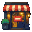 | Без бизнеса | Всю жизнь работаешь на других: своего дела нет. |
|  | Аскеза | Всю жизнь — образ жизни не выше «Стандарта». |
|  | Минимализм | Ничего из магазина: ни машин, ни часов, ни поездок. |
|  | Образцовый налогоплательщик | Ни доллара мимо налоговой: ни конвертов, ни офшоров, ни скрытой крипты. |
|  | Отравленное наследство | На старте — на 30 000 $ больше и семья, которая не даст жить ниже уровня «Люкс». |

## Карьеры

Зарплата — это процент от средней зарплаты в городе, где ты живёшь. Повышение приходит, когда карьерный навык дорастает до того, что требует следующая должность.

### Здравоохранение

Сверхурочные: +8% к зарплате в этом раунде.

| Должность | Зарплата | Карьерный навык | Статус |
| --- | --- | --- | --- |
| Медсестра | 85% средней зарплаты | 0 | +2 |
| Процедурная медсестра | 97% средней зарплаты | 5 | +5 |
| Старшая медсестра | 110% средней зарплаты | 12 | +9 |
| Главная медсестра | 125% средней зарплаты | 20 | +14 |

### ИТ

Сверхурочные: +5% к зарплате в этом раунде.

| Должность | Зарплата | Карьерный навык | Статус |
| --- | --- | --- | --- |
| Младший разработчик | 105% средней зарплаты | 0 | +3 |
| Разработчик | 120% средней зарплаты | 4 | +6 |
| Старший разработчик | 140% средней зарплаты | 10 | +11 |
| Ведущий разработчик | 168% средней зарплаты | 18 | +18 |
| Технический директор | 205% средней зарплаты | 28 | +28 |

### Госслужба

Сверхурочные: +4% к зарплате в этом раунде.

| Должность | Зарплата | Карьерный навык | Статус |
| --- | --- | --- | --- |
| Специалист | 95% средней зарплаты | 0 | +3 |
| Консультант | 106% средней зарплаты | 6 | +6 |
| Советник | 118% средней зарплаты | 14 | +10 |
| Начальник отдела | 132% средней зарплаты | 24 | +16 |

| Карьерный шаг | На должностях | Раунды · отдых | Что может выйти |
| --- | --- | --- | --- |
| **Готовиться к внутреннему конкурсу** Два раунда подготовки к экзамену на следующую ступень. Сдашь — поднимешься на ступень. | Специалист — Советник | 2 · 2 | 55%: Конкурс пройден: на ступень выше. 45%: В этот раз не вышло. Будет следующий конкурс. |

### Сфера услуг

Сверхурочные: +10% к зарплате в этом раунде.

| Должность | Зарплата | Карьерный навык | Статус |
| --- | --- | --- | --- |
| Курьер | 65% средней зарплаты | 0 | 0 |
| Старший смены | 80% средней зарплаты | 4 | +2 |
| Директор магазина | 98% средней зарплаты | 10 | +6 |
| Региональный менеджер | 122% средней зарплаты | 18 | +11 |
| Операционный директор | 155% средней зарплаты | 28 | +18 |

| Карьерный шаг | На должностях | Раунды · отдых | Что может выйти |
| --- | --- | --- | --- |
| **Сменить приложение доставки** Другая платформа: может платить лучше… или хуже. | Курьер | 1 · 2 | 60%: Новое приложение платит лучше: +10% к зарплате. 40%: Новое приложение платит хуже: −5% к зарплате. |
| **Попросить другой район** Район пооживлённее может платить больше. | Старший смены — Региональный менеджер | 1 · 2 | 50%: Дали район получше: +8% к зарплате. 50%: Всё остаётся как было. |
| **Открыть свой склад** Свой пункт доставки: доход без работы, если дело пойдёт. | Операционный директор | 1 · 4 | 55%: Склад работает: пассивный доход навсегда. 45%: Не получилось, и это бьёт по статусу. |

### Финансы

Сверхурочные: +6% к зарплате в этом раунде.

| Должность | Зарплата | Карьерный навык | Статус |
| --- | --- | --- | --- |
| Аналитик | 130% средней зарплаты | 0 | +5 |
| Старший аналитик | 160% средней зарплаты | 6 | +9 |
| Вице-президент | 200% средней зарплаты | 15 | +15 |
| Директор | 260% средней зарплаты | 28 | +23 |
| Управляющий директор | 350% средней зарплаты | 42 | +30 |

### Медицина

Сверхурочные: +8% к зарплате в этом раунде.

| Должность | Зарплата | Карьерный навык | Статус |
| --- | --- | --- | --- |
| Ординатор | 110% средней зарплаты | 0 | +5 |
| Лечащий врач | 150% средней зарплаты | 6 | +10 |
| Врач высшей категории | 200% средней зарплаты | 14 | +17 |
| Заведующая отделением | 260% средней зарплаты | 24 | +26 |

| Карьерный шаг | На должностях | Раунды · отдых | Что может выйти |
| --- | --- | --- | --- |
| **Открыть частный приём** Свои пациенты по вечерам: доход навсегда, но это утомляет. | Врач высшей категории — Заведующая отделением | 1 · 99 | 85%: Запись полная: доход навсегда и чуть меньше здоровья. 15%: Пациенты не идут. Приём закрывается. |

### Право

Сверхурочные: +6% к зарплате в этом раунде.

| Должность | Зарплата | Карьерный навык | Статус |
| --- | --- | --- | --- |
| Помощник юриста | 90% средней зарплаты | 0 | +4 |
| Младший юрист | 115% средней зарплаты | 8 | +8 |
| Юрист | 160% средней зарплаты | 18 | +15 |
| Партнёр | 240% средней зарплаты | 32 | +24 |
| Управляющий партнёр | 380% средней зарплаты | 46 | +32 |

| Карьерный шаг | На должностях | Раунды · отдых | Что может выйти |
| --- | --- | --- | --- |
| **Претендовать на партнёрство** Попроситься в партнёры фирмы. Помогает умение вести переговоры. | Юрист | 1 · 3 | 35%: Партнёрство получено: на ступень выше и доля прибыли. 65%: Говорят, пока рано. Придётся подождать и проглотить гордость. +10 пунктов к шансу за каждый уровень навыка «Переговоры» |
| **Привлечь крупного клиента** Привести в фирму важный счёт. Помогают связи. | Партнёр — Управляющий партнёр | 1 · 3 | 50%: Клиент твой: +10% к зарплате навсегда. 50%: Клиент уходит к конкурентам. +8 пунктов к шансу за каждый уровень навыка «Связи» |

### Образование

Сверхурочные: +3% к зарплате в этом раунде. Оставляет свободное время: +1 к фокусу каждый раунд.

| Должность | Зарплата | Карьерный навык | Статус |
| --- | --- | --- | --- |
| Учитель на замену | 80% средней зарплаты | 0 | +3 |
| Учитель | 90% средней зарплаты | 6 | +6 |
| Завуч | 102% средней зарплаты | 14 | +10 |
| Директор школы | 115% средней зарплаты | 24 | +15 |

### Блогинг

Сверхурочные: +12% к зарплате в этом раунде. Профессия для молодых: с 34 лет зарплата каждый раунд падает на 12%, но не больше чем на 70% в сумме.

| Должность | Зарплата | Карьерный навык | Статус |
| --- | --- | --- | --- |
| Начинающий блогер | 70% средней зарплаты | 0 | +6 |
| Блогер | 130% средней зарплаты | 5 | +14 |
| Блогер-миллионник | 220% средней зарплаты | 14 | +24 |
| Звезда | 250% средней зарплаты | 28 | +34 |

| Карьерный шаг | На должностях | Раунды · отдых | Что может выйти |
| --- | --- | --- | --- |
| **Попробовать завирусить** Рискованное видео: может вознести… или утопить. | Начинающий блогер — Блогер | 1 · 2 | 30%: Вирусный хит! Сразу на две ступени выше. 20%: Скандал: минус статус и рекламодатели. 50%: Никто не заметил. +5 пунктов к шансу за каждый уровень навыка «Связи» |
| **Запустить свой бренд** Бренд с твоим именем, который переживёт славу. | Звезда | 1 · 4 | 60%: Бренд продаётся сам: доход навсегда. 40%: Бренд не взлетает, и это заметно. |

### Рестораны и отели

Сверхурочные: +14% к зарплате в этом раунде.

| Должность | Зарплата | Карьерный навык | Статус |
| --- | --- | --- | --- |
| Официант | 60% средней зарплаты | 0 | +1 |
| Метрдотель | 78% средней зарплаты | 4 | +3 |
| Управляющий рестораном | 100% средней зарплаты | 10 | +7 |
| Директор отеля | 130% средней зарплаты | 18 | +12 |
| Директор сети | 170% средней зарплаты | 28 | +19 |

### Продажи

Сверхурочные: +8% к зарплате в этом раунде. Зарплата следует за экономикой: Бум +25%, Рост +10%, Замедление −10%, Рецессия −25%.

| Должность | Зарплата | Карьерный навык | Статус |
| --- | --- | --- | --- |
| Торговый представитель | 75% средней зарплаты | 0 | +2 |
| Менеджер по продажам | 100% средней зарплаты | 4 | +5 |
| Аккаунт-менеджер | 135% средней зарплаты | 10 | +10 |
| Директор по продажам | 180% средней зарплаты | 18 | +17 |
| Коммерческий директор | 240% средней зарплаты | 28 | +25 |

### Авиация

Сверхурочные: +6% к зарплате в этом раунде. Зарплата следует за экономикой: Бум +5%, Замедление −10%, Рецессия −35%.

| Должность | Зарплата | Карьерный навык | Статус |
| --- | --- | --- | --- |
| Пилот-стажёр | 75% средней зарплаты | 0 | +4 |
| Второй пилот | 120% средней зарплаты | 7 | +9 |
| Командир воздушного судна | 170% средней зарплаты | 18 | +16 |
| Старший командир | 205% средней зарплаты | 30 | +22 |

| Карьерный шаг | На должностях | Раунды · отдых | Что может выйти |
| --- | --- | --- | --- |
| **Перейти на дальние рейсы** Длинные рейсы платят больше и изматывают: часовые пояса, бессонные ночи. | Второй пилот — Командир воздушного судна | 1 · 3 | 70%: Длинные рейсы окупаются: +8% к зарплате навсегда. 30%: Зарплата выросла на 8%, а смена поясов бьёт по здоровью. |
| **Податься в национальную авиакомпанию** Национальный перевозчик берёт командиров из лучших. Помогают языки. | Командир воздушного судна — Старший командир | 1 · 3 | 40%: Национальный перевозчик берёт тебя: на ступень выше и форма, которую знают все. 60%: Тебя благодарят за интерес. +8 пунктов к шансу за каждый уровень навыка «Языки» |

### Архитектура

Сверхурочные: +5% к зарплате в этом раунде. Зарплата следует за экономикой: Бум +15%, Рост +5%, Замедление −10%, Рецессия −25%.

| Должность | Зарплата | Карьерный навык | Статус |
| --- | --- | --- | --- |
| Младший архитектор | 85% средней зарплаты | 0 | +4 |
| Архитектор проекта | 115% средней зарплаты | 5 | +8 |
| Ведущий архитектор | 150% средней зарплаты | 13 | +13 |
| Партнёр бюро | 210% средней зарплаты | 24 | +20 |

| Карьерный шаг | На должностях | Раунды · отдых | Что может выйти |
| --- | --- | --- | --- |
| **Участвовать в конкурсе** Проект общественного здания против лучших бюро. Помогают связи. | Архитектор проекта — Партнёр бюро | 1 · 3 | 25%: Победа: твоё имя в газетах и +6% к зарплате. 75%: Побеждает другое бюро. Чертежи уходят в ящик. +8 пунктов к шансу за каждый уровень навыка «Связи» |
| **Открыть своё бюро** Твоё имя на двери и свои клиенты: доход навсегда, если они придут. | Партнёр бюро | 1 · 4 | 55%: Бюро полно заказов: пассивный доход навсегда. 45%: Клиенты не приходят, и это заметно. |

### Недвижимость

Сверхурочные: +10% к зарплате в этом раунде. Зарплата следует за экономикой: Бум +30%, Рост +10%, Замедление −15%, Рецессия −35%.

| Должность | Зарплата | Карьерный навык | Статус |
| --- | --- | --- | --- |
| Агент-стажёр | 55% средней зарплаты | 0 | +2 |
| Агент | 88% средней зарплаты | 4 | +5 |
| Старший агент | 128% средней зарплаты | 10 | +9 |
| Директор офиса | 180% средней зарплаты | 20 | +15 |
| Владелец агентства | 235% средней зарплаты | 32 | +20 |

| Карьерный шаг | На должностях | Раунды · отдых | Что может выйти |
| --- | --- | --- | --- |
| **Взять элитные объекты** Самые дорогие дома города и самые трудные покупатели. Помогает умение вести переговоры. | Агент — Директор офиса | 1 · 3 | 55%: Пошли крупные сделки: +10% к зарплате навсегда. 45%: Богатые покупают через кого-то другого. +8 пунктов к шансу за каждый уровень навыка «Переговоры» |
| **Открыть своё агентство** Витрина с твоим именем и свои агенты. | Директор офиса | 1 · 4 | 50%: Агентство пошло в гору: на ступень выше и доход навсегда. 50%: Агентство так и не раскрутилось, и это видно. |

### Армия

Сверхурочные: +8% к зарплате в этом раунде. Оставляет свободное время: +1 к фокусу каждый раунд.

| Должность | Зарплата | Карьерный навык | Статус |
| --- | --- | --- | --- |
| Рядовой | 64% средней зарплаты | 0 | +4 |
| Сержант | 82% средней зарплаты | 5 | +7 |
| Лейтенант | 105% средней зарплаты | 12 | +11 |
| Капитан | 132% средней зарплаты | 20 | +15 |
| Полковник | 168% средней зарплаты | 32 | +21 |

| Карьерный шаг | На должностях | Раунды · отдых | Что может выйти |
| --- | --- | --- | --- |
| **Пройти отбор в спецназ** Отбор, который проходят немногие. Помогает хорошая форма. | Рядовой — Лейтенант | 1 · 3 | 35%: Отбор пройден: на ступень выше и берет. 65%: Отбор не пройден, и тело за это расплачивается. +8 пунктов к шансу за каждый уровень навыка «Здоровье» |

## Бизнес

Бизнес приносит доход с капитала, который в нём работает: пока он небольшой — со всего капитала, а когда перерастает то, на что рассчитан, — всё меньше с каждого доллара. Прибыль следует за экономикой, а достаточно плохой раунд приносит убыток. Каждый раунд бизнесу нужна единица фокуса или управляющий; без них он даёт 50% прибыли и теряет 8% капитала. Вести можно до 3 бизнесов сразу. Проданный со вкладки, он стоит от 70% до 100% того, что в нём лежит, в зависимости от экономики; больше платит только карта.

| Бизнес | Минимальный капитал | Доход в год | Рассчитан на | С экономикой | Управляющий | Финансовая грамотность |
| --- | --- | --- | --- | --- | --- | --- |
| Своя практика | 2 000 $ | до 22% | 30 000 $ | Бум +15%, Замедление −15%, Рецессия −40% | 50% прибыли | 0 |
| Интернет-магазин | 5 000 $ | до 20% | 80 000 $ | Бум +25%, Рост +5%, Замедление −25%, Рецессия −70% | 40% прибыли | 2 |
| Приложение | 3 000 $ | до 26% | 120 000 $ | Бум +40%, Замедление −30%, Рецессия −90%, Восстановление +10% | 45% прибыли | 2 |
| Бар | 30 000 $ | до 15% | 200 000 $ | Бум +30%, Рост +10%, Замедление −35%, Рецессия −130%, Восстановление −10% | 35% прибыли | 2 |
| Франшиза | 80 000 $ | до 11% | 600 000 $ | Бум +10%, Замедление −10%, Рецессия −40% | 20% прибыли | 2 |

## Города

У каждого города есть вид ночью, днём, в бум и в кризис, и своя иконка.

Переезд стоит 20% годовых расходов на жизнь в новом городе, ещё 4% за каждые 1 000 км пути, и единицу фокуса; с партнёром — на 50% больше, и ещё на 25% за каждого ребёнка. Переезд по своей воле опускает на 1 ступень до следующего повышения, а партнёр 2 года остаётся без зарплаты. Переезд, который предлагает карта, ничего из этого не стоит.

###  Мадрид

Ровный старт: зарплаты средние, цены средние, обеды долгие.

 

 

|  |  |
| --- | --- |
| Средняя зарплата | 32 000 $ в год |
| Расходы на жизнь | 26 000 $ в год |
| Эталонная квартира | 280 000 $ |
| Доход от сдачи недвижимости | 4,2% её стоимости в год |
| Подоходный налог | 19% · 30% · 45% |
| Налог на прирост капитала | 21% |
| Статус за жизнь здесь | +6 |
| Где платят больше | Госслужба +15% · Здравоохранение +10% · Образование +10% · Архитектура +10% |

###  Лондон

Здесь делают карьеру в финансах, а зарплату отдают за аренду.

 

 

|  |  |
| --- | --- |
| Средняя зарплата | 58 000 $ в год |
| Расходы на жизнь | 47 000 $ в год |
| Эталонная квартира | 620 000 $ |
| Доход от сдачи недвижимости | 3,6% её стоимости в год |
| Подоходный налог | 20% · 40% · 45% |
| Налог на прирост капитала | 20% |
| Статус за жизнь здесь | +12 |
| Где платят больше | Финансы +20% · Медицина +10% · Право +15% · Продажи +10% |

###  Нью-Йорк

Самые высокие зарплаты в игре — и самые высокие налоги.

 

 

|  |  |
| --- | --- |
| Средняя зарплата | 75 000 $ в год |
| Расходы на жизнь | 60 000 $ в год |
| Эталонная квартира | 700 000 $ |
| Доход от сдачи недвижимости | 4% её стоимости в год |
| Подоходный налог | 25% · 38% · 50% |
| Налог на прирост капитала | 25% |
| Статус за жизнь здесь | +15 |
| Где платят больше | Финансы +25% · ИТ +10% · Право +20% · Продажи +15% |

###  Дубай

Подоходного налога нет, зато способов потратить оставшееся — хоть отбавляй.

 

 

|  |  |
| --- | --- |
| Средняя зарплата | 56 000 $ в год |
| Расходы на жизнь | 45 000 $ в год |
| Эталонная квартира | 330 000 $ |
| Доход от сдачи недвижимости | 6,5% её стоимости в год |
| Подоходный налог | 0% · 0% · 0% |
| Налог на прирост капитала | 0% |
| Статус за жизнь здесь | +15 |
| Где платят больше | Сфера услуг +20% · Финансы +10% · Блогинг +20% · Рестораны и отели +15% |

###  Сингапур

Низкие налоги, высокая аренда, а прибыль от инвестиций не облагается вовсе.

 

 

|  |  |
| --- | --- |
| Средняя зарплата | 58 000 $ в год |
| Расходы на жизнь | 47 000 $ в год |
| Эталонная квартира | 640 000 $ |
| Доход от сдачи недвижимости | 3,2% её стоимости в год |
| Подоходный налог | 5% · 15% · 22% |
| Налог на прирост капитала | 0% |
| Статус за жизнь здесь | +12 |
| Где платят больше | ИТ +20% · Финансы +10% · Образование +25% · Авиация +15% |

###  Бангкок

На твои деньги здесь купишь вчетверо больше. На сбережения — тоже.

 

 

|  |  |
| --- | --- |
| Средняя зарплата | 13 000 $ в год |
| Расходы на жизнь | 10 500 $ в год |
| Эталонная квартира | 95 000 $ |
| Доход от сдачи недвижимости | 5% её стоимости в год |
| Подоходный налог | 5% · 20% · 35% |
| Налог на прирост капитала | 0% |
| Статус за жизнь здесь | +6 |
| Где платят больше | Сфера услуг +15% · ИТ +10% · Рестораны и отели +20% · Блогинг +10% |

###  Токио

Всё работает, ничего не дешевеет, а квартиры почти не дорожают.

 

 

|  |  |
| --- | --- |
| Средняя зарплата | 42 000 $ в год |
| Расходы на жизнь | 33 000 $ в год |
| Эталонная квартира | 450 000 $ |
| Доход от сдачи недвижимости | 3,8% её стоимости в год |
| Подоходный налог | 15% · 33% · 45% |
| Налог на прирост капитала | 20% |
| Статус за жизнь здесь | +13 |
| Где платят больше | ИТ +15% · Продажи +10% · Рестораны и отели +10% · Недвижимость +10% |

###  Москва

Плоский налог в тринадцать процентов и рынок, который качается вместе со ставками.

 

 

|  |  |
| --- | --- |
| Средняя зарплата | 18 000 $ в год |
| Расходы на жизнь | 14 000 $ в год |
| Эталонная квартира | 220 000 $ |
| Доход от сдачи недвижимости | 4,5% её стоимости в год |
| Подоходный налог | 13% · 13% · 15% |
| Налог на прирост капитала | 13% |
| Статус за жизнь здесь | +9 |
| Где платят больше | Финансы +15% · ИТ +15% · Госслужба +10% · Армия +10% |

###  Мехико

Жить дёшево, расти быстро, и тако на каждом углу.

 

 

|  |  |
| --- | --- |
| Средняя зарплата | 12 000 $ в год |
| Расходы на жизнь | 10 000 $ в год |
| Эталонная квартира | 140 000 $ |
| Доход от сдачи недвижимости | 6% её стоимости в год |
| Подоходный налог | 10% · 25% · 35% |
| Налог на прирост капитала | 10% |
| Статус за жизнь здесь | +7 |
| Где платят больше | Блогинг +15% · Рестораны и отели +10% · Продажи +15% · Право +10% |

###  Цюрих

Самые высокие зарплаты в игре, самые дорогие квартиры и никакого налога на прибыль от инвестиций.

 

 

|  |  |
| --- | --- |
| Средняя зарплата | 95 000 $ в год |
| Расходы на жизнь | 70 000 $ в год |
| Эталонная квартира | 1 400 000 $ |
| Доход от сдачи недвижимости | 2,8% её стоимости в год |
| Подоходный налог | 12% · 22% · 33% |
| Налог на прирост капитала | 0% |
| Статус за жизнь здесь | +16 |
| Где платят больше | Финансы +25% · Медицина +15% · Право +15% · ИТ +10% |

## Вещи

В одной категории лучшая вещь даёт весь свой статус, а остальные — 25% своего. «Часы»: остальные — 25%. «Мода»: остальные — 50%. «Машины и мотоциклы»: считаются только лучшие (2), первая целиком, остальные — 25%.

«Польза» — то, что вещь даёт помимо статуса. Внутри категории считается только лучшее из того, что есть; между категориями всё складывается. С машиной открывается вариант получше в карте с подработкой на себя, а с членством в клубе — в карте о работе на себя.

Вещи из категорий «Машины и мотоциклы» и «Техника» с годами теряют статус так же, как теряют в цене, пока не останется 25% того, что они давали новыми.

«Перепродажа» — сколько вещь стоит в день покупки относительно своей цены, и как это меняется каждый раунд помимо инфляции.

В рассрочку продаётся то, что служит долго и стоит от 5 000 $: 20% первым взносом, остальное — потребительским кредитом в пределах лимита кредитов. Если вещь продать, долг остаётся.

С рук продаются вещи некоторых категорий, только за наличные. Подержанной вещи уже несколько лет: если её категория стареет, статуса она даёт меньше. В день покупки она стоит тот же процент от уплаченного, что и новая, так что купить и продать в одном раунде никогда не выгодно. Раунд покупки покрывает гарантия; потом каждый раунд может понадобиться ремонт, который оплачивается вместе со счетами раунда.

| Категория | Цена | Возраст, лет | Ремонт |
| --- | --- | --- | --- |
| Машины и мотоциклы | 55% цены новой | 4 | 30% за раунд, 8% цены новой |
| Часы | 70% цены новой | 4 | 25% за раунд, 6% цены новой |

### Машины и мотоциклы

|  | Вещь | Цена | Содержание | Статус | Перепродажа | Польза | Примечания |
| --- | --- | --- | --- | --- | --- | --- | --- |
|  | SEAT Ibiza | 18 000 $ | 1 500 $/год | +3 | 80%, −22% за раунд | Переезд на 30% дешевле |  |
|  | Ducati Monster | 22 000 $ | 1 200 $/год | +5 | 80%, −20% за раунд | Переезд на 30% дешевле |  |
|  | Toyota Corolla | 26 000 $ | 1 600 $/год | +4 | 82%, −20% за раунд | Переезд на 30% дешевле |  |
|  | VW Golf GTI | 42 000 $ | 2 200 $/год | +6 | 80%, −22% за раунд | Переезд на 30% дешевле |  |
|  | Tesla Model 3 | 48 000 $ | 1 800 $/год | +8 | 78%, −24% за раунд | Переезд на 30% дешевле |  |
|  | BMW M3 | 95 000 $ | 4 000 $/год | +14 | 78%, −22% за раунд | Переезд на 30% дешевле |  |
|  | Porsche 911 | 150 000 $ | 6 000 $/год | +22 | 85%, −12% за раунд | Переезд на 30% дешевле |  |
|  | Lamborghini Aventador | 480 000 $ | 15 000 $/год | +35 | 85%, −8% за раунд | Переезд на 30% дешевле |  |

### Часы

|  | Вещь | Цена | Содержание | Статус | Перепродажа | Польза | Примечания |
| --- | --- | --- | --- | --- | --- | --- | --- |
|  | Casio F-91W | 20 $ |  | +1 | 50%, −10% за раунд |  |  |
|  | Tissot PRX | 750 $ |  | +2 | 60%, −8% за раунд | +2 пункта к поиску работы |  |
|  | Omega Speedmaster | 7 000 $ | 100 $/год | +6 | 75%, −3% за раунд | +4 пункта к поиску работы |  |
|  | Rolex Submariner | 11 000 $ | 150 $/год | +10 | 90%, +2% за раунд | +6 пунктов к поиску работы |  |
|  | Audemars Piguet Royal Oak | 38 000 $ | 300 $/год | +16 | 92%, +3% за раунд | +8 пунктов к поиску работы |  |
|  | Patek Philippe Nautilus | 90 000 $ | 400 $/год | +22 | 95%, +4% за раунд | +10 пунктов к поиску работы |  |

### Техника

|  | Вещь | Цена | Содержание | Статус | Перепродажа | Польза | Примечания |
| --- | --- | --- | --- | --- | --- | --- | --- |
|  | iPhone | 1 200 $ |  | +2 | 60%, −50% за раунд |  |  |
|  | MacBook Pro | 2 600 $ |  | +3 | 65%, −45% за раунд | +1 к карьерному навыку при учёбе |  |
|  | PS5 | 550 $ |  | +1 | 60%, −40% за раунд |  |  |
|  | Apple Watch | 450 $ |  | +1 | 50%, −50% за раунд |  |  |
|  | DJI Mavic | 1 800 $ |  | +2 | 55%, −50% за раунд |  |  |
|  | Рабочая станция для ИИ | 18 000 $ |  | +4 | 50%, −40% за раунд | +2 к карьерному навыку при учёбе |  |

### Мода

|  | Вещь | Цена | Содержание | Статус | Перепродажа | Польза | Примечания |
| --- | --- | --- | --- | --- | --- | --- | --- |
|  | Пиджак Zara | 100 $ |  | +1 | 20%, −60% за раунд | +3 пункта к поиску работы |  |
|  | Поло Ralph Lauren | 150 $ |  | +1 | 25%, −50% за раунд |  |  |
|  | Air Jordan 1 | 350 $ |  | +2 | 90%, +2% за раунд |  |  |
|  | Очки Persol | 450 $ |  | +2 | 30%, −40% за раунд |  |  |
|  | Лоферы Gucci | 950 $ |  | +3 | 40%, −30% за раунд | +4 пункта к поиску работы |  |
|  | Сумка Louis Vuitton Keepall | 2 800 $ |  | +6 | 60%, −15% за раунд |  |  |
|  | Костюм с Сэвил-Роу | 6 000 $ |  | +8 | 20%, −50% за раунд | +10 пунктов к поиску работы | Только в городе Лондон; при переезде теряется |
|  | Hermès Birkin | 14 000 $ |  | +12 | 95%, +3% за раунд | +6 пунктов к поиску работы |  |
|  | Пальто Chanel от кутюр | 25 000 $ |  | +14 | 40%, −25% за раунд | +8 пунктов к поиску работы |  |

### Искусство

|  | Вещь | Цена | Содержание | Статус | Перепродажа | Польза | Примечания |
| --- | --- | --- | --- | --- | --- | --- | --- |
|  | Авторский принт с подписью | 600 $ |  | +1 | 50%, −5% за раунд |  |  |
|  | Фотография ограниченного тиража | 5 000 $ |  | +4 | 80%, 0% за раунд |  |  |
|  | Принт Бэнкси | 28 000 $ |  | +8 | 90%, +5% за раунд |  |  |
|  | Литография Пикассо | 60 000 $ |  | +14 | 92%, +4% за раунд |  |  |
|  | Бронзовая скульптура | 150 000 $ |  | +22 | 92%, +3% за раунд |  |  |
|  | Картина старого мастера | 900 000 $ |  | +40 | 95%, +4% за раунд |  |  |

### Путешествия

|  | Вещь | Цена | Содержание | Статус | Перепродажа | Польза | Примечания |
| --- | --- | --- | --- | --- | --- | --- | --- |
|  | Выходные с Ryanair | 300 $ |  | +1 |  |  | Статус держится 2 года |
|  | Проездной Interrail | 1 200 $ |  | +3 |  |  | Статус держится 2 года |
|  | Лето на Ибице | 2 500 $ |  | +4 |  |  | Статус держится 2 года |
|  | Неделя на лыжах в Церматте | 4 500 $ |  | +5 |  |  | Статус держится 2 года. Только в городах: Мадрид, Лондон, Цюрих; при переезде теряется |
|  | Бизнес-класс Emirates | 6 000 $ |  | +6 |  | +1 к фокусу в следующем раунде | Статус держится 4 года |
|  | Сафари в Масаи-Мара | 9 000 $ |  | +8 |  | +1 к фокусу в следующем раунде | Статус держится 4 года |
|  | Курорт на Мальдивах | 14 000 $ |  | +9 |  | +1 к фокусу в следующем раунде | Статус держится 4 года |
|  | Кругосветка первым классом | 40 000 $ |  | +14 |  | +1 к фокусу в следующем раунде | Статус держится 4 года |

### Небо и море

|  | Вещь | Цена | Содержание | Статус | Перепродажа | Польза | Примечания |
| --- | --- | --- | --- | --- | --- | --- | --- |
|  | Курс яхтинга | 2 500 $ |  | +3 |  |  | Статус держится 4 года |
|  | Полёт на вертолёте | 6 000 $ |  | +5 |  |  | Статус держится 2 года |
|  | Неделя на арендованной яхте | 45 000 $ |  | +14 |  |  | Статус держится 4 года |
|  | Чартер NetJets | 80 000 $ |  | +18 |  |  | Статус держится 4 года |
|  | Парусная яхта Beneteau | 180 000 $ | 12 000 $/год | +22 | 75%, −12% за раунд |  |  |
|  | Моторная яхта Sunseeker | 1 200 000 $ | 90 000 $/год | +55 | 70%, −15% за раунд |  | Только в городах: Дубай, Сингапур; при переезде теряется |

### Питомцы

|  | Вещь | Цена | Содержание | Статус | Перепродажа | Польза | Примечания |
| --- | --- | --- | --- | --- | --- | --- | --- |
|  | Собака из приюта | 300 $ | 1 200 $/год | +2 | 0%, 0% за раунд |  |  |

### Клубы и абонементы

|  | Вещь | Цена | Содержание | Статус | Перепродажа | Польза | Примечания |
| --- | --- | --- | --- | --- | --- | --- | --- |
|  | Спортзал | 50 $ | 360 $/год | +1 |  |  | Взнос, пока членство действует |
|  | Amex Platinum | 0 $ | 800 $/год | +5 |  | +2 пункта к поиску работы | Взнос, пока членство действует |
|  | Soho House | 500 $ | 3 000 $/год | +8 |  | +6 пунктов к поиску работы | Взнос, пока членство действует |
|  | Абонемент на «Бернабеу» | 1 000 $ | 1 800 $/год | +6 |  | +3 пункта к поиску работы | Взнос, пока членство действует. Только в городе Мадрид; при переезде теряется |
|  | Абонемент «Арсенала» | 1 500 $ | 2 600 $/год | +7 |  | +3 пункта к поиску работы | Взнос, пока членство действует. Только в городе Лондон; при переезде теряется |
|  | Абонемент «Никс» | 2 500 $ | 4 500 $/год | +9 |  | +4 пункта к поиску работы | Взнос, пока членство действует. Только в городе Нью-Йорк; при переезде теряется |
|  | Пляжный клуб в Джумейре | 3 000 $ | 5 000 $/год | +10 |  | +4 пункта к поиску работы | Взнос, пока членство действует. Только в городе Дубай; при переезде теряется |
|  | Paddock Club Гран-при Сингапура | 4 000 $ | 6 000 $/год | +11 |  | +5 пунктов к поиску работы | Взнос, пока членство действует. Только в городе Сингапур; при переезде теряется |
|  | Место у ринга на «Раджадамнерне» | 150 $ | 400 $/год | +3 |  | +2 пункта к поиску работы | Взнос, пока членство действует. Только в городе Бангкок; при переезде теряется |
|  | Ложа на турнире сумо в Рёгоку | 2 000 $ | 3 500 $/год | +9 |  | +4 пункта к поиску работы | Взнос, пока членство действует. Только в городе Токио; при переезде теряется |
|  | Абонемент в ложу Большого театра | 800 $ | 2 000 $/год | +7 |  | +3 пункта к поиску работы | Взнос, пока членство действует. Только в городе Москва; при переезде теряется |
|  | Ложа на стадионе «Ацтека» | 6 000 $ | 1 500 $/год | +6 |  | +3 пункта к поиску работы | Взнос, пока членство действует. Только в городе Мехико; при переезде теряется |
|  | Гольф-клуб в Цумиконе | 25 000 $ | 8 000 $/год | +13 |  | +6 пунктов к поиску работы | Взнос, пока членство действует. Только в городе Цюрих; при переезде теряется |

### Образование

|  | Вещь | Цена | Содержание | Статус | Перепродажа | Польза | Примечания |
| --- | --- | --- | --- | --- | --- | --- | --- |
|  | Сертификат PMP | 4 000 $ |  | +4 | 0%, 0% за раунд | +3% к зарплате. +8 пунктов к поиску работы |  |
|  | Бизнес-коуч | 0 $ | 6 000 $/год | +2 |  | +2% к зарплате | Взнос, пока членство действует |
|  | Языковая школа за границей | 6 000 $ |  | +4 |  |  | Статус держится 4 года |
|  | MBA в IESE | 95 000 $ |  | +15 |  | +10% к зарплате | Даёт только карта |

## Недвижимость

Цена — процент от эталонной квартиры в каждом городе. Для примера дана цена в городе Мадрид.

Статус жилья — это статус дома, в котором ты живёшь. Кроме того, роскошное жильё (от +37), в котором ты не живёшь, сданное или в другом городе, даёт 50% своего статуса: считаются лучшие (2).

|  | Объект | Цена | Мадрид | Статус, если жить в нём | Назначение | Аренда |
| --- | --- | --- | --- | --- | --- | --- |
| 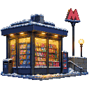 | Ларёк у метро | 8% эталонной квартиры | 22 400 $ |  | Только сдавать | 95% дохода от сдачи жилья |
|  | Лавка на плавучем рынке | 10% эталонной квартиры | 28 000 $ |  | Только сдавать | 95% дохода от сдачи жилья |
|  | Машино-место | 12% эталонной квартиры | 33 600 $ |  | Только сдавать | 90% дохода от сдачи жилья |
| 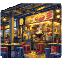 | Место в хокер-центре | 15% эталонной квартиры | 42 000 $ |  | Только сдавать | 100% дохода от сдачи жилья |
| 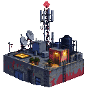 | Крыша под антенны | 20% эталонной квартиры | 56 000 $ |  | Только сдавать | 100% дохода от сдачи жилья |
| 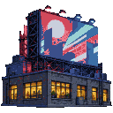 | Билборд на Таймс-сквер | 25% эталонной квартиры | 70 000 $ |  | Только сдавать | 105% дохода от сдачи жилья |
| 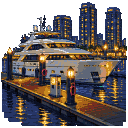 | Причал в Марине | 30% эталонной квартиры | 84 000 $ |  | Только сдавать | 105% дохода от сдачи жилья |
|  | Студия | 60% эталонной квартиры | 168 000 $ | +8 | Жить или сдавать | 100% дохода от сдачи жилья |
| 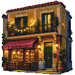 | Квартира для туристов в центре | 70% эталонной квартиры | 196 000 $ |  | Только сдавать | 130% дохода от сдачи жилья |
|  | Банковское хранилище на Парадеплац | 90% эталонной квартиры | 252 000 $ |  | Только сдавать | 100% дохода от сдачи жилья |
|  | Квартира | 100% эталонной квартиры | 280 000 $ | +14 | Жить или сдавать | 100% дохода от сдачи жилья |
| 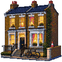 | Дом для студентов | 110% эталонной квартиры | 308 000 $ |  | Только сдавать | 120% дохода от сдачи жилья |
|  | Лофт | 125% эталонной квартиры | 350 000 $ | +18 | Жить или сдавать | 100% дохода от сдачи жилья |
|  | Торговая точка | 130% эталонной квартиры | 364 000 $ |  | Только сдавать | 125% дохода от сдачи жилья |
|  | Таунхаус | 150% эталонной квартиры | 420 000 $ | +21 | Жить или сдавать | 100% дохода от сдачи жилья |
| 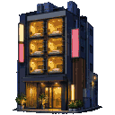 | Капсульный отель в Синдзюку | 180% эталонной квартиры | 504 000 $ |  | Только сдавать | 120% дохода от сдачи жилья |
|  | Семейный дом | 180% эталонной квартиры | 504 000 $ | +24 | Жить или сдавать | 100% дохода от сдачи жилья |
|  | Офисный этаж | 220% эталонной квартиры | 616 000 $ |  | Только сдавать | 115% дохода от сдачи жилья |
|  | Дуплекс | 250% эталонной квартиры | 700 000 $ | +31 | Жить или сдавать | 100% дохода от сдачи жилья |
|  | Склад | 300% эталонной квартиры | 840 000 $ |  | Только сдавать | 120% дохода от сдачи жилья |
|  | Шале | 320% эталонной квартиры | 896 000 $ | +37 | Жить или сдавать | 100% дохода от сдачи жилья |
|  | Пентхаус | 400% эталонной квартиры | 1 120 000 $ | +42 | Жить или сдавать | 100% дохода от сдачи жилья |
|  | Поместье | 550% эталонной квартиры | 1 540 000 $ | +50 | Жить или сдавать | 100% дохода от сдачи жилья |
|  | Вилла | 800% эталонной квартиры | 2 240 000 $ | +60 | Жить или сдавать | 100% дохода от сдачи жилья |
|  | Доходный дом | 900% эталонной квартиры | 2 520 000 $ |  | Только сдавать | 110% дохода от сдачи жилья |
|  | Особняк | 1500% эталонной квартиры | 4 200 000 $ | +80 | Жить или сдавать | 100% дохода от сдачи жилья |

Без своего жилья приходится снимать:

|  | Аренда | Расходы на жильё | Статус |
| --- | --- | --- | --- |
|  | Съёмная комната | 55% | 0 |
|  | Съёмная квартира | 100% | +3 |

С годами «съёмная комната» и образ жизни «Эконом» отнимают больше статуса. Комната: 0 с 22 лет, −3 с 26 лет, −6 с 32 лет, −10 с 40 лет. Эконом: −2 с 22 лет, −4 с 26 лет, −7 с 32 лет, −11 с 40 лет.

## Инвестиции

Финансовая грамотность решает, что можно покупать самостоятельно. Она растёт как любой навык: каждый раунд с вложенными деньгами даёт +1 балл, а уровни наступают на 3, 8, 15 баллах. Курс или хорошая книга поднимают на уровень, до 2-го; 3-й приходит только с инвестициями. Карта может дать то, что требует уровня выше.

| Актив | Тикер | Класс | Финансовая грамотность | Доход | Что это |
| --- | --- | --- | --- | --- | --- |
| Казначейские векселя США | TBILL | Облигации | 0 | Купон зависит от ставок | Короткие займы правительству США, продлеваются каждый раунд. Платят чуть меньше текущей ставки, а цена не меняется никогда. |
| Облигации США, 2 года | UST2 | Облигации | 0 | Купон зависит от ставок | Двухлетний заём правительству США. Платит по текущей ставке и почти не колеблется в цене. |
| Облигации США, 10 лет | UST10 | Облигации | 0 | Купон зависит от ставок | Десять лет купонов от правительства США. Когда ставки растут, цена резко падает. |
| Облигации Германии | BUND | Облигации | 0 | Купон зависит от ставок | Немецкий госдолг. Платит чуть меньше, зато спится чуть спокойнее. |
| S&P 500 | SPX | Акции | 0 | 1,4% в год | 500 крупнейших компаний США в одном фонде. |
| MSCI World | MSCI | Акции | 0 | 1,8% в год | Компании со всего развитого мира в одном фонде. За ним следует твой пенсионный план. |
| Глобальный фонд недвижимости | REIT | Акции | 0 | 3,8% в год | Компании недвижимости со всего мира: аренда приходит дивидендами, без жильцов, за которыми надо бегать. |
| Малые компании США | R2K | Акции | 0 | 1,2% в год | Две тысячи небольших американских компаний: в хорошие времена растут быстрее, в плохие падают сильнее. |
| Apple | AAPL | Акции | 0 | 0,5% в год | Акция роста. Преданный клиент — в каждом кармане. |
| Microsoft | MSFT | Акции | 0 | 0,8% в год | Акция роста. Подписка прилагается. |
| Nvidia | NVDA | Акции | 0 |  | Акция роста на полной громкости. В бум взлетает, в спад идёт ко дну. |
| Amazon | AMZN | Акции | 0 |  | Акция роста: всё вкладывает обратно в дело и не платит дивидендов. |
| Tesla | TSLA | Акции | 0 |  | Наполовину автопроизводитель, наполовину вечный спор. За плохой раунд может подешеветь в разы. |
| Inditex | ITX | Акции | 0 | 3% в год | Мода, которая идёт за покупателем. Циклическая акция с хорошими дивидендами. |
| LVMH | MC | Акции | 0 | 1,8% в год | Роскошь, которая растёт и падает вместе с настроением богатых. |
| Ferrari | RACE | Акции | 0 | 0,8% в год | Продаёт меньше машин, чем могла бы. Нарочно. |
| Santander | SAN | Акции | 0 | 5% в год | Банк: щедрые дивиденды и цена, которая топчется на месте. |
| Coca-Cola | KO | Акции | 0 | 3,2% в год | Защитная акция. Её пьют и в рецессию. |
| Bitcoin | BTC | Крипта | 2 |  | Первая монета. У неё свои времена года, и зимы у неё долгие. |
| Ethereum | ETH | Крипта | 2 |  | Вторая монета. Всё то же, что биткоин, только резче. |
| Dogecoin | DOGE | Крипта | 2 |  | Шутка, у которой есть цена. Иногда цена и есть шутка. |
| Золото | XAU | Золото | 1 |  | Ничего не платит и ни о чём не беспокоится. Блестит, когда цены пускаются вскачь. |

## Образ жизни, аренда, страховки и фокус

|  | Образ жизни | Расходы на жизнь | Статус |
| --- | --- | --- | --- |
|  | Эконом | 70% | −2 |
|  | Стандарт | 100% | 0 |
|  | Комфорт | 140% | +3 |
|  | Люкс | 200% | +8 |

|  | Страховка | Взнос в год |
| --- | --- | --- |
|  | Медицинская страховка | 1,5% расходов на жизнь в городе |
|  | Страховка жилья | 0,6% расходов на жизнь в городе |
|  | Страховка жизни | 0,6% расходов на жизнь в городе |

|  | На что тратить фокус | Что даёт |
| --- | --- | --- |
|  | Работать сверхурочно | Больше зарплаты в этом раунде, в зависимости от карьеры. С 2-го раунда подряд — −1 к здоровью; с 3-го — шанс выгорания 35%: ещё −2 к здоровью и −1 к фокусу в следующем раунде |
|  | Учиться ради карьеры | +1 к карьерному навыку сверх +1 за работу; не больше 3 на одной должности и ничего на последней |
|  | Искать работу получше | Шанс 20% на прибавку +3% к зарплате навсегда. После прибавки — 1 раунд без поиска; каждый неудачный поиск подряд отнимает 15 пунктов, но шанс не падает ниже 5% |
|  | Пройти курс переговоров | +3 балла к навыку «Переговоры»; на 3-м уровне ничего |
|  | Ходить на языковые курсы | +3 балла к навыку «Языки»; на 3-м уровне ничего |
|  | Заводить знакомства | +3 балла к навыку «Связи»; на 3-м уровне ничего |
|  | Заниматься спортом | +3 балла к навыку «Здоровье»; на 3-м уровне ничего |

Навыки: все они, как и финансовая грамотность, идут от уровня 0 до 3, на 3, 8, 15 баллах, и каждый уровень дороже предыдущего. Раунд учёбы с фокусом даёт 3 балла, раунд практики — 1. Навык «Управление» растёт только от ведения бизнеса.

|  | Навык | За уровень | Практика |
| --- | --- | --- | --- |
|  | Переговоры | +1% при поиске работы, +2% за повышение, бизнес продаётся на 4% дороже | Поиск работы; Продажи, Право, Финансы, Недвижимость |
|  | Языки | Переезд на 15% дешевле; с уровня 2 — без потери ступени; с уровня 3 партнёр работает сразу по приезде | Жизнь вне родного города; Рестораны и отели, Авиация |
|  | Связи | +8 пунктов к поиску работы, +1 к статусу | Членство в клубе; Продажи, Блогинг, Рестораны и отели, Госслужба, Недвижимость |
|  | Управление | +6% к прибыли, управляющий на 4 пункта дешевле; с уровня 3 — ещё один бизнес | Ведение бизнеса |
|  | Здоровье | Медицинская страховка на 20% дешевле; с уровня 3 — +1 к фокусу | Спортзал; Здравоохранение, Медицина, Армия |

Семья: партнёр добавляет 45% к расходам на жизнь, а каждый ребёнок — 22% на 20 лет.

       

## Мимо налоговой

Каждый способ что-то скрыть от налоговой экономит налоги в этом раунде и добавляет подозрений. В каждом раунде шанс проверки равен самому подозрению, до потолка. Если ничего не скрывать, подозрение снижается.

| Способ | Что экономит | Подозрение | Примечания |
| --- | --- | --- | --- |
| Зарплата в конверте | Подоходный налог с этой части зарплаты | 25%: +4, 50%: +9 за раунд | Нужна работа |
| Офшорная компания | 80% налога на инвестиции | +6 за раунд | Финансовая грамотность 3; плата 6 000 $ в год |
| Скрыть крипту | Налог с прибыли от крипты | +6 за раунд с прибылью; вдвое больше с 38 лет | Биржи сообщают в налоговую |
| Покупка без чека | 25% цены | +15 при продаже | Искусство и Часы |

Подозрение снижается на 8 за каждый раунд без сокрытия, а шанс проверки никогда не выше 60%. Проверка взыскивает скрытое за последние 4 года, штраф 40% и 30% стоимости купленного без чека; она даёт −8 к статусу и закрывает все схемы.

## Карты

Каждый раунд раздаётся 3 карты. Первый вариант каждой карты ничего не стоит и ничего не покупает.

### Карьера (90)

|  | Карта | Варианты |
| --- | --- | --- |
|  | **Попросить прибавку** Через неделю аттестация, а аренда с прошлой успела вырасти дважды. | 1. Промолчать 2. Попросить 3. Сначала собрать аргументы 4. Торговаться всерьёз |
|  | **Звонок от конкурентов** Конкуренты с другого конца города хотят тебя переманить и предлагают больше. | 1. Хранить верность 2. Перейти к ним 3. Показать предложение начальству |
|  | **Повышение с подвохом** Повышение твоё. Правда, стол стоит в другом городе: Лондон. | 1. Отказаться 2. Паковать чемоданы |
|  | **Офис на востоке** Компания открывает отделения: Токио и Москва. Нужен человек, который знает дело. | 1. Остаться на месте 2. Ехать: Токио 3. Ехать: Москва |
|  | **Офис на западе** Две вакансии, переезд оплачен: Мехико или Цюрих. | 1. Остаться на месте 2. Ехать: Мехико 3. Ехать: Цюрих |
|  | **Аврал** Срок сдачи сдвинули, и не в ту сторону. Кому-то придётся месяц сидеть допоздна. | 1. Делать минимум 2. Взять сверхурочные |
|  | **Волна увольнений** В календаре появляется общее собрание. Повестки нет. | 1. Взять выходное пособие 2. Бороться за своё место 3. Переучиваться, пока ищешь работу |
|  | **Реструктуризация** Компания пересматривает, кто обходится ей дороже всех. Твоё имя в списке. | 1. Согласиться на должность ниже 2. Уйти с компенсацией 3. Бороться за место |
|  | **Новое начальство** Письма в полночь. Хвалит наедине, отчитывает при всех. | 1. Стиснуть зубы 2. Пожаловаться в отдел кадров 3. Перейти в другую команду |
|  | **Другая лестница** Знакомые из банка говорят, что у них берут людей с «опытом реальной жизни». | 1. Остаться на месте 2. Пойти в финансы с самого низа 3. Оплатить курс и подать резюме |
|  | **Фирма ищет помощников** Юридическая фирма набирает помощников юриста. Рабочий день длинный, а карьерная лестница — самая высокая в городе. | 1. Остаться на месте 2. Пойти в юристы с самого низа 3. Оплатить подготовительный курс |
|  | **Суббота на рынке** За прилавок нужен продавец. Резюме никто не спрашивает. | 1. Идти дальше 2. Встать за прилавок |
|  | **Требуется персонал** Бар на углу не справляется, а банка для чаевых полна. | 1. Пройти мимо 2. Надеть фартук |
|  | **Школе нужен учитель** Школа по соседству осталась без учителя посреди года. Твой диплом подойдёт. | 1. Это не твоё 2. Взять класс |
|  | **Видео, которое разошлось** Снято в спальне, а посмотрели сто тысяч человек. Тебе пишут бренды. | 1. Остаться на работе 2. Сделать это работой |
|  | **Предложение в сорока минутах езды** Фирма в промзоне платит больше. Поезда нет: придётся ездить на машине. | 1. Остаться на месте 2. Согласиться 3. Попросить больше |
|  | **Громкое имя** Google, Inditex или Goldman Sachs: главный игрок твоей отрасли хочет поговорить. | 1. Никуда не уходить 2. Принять предложение 3. Жёстко торговаться |
|  | **Акции или зарплата** Прибавку можно получать деньгами каждый месяц или акциями, которые станут твоими через два года. | 1. Взять деньгами 2. Взять акциями |
|  | **Удалёнку одобрили** Можно работать из дома насовсем. Если захочешь. | 1. Ходить в офис, как раньше 2. Уйти на удалёнку 3. Попросить вместо этого прибавку |
|  | **Начальник уходит** Твой начальник уходит к конкурентам и зовёт тебя в свою команду. Обещает больше денег. | 1. Остаться 2. Уйти вместе с ним 3. Использовать предложение на переговорах |
|  | **Возглавить команду** Твой руководитель уходит и называет на своё место тебя. | 1. Остаться практиком 2. Принять команду |
|  | **Звонит хедхантер** «Найдётся время на кофе? Строго между нами». | 1. Неинтересно 2. Пойти на встречу 3. Согласиться на переезд в Нью-Йорк |
|  | **Четырёхдневка** Компания пробует четырёхдневную неделю: зарплата меньше на 20%, зато лишний выходной — навсегда. | 1. Остаться на полной ставке 2. Перейти на четыре дня |
|  | **Забастовка в метро** Неделю метро не ходит, а офис всё так же открывается в девять. | 1. Всю неделю ездить на такси 2. Работать из дома и отстать |
|  | **Сорок этажей с инвестором** В лифт заходит знаменитый инвестор. У тебя секунд сорок. | 1. Смотреть в телефон 2. Рассказать свою идею |
|  | **Истекает виза** Пора продлевать резидентскую визу: медосмотр, анкета и сбор. | 1. Заплатить агенту 2. Провести день в очередях |
|  | **Караоке с начальством** После новогоднего ужина начальник бронирует караоке и смотрит на тебя. | 1. Найти отговорку 2. Взять микрофон |
|  | **Рубль падает** За ночь рубль теряет треть к доллару, а с ним и зарплата. | 1. Переждать 2. Договориться о зарплате в долларах |
|  | **Работа на всю жизнь** Компания предлагает контракт до самой пенсии. Взамен никто не уходит домой раньше начальника. | 1. Оставить всё как есть 2. Подписать на всю жизнь |
|  | **Вопрос от отдела кадров** Отдел кадров просит копию диплома MBA. До пятницы. | 1. Блефовать до конца 2. Признаться |
|  | **Двоюродный брат в министерстве** Брат может устроить тебя на госслужбу без экзамена. Семья помогает семье. | 1. Отказаться, спасибо 2. Принять услугу |
|  | **Компания выходит на биржу** Компания выходит на биржу, и акции для сотрудников наконец чего-то стоят. Можно продать в первый день или подождать. | 1. Продать всё в первый день 2. Подождать полгода 3. Продать половину |
|  | **Забастовка на работе** Объявлена забастовка из-за зарплат. Начальник спрашивает, не спрашивая, кто выйдет. | 1. Выйти на работу 2. Присоединиться к забастовке 3. Вести переговоры |
|  | **Пост в LinkedIn** Пост «чему меня научили неудачи» готов. Осталось нажать «опубликовать». | 1. Удалить 2. Опубликовать |
|  | **ИИ на твоё место** Компания пробует ИИ-агента, который делает большую часть твоей работы. Обучать его предстоит тебе. | 1. Работать как раньше 2. Научиться им управлять 3. Сделать ставку на то, чего машина не умеет |
|  | **Новогодний корпоратив** На корпоративе уже третья бутылка вина. Начальник один у барной стойки. | 1. Уйти пораньше 2. Остаться и заводить знакомства 3. Высказать начальнику всё, что думаешь |
|  | **Творческий отпуск** Компания предлагает год без зарплаты всем желающим. Место сохраняют. Или похожее. | 1. Нет, спасибо 2. Взять год |
|  | **Чужие заслуги** Коллега выдаёт твой проект за свой на встрече с руководством. | 1. Промолчать 2. Поговорить начистоту 3. Пойти в отдел кадров с доказательствами |
|  | **Советник за акции** Стартап просит финансовых советов по выходным. Платить нечем: предлагают акции. | 1. Отказаться 2. Взять акции |
|  | **Офис в Азии** Компания открывает офис в городе Сингапур и ищет надёжного человека, чтобы его запустить. Переезд оплачивается. | 1. Остаться на месте 2. Переехать: Сингапур |
|  | **Предложение: Мадрид** Компания в городе Мадрид предлагает ту же должность, удобный график и чуть больше денег. И летние террасы. | 1. Нет, спасибо 2. Согласиться и переехать: Мадрид |
|  | **Проект на выходные** Пятница, шесть вечера. Маргарита кладёт тебе на стол папку: клиент ждёт её в понедельник. | 1. Сказать, что есть планы 2. Взять выходные на себя |
|  | **Офис за границей** Маргарита открывает офис за границей, и ей нужен там человек, которому можно доверять, ступенью выше. | 1. Поблагодарить и остаться 2. Собирать чемоданы: Лондон 3. Собирать чемоданы: Нью-Йорк |
|  | **Список в коридоре** Коробки в коридоре и менеджер со списком. Маргарита в той комнате, где его составляют. | 1. Ждать списка 2. Попросить её слова 3. Взять добровольное выходное пособие |
|  | **Работа в фирме друга** Звонит одноклассник: в фирме есть место, и оно твоё, если хочешь. | 1. Остаться на месте 2. Согласиться 3. Согласиться, но за свою цену |
|  | **Проводы на пенсию** Маргарита уходит на пенсию выращивать помидоры и протягивает записную книжку: «Мне она больше не нужна». | 1. Выпить кофе на прощание 2. Взять её контакты 3. Попросить её взглянуть на твоё дело |
|  | **Ежегодная медкомиссия** На ежегодной комиссии врач слышит шум в сердце. Без заключения специалиста лицензия ждёт. | 1. Ждать допуска 2. Заплатить специалисту |
| 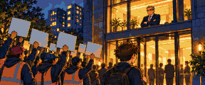 | **Забастовка пилотов** Профсоюз объявляет забастовку из-за зарплат. Авиакомпании нужен кто-то на утренние рейсы. | 1. Лететь утренним рейсом 2. Присоединиться к забастовке |
|  | **База за границей** Авиакомпания открывает базы в двух своих хабах и спрашивает, кто переедет вместе с работой. Переезд оплачен. | 1. Остаться на месте 2. Перебраться на базу в Дубай 3. Перебраться на базу в Сингапур |
|  | **Флот на земле** В эту рецессию никто не летает. Половина флота стоит в пустыне, и авиакомпания просит пилотов подождать. | 1. Ждать на половине зарплаты 2. Уйти в грузовые перевозки |
| 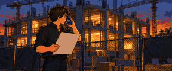 | **Застройщик не платит** Дом стоит, а застройщик перестал брать трубку. Твой гонорар у него в кармане. | 1. Махнуть рукой 2. Подать в суд |
| 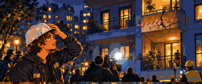 | **Трещина в балконе** Треснул балкон в доме, который подписан твоим именем. Никто не пострадал, но газеты уже знают, чей это проект. | 1. Оплатить ремонт 2. Свалить на подрядчика |
| 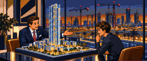 | **Знаменитый заказчик** Поп-звезда хочет виллу на скале, всю из стекла, и хочет, чтобы её спроектировал именно ты. | 1. Отказаться 2. Взяться за виллу |
|  | **Две комиссии за одну сделку** И покупатель, и продавец предлагают тебе комиссию, и никто не знает о другом. | 1. Играть честно 2. Взять обе |
|  | **Командировка за границу** Часть отправляют за границу на полгода. Добровольцам положена премия, остальных берут на заметку. | 1. Остаться в части 2. Вызваться добровольцем |
|  | **Двадцать лет службы** Двадцать лет в форме. Можно уйти сейчас с пожизненной пенсией, а на госслужбе для тебя есть место. | 1. Остаться на службе 2. Уйти на пенсию |
|  | **Новое назначение** Армия переводит твою часть за границу. Переезд оплачен, а просьба остаться — это просьба об одолжении. | 1. Попросить остаться 2. Уехать с частью в Дубай 3. Уехать с частью в Лондон |
| 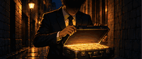 | **Предложение от частников** Частная охранная компания ищет таких офицеров за границей, с зарплатой, о которой в армии и не мечтают. | 1. Остаться в армии 2. Подписать контракт |
| 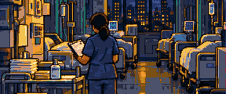 | **Нападение в приёмном покое** Родственник пациента бьёт тебя на ночной смене в приёмном покое. К утру руки всё ещё дрожат. | 1. Работать дальше как ни в чём не бывало 2. Подать заявление 3. Попроситься в отделение |
| 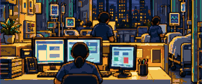 | **Постоянная ставка** Две большие больницы предлагают тебе постоянную ставку с зарплатой выше. Обе в других городах. | 1. Остаться на месте 2. Взять ставку в Мадрид 3. Взять ставку в Лондон |
|  | **Реанимации нужны люди** В реанимации не хватает медсестёр. Платят больше, а ночи долгие и тяжёлые. | 1. Остаться в отделении 2. Перейти в реанимацию |
|  | **Твои опционы** Компания говорит о выходе на биржу. Опционы можно продать сейчас или придержать до размещения. | 1. Продать сейчас 2. Ждать размещения |
|  | **Массовые сокращения** Компания сокращает пятую часть штата и сначала ищет добровольцев, с выходным пособием. | 1. Не высовываться 2. Взять пособие |
|  | **Звонок из Нью-Йорка** Хедхантер зовёт тебя в крупную техкомпанию в Нью-Йорке: платят гораздо больше, но начинать ступенью ниже. | 1. Повесить трубку 2. Переехать в Нью-Йорк 3. Попросить прибавку |
|  | **Экзамен на старшую должность** Объявлен экзамен на старшие должности: два года вечеров над программой, а мест мало. | 1. Пропустить 2. Готовиться |
|  | **Госслужащим урезают зарплату** Бюджет пуст, и правительство урезает зарплаты госслужащим. Профсоюзы объявляют забастовку. | 1. Смириться 2. Бастовать |
|  | **Международная организация** Международная организация ищет госслужащих в свои офисы, с надбавкой на первые годы. | 1. Остаться на месте 2. Уехать в Мадрид 3. Уехать в Москва |
| 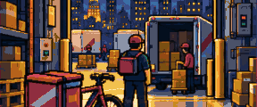 | **Приложение снижает тарифы** С понедельника приложение доставки платит меньше за заказ. Курьеры ворчат, кто-то уходит. | 1. Терпеть 2. Перейти в другое приложение |
| 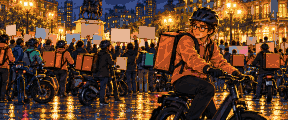 | **Забастовка курьеров** Курьеры бастуют за честный тариф. Курьеров на улицах мало, и каждый заказ оплачивается вдвое. | 1. Возить дальше 2. Присоединиться к забастовке |
|  | **Всегда на связи** Компания предлагает тебе следующую ступень сразу, если отвечать на звонки в любое время, каждый день. | 1. Сберечь вечера 2. Принять повышение |
|  | **Годовой бонус** Удачный год для банка. Бонус можно получить деньгами или акциями банка, которые нельзя продать два года. | 1. Получить деньгами 2. Получить акциями |
|  | **Инсайдерская информация** Клиент проговаривается: его компанию купят на следующей неделе. Никто не узнает, если купить её акции сейчас. | 1. Промолчать 2. Воспользоваться |
|  | **Слияние банков** Твой банк покупает банк покрупнее. Для тебя есть место ступенью ниже, но с зарплатой выше, или пособие тем, кто уйдёт. | 1. Согласиться на новое место 2. Взять пособие и больше не работать |
| 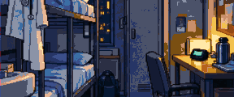 | **Иск о врачебной ошибке** Семья пациента подаёт на тебя в суд: по их словам, диагноз поставлен слишком поздно. Юристы больницы советуют договориться. | 1. Договориться 2. Судиться |
| 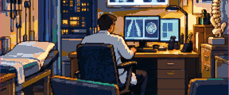 | **Специализация** Открывается место в ординатуре по кардиологии: годы экзаменов и дежурств, а в конце — должность с зарплатой выше. | 1. Остаться терапевтом 2. Учиться |
|  | **Частная клиника** Частная клиника зовёт тебя на полную ставку и платит гораздо больше. Пациенты останутся в государственной больнице. | 1. Остаться в государственной 2. Уйти в частную |
|  | **Дело на первых полосах** Знаменитый обвиняемый просит тебя взяться за его защиту. Выигрыш — и у тебя имя, проигрыш — и над тобой смеются. | 1. Отказаться 2. Взяться за дело |
|  | **Клиент платит наличными** Владелец сети ночных клубов платит щедро, наличными и без чеков. И хочет, чтобы так и оставалось. | 1. Отказать 2. Взять наличные |
|  | **Своя фирма** Двое клиентов готовы перейти к тебе, если откроется твоя собственная фирма. Аренда и сотрудники — за твой счёт. | 1. Остаться в фирме 2. Открыть свою фирму |
|  | **Долгое лето** Два месяца без уроков. Одна семья ищет репетитора, а пляж ищет тебя. | 1. Отдыхать 2. Давать частные уроки |
|  | **Бывший ученик** Ученик, которого когда-то удалось удержать в школе, теперь знаменит и в интервью благодарит тебя. | 1. Поблагодарить в ответ 2. Попросить об услуге |
|  | **Новый закон об образовании** Новое правительство снова меняет программу. Новые учебники, новые формы и та же зарплата. | 1. Делать минимум 2. Освоить новую программу 3. Выйти на протесты |
| 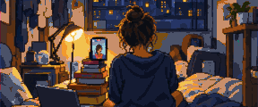 | **Бренд платит слишком щедро** Бренд чая для похудения предлагает целое состояние за месяц постов. Отзывы о нём недобрые. | 1. Отказаться 2. Взять деньги |
|  | **Теневой бан** Твои посты видят вдвое меньше людей, и никто на платформе не объясняет почему. | 1. Переждать 2. Заплатить за продвижение |
|  | **Неделя в трендах** Твоё видео на этой неделе повсюду. Все ждут продолжения, прямо сейчас. | 1. Не гнаться 2. Поймать волну |
| 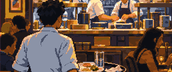 | **Шанс на звезду** Говорят, в городе инспекторы гида. Сезон идеальных блюд может принести ресторану звезду. | 1. Готовить как обычно 2. Бороться за звезду |
| 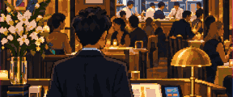 | **Санитарная проверка** На следующей неделе придёт инспектор. Холодильная камера барахлит, а хозяин не хочет платить за ремонт. | 1. Оплатить ремонт самому 2. Спрятать на время проверки |
|  | **Огромный клиент** Огромный клиент выбирает поставщика. В одиночку шансов мало, с коллегой — наверняка, но за половину комиссии. | 1. Разделить с коллегой 2. Добиваться в одиночку |
|  | **Невыполнимый план** Новый коммерческий директор удваивает всем план. Выполнишь — премия, нет — оклад урежут. | 1. Выложиться 2. Добиться плана пониже 3. Добиться плана пониже, с цифрами на руках |
|  | **Звонок от конкурентов** Конкуренты хотят тебя, и твоих клиентов в придачу. Платят хорошо, а прежняя фирма такого не простит. | 1. Остаться на месте 2. Уйти вместе с клиентами 3. Попросить фирму перебить предложение |

### Образование (9)

|  | Карта | Варианты |
| --- | --- | --- |
|  | **Магистратура** Два года вечеров и выходных — и новая строчка в резюме. | 1. Не сейчас 2. Оплатить 3. Взять на неё кредит |
|  | **Курс по инвестициям** Двенадцать недель, по вечеру в каждую: облигации, акции и как не потерять всё. | 1. Пропустить 2. Записаться |
|  | **Книга о деньгах** Коллега даёт тебе почитать книгу, которая «полностью меняет взгляд на деньги». | 1. Оставить на полке 2. Прочитать |
|  | **Программа MBA** Тебя берут на программу MBA в IESE. Стоит целое состояние и съедает вечера на два года вперёд. | 1. Это не для меня 2. Поступить и оплатить 3. Поступить в кредит |
|  | **Курсы программирования** Шестнадцать недель — и ты младший разработчик. Говорят, на работу берут всех. | 1. Пропустить 2. Записаться и уйти в ИТ |
|  | **Новый язык** В двух кварталах от тебя преподаватель ведёт вечерние занятия. | 1. Может, в следующем году 2. Записаться |
|  | **Курс за счёт компании** Компания оплатит дорогой курс. Мелким шрифтом: два года работы на неё или вернуть деньги. | 1. Нет, спасибо 2. Согласиться на два года 3. Оплатить самостоятельно, без обязательств |
|  | **Тюремная библиотека** Три полки, словарь и уйма времени. | 1. Спать 2. Учить язык 3. Учиться ремеслу |
|  | **Небольшое улучшение** Резюме никто не проверяет. MBA смотрелся бы в твоём очень хорошо. | 1. Оставить резюме как есть 2. Добавить MBA |

### Бизнес (26)

|  | Карта | Варианты |
| --- | --- | --- |
|  | **Подработка** Давнему клиенту нужна работа, которая займёт три выходных подряд. | 1. Отказаться 2. Взяться 3. Взяться за оба заказа: до второго — на машине |
|  | **Работа на себя** Ту же работу можно делать для трёх клиентов, а не для одного начальника. | 1. Остаться на зарплате 2. Уйти на вольные хлеба 3. Начать со знакомых по клубу |
|  | **Свой бар** Бар на углу продаётся. Владелец хочет выйти из дела до весны. | 1. Пройти мимо 2. Купить и встать у руля 3. Вложиться, а управлять будет друг |
|  | **Интернет-магазин** Тебе попался товар, про который все спрашивают, где такой купить. | 1. Не связываться 2. Запустить |
|  | **Свободная комната** Свободная комната могла бы сама зарабатывать себе на жизнь — на Airbnb. | 1. Сохранить личное пространство 2. Разместить объявление |
|  | **Запустить приложение** Идея живёт в голове уже год. На неё уйдут все ночи ближайших шести месяцев. | 1. Оставить в ящике стола 2. Сделать |
|  | **Зовут в сооснователи** Кто-то из самых толковых бывших коллег открывает компанию и зовёт тебя. | 1. Пожелать удачи 2. Вложить деньги 3. Войти в число основателей |
|  | **Предложение о покупке бизнеса** Компания покрупнее хочет выкупить твой бизнес. Сумма серьёзная. | 1. Оставить бизнес себе 2. Продать 3. Попросить больше |
|  | **Конкурент по соседству** На той же улице открылось точно такое же заведение, да ещё с праздником открытия. | 1. Подождать и посмотреть 2. Снизить цены 3. Сделать ремонт |
|  | **Отзыв стал вирусным** Кто-то написал о твоём деле, и полрайона это репостнуло. Тон пока неизвестен. | 1. Пусть идёт как идёт 2. Вежливо ответить 3. Купить фальшивые отзывы |
|  | **Трудовая инспекция** Инспектор запрашивает договоры, графики и расчётные листки твоего бизнеса. | 1. Пусть приходят 2. Заранее позвать кадрового консультанта |
|  | **Лицензии пока нет** Бизнесу придётся закрыться на несколько недель: не хватает бумаги, и никто не знает, кто её подписывает. | 1. Ждать 2. Заплатить посреднику 3. Открыться всё равно |
|  | **Субсидия** Есть помощь для такого бизнеса, как твой. В анкете сорок страниц. | 1. Не стоит того 2. Заполнить всё |
|  | **Бар на пляже** Друг на Самуи ищет ещё одного партнёра для бара на песке. | 1. Остаться в городе 2. Вложить деньги |
|  | **Партнёр для такерии** Продавец тако на углу ищет партнёра, чтобы открыть второй ларёк. | 1. Пожелать удачи 2. Вложить деньги |
|  | **Мемуары из камеры** Издательство считает, что твоя история продастся. Подкаст — тоже. | 1. Держать при себе 2. Рассказать всё |
|  | **Чистые деньги** Твой бизнес принимает много наличных. Друг объясняет, как принимать чуть больше — на бумаге. | 1. Вести честный учёт 2. Отмыть спрятанное |
|  | **Элон Моск хочет твой бизнес** Увидел его в соцсетях и в ответе предлагает втрое больше, чем он стоит. | 1. Отказаться 2. Ударить по рукам |
| 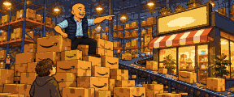 | **Продавать через Джеффа Бозоса** Его платформа доставит твой бизнес до каждой двери в стране. За тридцать процентов с каждой продажи. | 1. Остаться независимым 2. Выйти на платформу |
| 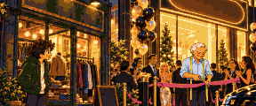 | **Амансио Ортига открывается напротив** Огромный новый магазин прямо перед твоим бизнесом. Он сам заходит: «Или присоединяйся к нам». | 1. Держаться 2. Взять его франшизу |
| 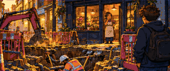 | **Стройка у твоего бизнеса** Мэрия роет траншею у твоей двери под линию метро. Говорят, на два года. | 1. Терпеть 2. Требовать компенсацию у мэрии 3. Начать доставку |
|  | **Конкурс района** Район награждает лучшую веранду и витрину. Приз: новые клиенты. | 1. Не участвовать 2. Бороться за приз |
|  | **Блогер хочет есть бесплатно** Местный блогер предлагает отличный отзыв в обмен на бесплатные обеды весь год. | 1. Отказать 2. Согласиться |
|  | **Партнёр платит себе дважды** Кто-то в компании намекает, что партнёр годами платит себе зарплату дважды. | 1. Доверять партнёру 2. Позвать аудиторов 3. Проверить книги лично |
|  | **Предложение о покупке** Конкурент в десять раз крупнее хочет купить твой бизнес и намекает, что отказ дорого обойдётся. | 1. Отказать 2. Продать по их цене 3. Дать отпор |
| 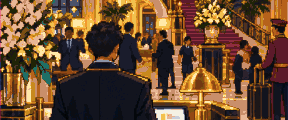 | **Бар по соседству** Соседний бар сдают в аренду со всем оборудованием. Ты знаешь каждого завсегдатая и каждую ошибку хозяина. | 1. Пропустить 2. Взять бар |

### Инвестиции (30)

|  | Карта | Варианты |
| --- | --- | --- |
|  | **Верняк от двоюродного брата** «Поверь мне. Tesla. Упасть просто не может». | 1. Сменить тему 2. Вложить немного 3. Вложиться по-крупному |
|  | **Акции для сотрудников** Работодатель продаёт тебе акции Microsoft со скидкой 15%. | 1. Пропустить 2. Купить немного 3. Купить по максимуму |
|  | **Монета с собакой** В спортзале у всех есть Dogecoin. Кто-то только что купил на него машину. | 1. Не лезть 2. Небольшая ставка 3. Ва-банк |
|  | **Стартап друга** Друг собирает деньги у «людей, которые в нас верят». | 1. Не в этот раз 2. Вложиться 3. Помочь советом, а не деньгами |
|  | **Громкое IPO** Завтра на биржу выходит компания, о которой говорят все, и у твоего брокера есть для тебя акции. | 1. Наблюдать со стороны 2. Подать заявку |
|  | **«20% в месяц, с гарантией»** У хорошо одетого знакомого твоих знакомых есть фонд, который никогда не теряет. Он показывает выписки. | 1. Уйти 2. Попробовать на небольшой сумме 3. Вложить всё |
|  | **Вывод средств приостановлен** Биржа, на которой лежат твои монеты, «приостановила вывод на время техработ». | 1. Переждать 2. Заплатить комиссию и вывести всё |
|  | **Дубай: квартира на котловане** Глянцевый буклет, башня, которой ещё нет, и рассрочка. | 1. Выбросить буклет 2. Забронировать квартиру |
|  | **Гуру трейдинга** Посты — из арендованного суперкара, а места на курсе «почти закончились». | 1. Листать дальше 2. Купить курс |
|  | **Недвижимость вскладчину** Платформа предлагает купить долю в доме, который сдаётся в аренду. | 1. Отказаться 2. Купить долю |
|  | **«Гарантированный» продукт** Банк предлагает двухлетние облигации «без риска». Комиссия на входе — мелким шрифтом. | 1. Нет, спасибо 2. Оформить 3. Попросить индексный фонд без комиссии |
|  | **Фонд с тройным плечом** Блогер клянётся плечевым ETF: втрое больше рынка. И вверх, и вниз. | 1. Пропустить 2. Вложить деньги |
|  | **План швейцарского банка** Банк предлагает план на десять лет: процент низкий, зато надёжно, как в сейфе. | 1. Нет, спасибо 2. Вложить в план 10 000 $ |
|  | **Своя монета** Назови её $RATA, заплати инфлюенсерам и продай, пока никто не заметил. Что может пойти не так? | 1. Сохранить достоинство 2. Запустить $RATA |
|  | **Шурин что-то знает** Он работает в банке. В понедельник объявят о поглощении, и пока никто не знает. | 1. Сменить тему 2. Купить до понедельника |
|  | **Обед с Уорреном Бафе** Старый инвестор угощает бургером и вишнёвой колой. Можно задать ему один вопрос. | 1. Поговорить о погоде 2. Спросить, как он это сделал 3. Спросить, что купить |
|  | **Земля в метавселенной** Марк Цукербот продаёт участки в своём виртуальном мире: «Здесь будут жить все». Можно стать одним из первых. | 1. Остаться в реальном мире 2. Купить участок |
| 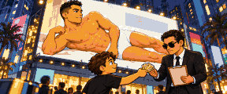 | **Линия белья Криштиану Роналгу** Его менеджер ищет деньги на новую линию: «Продаётся сама. Посмотри на него». | 1. Не твой стиль 2. Вложиться |
|  | **Звонок от Джордана Беллфорта** «У меня есть акция, которая только растёт. Только растёт». Он говорит очень быстро. На решение минута. | 1. Положить трубку 2. Купить, что он продаёт |
|  | **Копировать трейдера** Трейдер из соцсетей показывает 400% за год. Приложение автоматически копирует его сделки на твой счёт. | 1. Не трогать 2. Попробовать немного 3. Вложиться всерьёз |
|  | **Монета с крысой** Тони показывает телефон: $RATA, монета с крысой. «Она может только расти», — говорит он. | 1. Вежливо отказаться 2. Вложить немного 3. Спросить, что эта монета вообще делает |
|  | **До луны** Скриншот в три часа ночи: $RATA выросла в пять раз. Тони добавил ракеты. | 1. Держать: она может только расти 2. Продать всё 3. Продать половину, остальное держать |
|  | **$RATA обнуляется** Монета за ночь потеряла всё. Тони сидит на скамейке в парке и обновляет курс. | 1. Оставить его в покое 2. Взять два кофе и посидеть рядом |
|  | **Приложение, чтобы делить счёт** Ника, из твоего бывшего класса, делает приложение, чтобы делить счёт между друзьями. Ей нужны первые деньги. | 1. Пожелать удачи 2. Вложить немного 3. Помогать по выходным |
|  | **Ещё немного** У приложения есть пользователи, а денег нет. Ника просит ещё столько же, чтобы продержаться два года. | 1. Сказать, что это было всё 2. Вложить ещё столько же |
|  | **Новости стартапа** Через два года звонит Ника. У неё новости о компании, и большие, так или иначе. | 1. Выслушать новости 2. Заранее продать долю фонду |
|  | **Вторая идея** Ника вернулась: коробки, наклейки и вторая идея — то же приложение, только для собак. | 1. Пожелать удачи 2. Снова вложить немного 3. Познакомить её с людьми |
|  | **Гарантированный фонд** Стас из банка предлагает тебе фонд: гарантированный, говорит он, и с совсем маленькой комиссией. | 1. Нет, спасибо 2. Подписаться 3. Попросить вместо него индексный фонд |
|  | **Колокол на бирже** Ника звонит в колокол: первый день её компании на бирже. Она машет тебе со сцены. | 1. Хлопать из зала 2. Купить акции в первый день 3. Попросить у неё работу |
|  | **Без объявления** Хозяин хочет тихо продать сданную квартиру, пока она не попала в объявления. Ты узнаёшь первым. | 1. Передать клиенту 2. Купить самому |

### Жильё (36)

|  | Карта | Варианты |
| --- | --- | --- |
|  | **Аренда дорожает** Письмо от хозяина квартиры: «в соответствии с рынком». | 1. Платить 2. Торговаться |
|  | **Первая квартира** Программа для покупателей первого жилья: первый взнос — всего десятая часть цены. | 1. Снимать дальше 2. Купить студию 3. Купить квартиру с помощью родных |
|  | **Хозяин продаёт квартиру** Сначала её предлагают тебе — чуть дешевле, чем в объявлении. | 1. Съехать 2. Купить |
|  | **Фиксированная или плавающая** Банк предлагает сменить ставку ипотеки — на этот раз без комиссии. | 1. Оставить как есть 2. Перевести плавающую ипотеку на фиксированную 3. Перевести фиксированную ипотеку на плавающую |
|  | **Жилец перестаёт платить** Три месяца тишины и забитый почтовый ящик. | 1. Ждать и смириться с убытком 2. Нанять юриста |
|  | **Ремонт** Кухня — из прошлого века, а в ванной течёт. | 1. Подлатать 2. Сделать как следует 3. Сделать по высшему разряду |
|  | **Потоп** Пока ты в отъезде на выходных, прорывает трубу. Квартира твоя — значит, и счёт твой. | 1. Вызвать ремонтную фирму 2. Сделать почти всё своими руками |
|  | **Съехаться** Две аренды, два холодильника, а ночуешь ты всё равно не у себя. | 1. Пока рано 2. Съехаться |
|  | **Шумные соседи** Сверху репетируют на барабанах во время ужина. И перед сном. | 1. Терпеть 2. Подняться и поговорить 3. Найти другую съёмную квартиру 4. Сделать звукоизоляцию |
|  | **Сбор на ремонт дома** Нужно менять лифт, и собрание жильцов проголосовало за сбор. Твоя доля — в этом месяце. | 1. Заплатить свою долю 2. Оспорить в суде |
|  | **Сдать комнату** Есть свободная комната, а подруга ищет, где жить. Платила бы хорошо. | 1. Лучше не надо 2. Сдать ей |
| 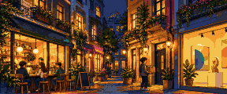 | **Модный район** В районе, о котором все говорят, освободилась квартира. Кофейни, галереи и аренда им под стать. | 1. Остаться на месте 2. Снять всю квартиру 3. Снять комнату в этом районе |
| 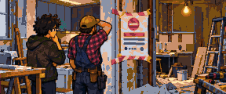 | **Ремонт остановлен** На двери предписание: у ремонта нет разрешения, которое мэрия поменяла в прошлом месяце. | 1. Ждать, пока решат 2. Заплатить доплату и продолжать |
|  | **Август в Мадриде** В августе все уезжают. Квартира могла бы зарабатывать, пока тебя нет. | 1. Оставить пустой 2. Сдать официально, с документами 3. Сдать за наличные, без вопросов |
|  | **Аренда дорожает на пятую часть** Арендодатель пишет: договор продлевается на двадцать процентов дороже. | 1. Платить 2. Оспорить в комиссии по аренде |
|  | **Лотерея на квартиру** Государство строит квартиры за долю рыночной цены. Есть жеребьёвка. | 1. Не участвовать 2. Подать заявку |
|  | **Пришли дожди** Муссон затапливает улицу, а с ней и первый этаж. | 1. Пусть разбирается страховка 2. Мешки с песком и уборка своими силами |
|  | **Земля дрожит** Сильное землетрясение. Дом стоит, но не без потерь. | 1. Позвонить в страховую 2. Починить что можно самостоятельно |
|  | **Квартира на двоих** Сосед по квартире съезжает, а хозяин не снижает аренду. Кто-то должен платить за пустую комнату. | 1. Какое-то время платить за двоих 2. Найти нового соседа 3. Переехать в пригород |
|  | **Квартира в Грамп-тауэр** Рональд Грамп сам показывает дом: «Лучшие квартиры. Все так говорят». Они на 30% дороже соседних. | 1. Искать дальше 2. Подписать |
|  | **Захватчики в квартире** Сдаваемая квартира пустовала между жильцами. Уже нет: замок поменяли. | 1. Идти в суд 2. Заплатить, чтобы ушли 3. Вызвать фирму по выселению |
| 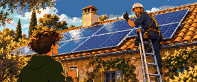 | **Солнечные панели** По посёлку прошёл монтажник: с такой крышей, говорит, электричество будет почти бесплатным. | 1. Платить по старому счёту 2. Поставить панели 3. Поставить панели с аккумулятором |
|  | **Дом в часе езды, с оптоволокном** Работа из дома, аренда в городе. В часе езды есть дома с садом и интернетом меньше чем за полцены. | 1. Остаться в городе 2. Купить дом за городом |
|  | **Вернуться к родителям** Тебе за тридцать, денег впритык, и родители предлагают твою старую комнату. Без аренды. | 1. Продолжать снимать 2. Вернуться на пару лет 3. Вернуться всего на год |
|  | **Жильцы голосуют за ремонт** Соседи голосуют за лифт и новый вход. Придётся скинуться, зато жильё подорожает. | 1. Голосовать против 2. Голосовать за |
|  | **В город приезжает фестиваль** В город приезжает огромный фестиваль, и за твоё жильё на неделю предлагают целое состояние. | 1. Остаться дома 2. Сдать на неделю |
|  | **Квартира по льготной цене** Тебе выпала квартира в розыгрыше льготного жилья: цена намного ниже рыночной. | 1. Отказаться 2. Купить |
|  | **Соседи сверху заливают** У соседей сверху лопнула труба, и с потолка капает. Их страховая обещает заплатить. Когда-нибудь. | 1. Ждать выплаты от их страховой 2. Оплатить ремонт самим |
|  | **Пятно на потолке** Над кроватью расползается чёрное пятно. Пётр Ильич смотрит на него и называет это «характером». | 1. Терпеть 2. Пожаловаться письменно 3. Починить своими руками |
|  | **Письмо от хозяина** Пётр Ильич у двери с письмом. Аренда растёт, говорит он, как и всё вокруг. | 1. Платить по-новому 2. Торговаться 3. Искать другую квартиру |
|  | **Квартира по дружеской цене** Пётр Ильич уходит на пенсию и уезжает к морю. Квартиру он скорее продаст тебе, чем чужому. | 1. Дальше снимать 2. Купить в ипотеку 3. Купить сразу |
|  | **Страховка к ипотеке** К твоей ипотеке, говорит Стас, банк настойчиво рекомендует свою страховку. | 1. Оставить как есть 2. Взять страховку банка 3. Купить такую же защиту в другом месте |
|  | **Новоселье** Новоселье в квартире, которую только что купил одноклассник. Котёл тебе показывают, как новорождённого. | 1. Принести цветок и уйти домой 2. Тоже начать смотреть квартиры 3. Спросить, как ему это удалось |
| 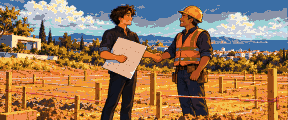 | **Дом по своему проекту** Годами ты рисуешь дома для других. Появляется участок, и знакомый подрядчик предлагает цену для своих. | 1. Рисовать дальше для других 2. Построить свой дом |
| 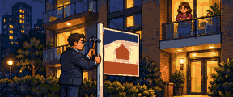 | **Продавец спешит** Продавцу нужно уехать до конца месяца, и он согласен на любую разумную цену. | 1. Отдать коллеге 2. Шепнуть клиенту-инвестору 3. Купить, чтобы жить там |
| 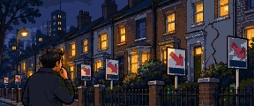 | **Разговоры о пузыре** Цены как никогда высоки, и в агентстве все говорят, что пик близко. | 1. Держаться 2. Продать свой дом на пике |

### Образ жизни (46)

|  | Карта | Варианты |
| --- | --- | --- |
|  | **Новая машина коллеги** Она стоит сразу на двух парковочных местах. Смотреть спускается весь офис. | 1. Пожать плечами 2. Недорого купить у коллеги старый VW Golf GTI 3. Взять BMW M3 в кредит |
|  | **Ретрит в Тулуме** Подруга вернулась с недели йоги и тишины и только о ней и говорит. | 1. Работать дальше 2. Простая неделя 3. Роскошный ретрит, с шаманом |
|  | **Ибица** В общем чате уже есть вилла, даты и срок, до которого вносить предоплату. | 1. Остаться дома 2. Поехать 3. Поехать и взять столик в клубе |
|  | **Новый iPhone** Твой ещё работает. У нового камера лучше. | 1. Оставить старый 2. Купить |
|  | **Свадьба за границей** У друзей свадьба на берегу озера: четыре дня, дресс-код — «элегантный». | 1. Отправить подарок 2. Поехать 3. Поехать с размахом |
|  | **Лист ожидания** Звонят из бутика. Два года в очереди — и Rolex Submariner наконец ждёт тебя. | 1. Уступить очередь 2. Купить и носить 3. Купить и перепродать |
|  | **Бизнес-класс за доплату** За малую часть цены билета кресло превращается в кровать. | 1. Остаться в экономе 2. Доплатить за бизнес-класс |
|  | **Закрытая распродажа** Скидка сорок процентов, только сегодня вечером, вход по приглашениям. | 1. Удалить письмо 2. Лоферы Gucci 3. Сумка Louis Vuitton Keepall |
|  | **Нужна машина** Метро закрывается в полночь, а новая работа — нет. | 1. Ездить на метро дальше 2. Купить Toyota Corolla без кредита 3. Взять Tesla Model 3 в кредит |
|  | **У стойки в клубе** Член клуба, с которым вы каждую неделю киваете друг другу, вкладывается в ресторан друга и ищет ещё одного партнёра. | 1. Сменить тему 2. Вложиться в ресторан 3. Попросить познакомить с людьми 4. Попросить познакомить с тем, кто решает в твоей компании |
|  | **Столик с бутылкой** Кто-то предлагает взять столик. Официант уже держит меню. | 1. Уйти домой пораньше 2. Скинуться 3. Оплатить столик своей картой |
|  | **Чёрная пятница** Корзина полна ещё со вторника. | 1. Закрыть вкладку 2. PS5 3. MacBook Pro |
|  | **Идеальный жилец** Платит первого числа, поливает цветы и никогда не берёт твою кружку. | 1. Оставить всё как есть 2. Немного поднять плату |
| 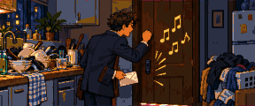 | **Плата задерживается** Жилец не заплатил ни в этом месяце, ни в прошлом. За дверью играет музыка. | 1. Дать ещё месяц 2. Попросить съехать |
|  | **Жилец со связями** Жилец хочет познакомить тебя с подругой, которая работает там, где хотелось бы работать тебе. | 1. Ужин, и только 2. Взять визитку и написать |
|  | **Напряжение дома** Партнёра выводит из себя жилец, который каждый вечер сидит на диване. | 1. Партнёр прав: жилец съезжает 2. Осталось недолго |
|  | **Вечеринка жильца** Возвращение после выходных. Жилец устроил вечеринку. Диван не выжил. | 1. Махнуть рукой 2. Заставить жильца заплатить |
|  | **Жилец съезжает** Жилец нашёл своё жильё и возвращает ключ с маленьким подарком, под мышкой коробка с цветами. | 1. Оставить залог на покраску 2. Вернуть залог |
|  | **Запись на приём** Чтобы продлить документ, нужна запись. Ближайшая свободная — через три недели, во вторник в 9:00. | 1. Взять выходной и пойти 2. Заплатить агентству |
|  | **Свадьба на Бали** Лучший друг женится на Бали. Перелёт, отель, подарок и неделя без работы. | 1. Вежливо отказаться 2. Отправиться на Бали |
|  | **Всего одна кружка** Коллега зовёт выпить по кружке после работы. В Мадриде одна кружка заканчивается ужином в полночь. | 1. Пойти домой 2. Остаться на ужин |
|  | **Тебя зовут в клуб** Член закрытого клуба в Мейфэре готов тебя рекомендовать. | 1. Вежливо отказаться 2. Заплатить вступительный взнос |
|  | **Золотая виза** С твоими активами можно получить десять лет резидентства и статус в придачу. | 1. Не нужно 2. Подать заявку |
|  | **Экономика лапши** Внутри лапша быстрого приготовления — это деньги. Всем нужна, ни у кого не хватает. | 1. Купить, что нужно 2. Заняться торговлей лапшой |
|  | **Чемодан хамона** Друг хорошо заплатит за целые окорока хамона в твоём багаже. Таможня может не согласиться. | 1. Взять только одежду 2. Положить окорока |
| 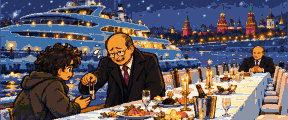 | **Яхта олигарха по дешёвке** Нервный человек срочно продаёт яхту намного дешевле её цены. Владимир Поутин смотрит с другого конца очень длинного стола. | 1. Не твоя лодка 2. Купить |
|  | **Гала-вечер с Биллом Воротой** Он пускает по залу банку для пожертвований, и, когда она доходит до тебя, все замолкают. | 1. Передать дальше 2. Отдать десятую часть всего, что есть 3. Положить немного |
|  | **Рекламный пост** Ким Кардашьон хочет фото с её новой водой: «Просто улыбнись и скажи, что она изменила тебе жизнь». | 1. Отказаться 2. Сделать пост 3. Сделать как следует, для подписчиков |
| 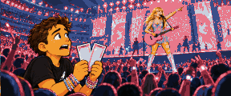 | **Тейлор Свифтли на гастролях** Билеты раскупили за минуту. У тебя два, по цене, от которой хочется сесть. | 1. Подарить 2. Пойти на концерт 3. Перепродать |
|  | **«Не думаешь начать своё дело?»** Школьная подруга пишет впервые за десять лет. Продаёт коктейли и ищет «партнёров». | 1. Отказаться 2. Купить стартовый набор 3. Купить набор и привлекать других |
|  | **Встреча выпускников** Двадцать лет спустя ужин с классом. Все знают, кто будет рассказывать, как у него всё прекрасно. | 1. Не идти 2. Пойти и пустить пыль в глаза 3. Пойти и рассказать как есть |
|  | **Мальчишник на тебе** Лучший друг женится, и мальчишник на тебе. В чате уже говорят про Лас-Вегас. | 1. Увильнуть 2. Что-нибудь простое, здесь 3. С размахом, в Лас-Вегасе |
|  | **Приглашение на подкаст** Подкаст о личных финансах хочет взять у тебя интервью. Там знают, что ты разбираешься в деньгах. | 1. Отказаться 2. Пойти как есть 3. Хорошо подготовиться |
| 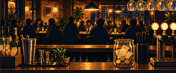 | **Выходные в приложении** Сервисы доставки и такси ищут людей на выходные. | 1. Отдыхать по выходным 2. Развозить заказы на велосипеде 3. Возить людей на своей машине |
|  | **Кризис среднего возраста** Взгляд в зеркало, и понятно: что-то надо менять. Сейчас. | 1. Пойти к психотерапевту 2. Мотоцикл, татуировка и путешествие 3. Взять отпуск за свой счёт и объехать мир |
|  | **Чёрная карта** Банк предлагает свою самую престижную карту: тяжёлый металл, бизнес-залы в аэропортах и годовая плата под стать. | 1. Нет, спасибо 2. Оформить 3. Оформить и обновить с размахом |
|  | **Кулинарное шоу** Кулинарное шоу ищет участников. Друзья говорят, что твой омлет достоин телевидения. | 1. Оставить как есть 2. Подать заявку 3. Подать заявку и тренироваться |
|  | **Любимая группа в городе** Билеты разлетелись за минуту. Остались перекупщики, втридорога. | 1. Не идти 2. Купить у перекупщиков 3. Первый ряд и вечеринка после |
|  | **Цифровой кочевник** Работа из дома. А дом мог бы быть на пляже в Таиланде: та же зарплата и вдвое меньше расходов. | 1. Остаться 2. Переехать: Бангкок |
|  | **Фото не с той вечеринки** Твоё фото многолетней давности, не с теми людьми, сегодня повсюду. | 1. Переждать 2. Нанять пиар-агентство 3. Извиниться в прайм-тайм |
|  | **Благотворительный вечер** Место за столом бесплатное. То, что ты пообещаешь, зачитают вслух. | 1. Отклонить приглашение 2. Пообещать щедрую сумму 3. Оплатить крыло больницы |
| 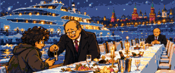 | **Яхта на камнях** Шкипер вывел твою яхту на собственную вечеринку и посадил на камни. С гостями на борту. | 1. Тихо со всеми расплатиться 2. Пусть разбираются адвокаты |
|  | **Письмо без подписи** В нём знают, где ты живёшь и в какую школу ходят дети. И хотят денег. | 1. Не обращать внимания 2. Нанять охрану |
|  | **Шедевр, в некотором роде** Эксперт долго разглядывает твою картину в лупу. Потом спрашивает, где её купили. | 1. Промолчать и оставить на стене 2. Подать в суд на галерею 3. Отдать в музей как подделку |
|  | **Кабриолет у остановки** У твоей автобусной остановки тормозит кабриолет. За рулём машет рукой твоя бывшая любовь. | 1. Помахать в ответ и ждать автобус 2. Купить машину не хуже 3. Взять такую на выходные и выложить фото |
|  | **Выходные на яхте** Пишет двоюродная сестра: её новый парень арендовал яхту и уже поднимает тост за всех. Мелким шрифтом: счёт делится на всех. | 1. Заранее найти отговорку 2. Поехать и заплатить свою долю 3. Поехать, заплатить и выложить фото |

### Удача (23)

|  | Карта | Варианты |
| --- | --- | --- |
|  | **Наследство в оформлении** Дальняя тётя оставила кое-что. Между нотариусами, пошлинами и печатями получить его — отдельная история. | 1. Заплатить пошлину и получить сразу 2. Ждать окончания оформления |
|  | **Заморозка вкладов** Банки ограничивают снятие наличных «ради вашей безопасности». Очереди огибают квартал. | 1. Стоять в очереди 2. Занять у семьи 3. Продать немного золота 4. Платить криптой |
|  | **Новогодняя лотерея** В офисе все скидываются на билеты. Остаться в стороне не хочется. | 1. Обойтись без билета 2. Купить билет 3. Купить десять |
|  | **Машина не заводится** Щелчок, лампочка на приборной панели и эвакуатор. | 1. Официальный сервис 2. Сервис подешевле |
|  | **Возврат налога** Налоговая должна тебе денег. Бывает и так. | 1. Забрать деньги 2. Положить в пенсионный план |
|  | **Украли телефон** Секунду назад он лежал на столике в кафе. | 1. Купить новый 2. Достать из ящика старый |
|  | **Неожиданная премия** Хороший год. Начальство вызывает тебя к себе — с улыбкой. | 1. Взять премию 2. Попросить вместо неё прибавку |
|  | **Сообщение от «твоего банка»** Выглядит правдоподобно. Пишут, что твой счёт заблокирован. | 1. Быстро со всем разобраться 2. Проверить как следует |
|  | **Штраф за превышение скорости** По почте приходит фотография твоей машины. | 1. Оплатить 2. Оспорить |
|  | **Приложение для ставок** Бесплатная ставка для начала. Твоя команда играет сегодня вечером. | 1. Удалить приложение 2. Небольшая ставка 3. Гнаться за крупным выигрышем |
|  | **Поймали с жвачкой** Контролёр видит у тебя жвачку в метро. Город штрафов во всех смыслах. | 1. Заплатить штраф 2. Оспорить и утро собирать мусор |
|  | **Невиновность, честно** Полиция уверена, что это твоих рук дело. А в тот день был приём у стоматолога. | 1. Довериться госадвокату 2. Заплатить хорошему адвокату |
|  | **Сосед по камере — банкир** Сосед с верхней койки управлял хедж-фондом. У него есть мнение о твоём портфеле. | 1. Сделать вид, что спишь 2. Записывать |
|  | **Верная ставка** Мужчина в баре клянётся, что воскресный матч второго дивизиона уже решён. | 1. Посмотреть бесплатно 2. Поставить две тысячи |
| 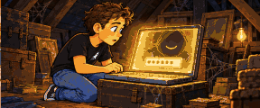 | **Старый ноутбук на чердаке** На нём крипто-кошелёк из самых первых времён. Заблокирован. Пароль — что-то из тех лет. | 1. Оставить в коробке 2. Перебрать все свои пароли |
|  | **Челлендж Мистера Фиста** Кто продержится неделю в световом круге, получает состояние. Смотреть будут миллионы. | 1. Смотреть из дома 2. Участвовать |
|  | **Классика в сарае** В дедушкином сарае под брезентом стоит спорткар семидесятых. В пыли, но целый. | 1. Продать как есть 2. Восстановить и продать 3. Восстановить и оставить себе |
|  | **Тебя взломали** Почту угнали и требуют выкуп за фотографии и документы. | 1. Сменить все пароли и начать заново 2. Заплатить выкуп 3. Заявить в полицию |
|  | **Офисная лотерея** Все скинулись по двадцать, а билет у тебя. Он выиграл. | 1. Разделить выигрыш 2. Сказать, что не выиграл |
|  | **Вирусное видео, но не то** Кто-то снял твой спор в баре, и ролик облетел весь мир. У тебя уже есть прозвище. | 1. Исчезнуть из соцсетей 2. Извиниться на видео 3. Заработать на этом: продавать футболки |
|  | **Дрон на террасе** На твою террасу падает дрон. Владелец звонит в дверь и предлагает заплатить, лишь бы не было заявления. | 1. Просто вернуть дрон 2. Взять деньги 3. Подать заявление |
|  | **Полицейский аукцион** Полиция распродаёт конфискованное: машины, часы, даже гидроцикл. | 1. Посмотреть и не торговаться 2. Торговаться за машину 3. Торговаться за дорогие часы |
|  | **Иск** Незнакомый человек утверждает, что часть твоего состояния — его. У его адвокатов есть пресс-служба. | 1. Договориться до суда 2. Судиться 3. Торговаться лично 4. Защищать себя в суде лично |

### Семья (28)

|  | Карта | Варианты |
| --- | --- | --- |
|  | **Пойти на свидание** Друзья хотят тебя кое с кем познакомить. Отговорки закончились. | 1. Остаться без пары 2. Согласиться |
|  | **Свадьба** Свадьбе быть. Вопрос только в том, какой. | 1. Расписаться и пообедать 2. Классическая свадьба 3. Свадьба на широкую ногу |
|  | **Ребёнок?** Мимо детских колясок вы теперь проходите заметно медленнее. | 1. Пока рано 2. Да |
|  | **Брачный договор** Нотариус упоминает о нём. Осторожно. | 1. Незачем 2. Подписать |
|  | **Родне нужны деньги** «Только до лета». | 1. Отказать 2. Одолжить 3. Подарить сумму поменьше |
|  | **Поручиться по кредиту** Другу детства нужен поручитель по кредиту. | 1. Отказаться 2. Подписать |
|  | **Родителям нужна помощь** Пенсии хватает уже не так надолго, как раньше. | 1. Сейчас никак 2. Отправлять деньги каждый месяц 3. Оплатить сиделку |
|  | **Наследство** Бабушка кое-что тебе оставила. И записку: «распорядись с умом». | 1. Забрать деньги 2. Вложить всё в индексный фонд 3. Пустить на первый взнос за студию под сдачу |
|  | **Развод** К этому шло давно. | 1. Договориться по-тихому 2. Нанять хорошего адвоката 3. Попробовать семейную терапию |
|  | **В какую школу** Школа рядом с домом — нормальная. В другой — лист ожидания и форменный пиджак. | 1. Школа рядом с домом 2. Частная школа 3. Международная школа |
|  | **Собака в приюте** Трёхлетний пёс смотрит из вольера так, будто давно тебя знает. | 1. Лучше не надо 2. Взять из приюта |
|  | **Партнёр хочет своё дело** Вторая половинка хочет уйти с работы и начать своё дело. Нужна поддержка и время без зарплаты. | 1. Попросить не делать этого 2. Поддержать |
|  | **Дача в семье** Тётя оставляет тебе деревянную дачу в часе от города. | 1. Продать 2. Оставить для выходных |
| 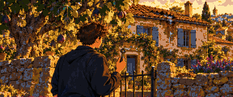 | **Дом в деревне** Тебе достаётся семейный дом в деревне. Крыша течёт, а инжир плодоносит. | 1. Продать как есть 2. Отремонтировать для лета 3. Отремонтировать и сдавать туристам |
|  | **Ребёнок хочет стримить** Ребёнок хочет всё бросить и вести стримы. Нужны компьютер, камера, микрофон и свет. | 1. Сначала учёба 2. Купить технику 3. Купить технику и вести канал |
|  | **Группа тестя** Отец твоего партнёра добавляет тебя в группу в WhatsApp, которая инвестирует по «сигналам» анонимного гуру. | 1. Отключить уведомления 2. Выйти из группы 3. Следовать сигналам |
|  | **Первый внук** Скоро в семье появится внук. Молодые родители вымотаны, и денег у них впритык. | 1. Поздравить, и всё 2. Помочь деньгами 3. Сидеть с малышом пару дней в неделю |
| 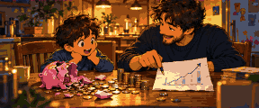 | **Копилка** Ребёнок разбил копилку и хочет «инвестировать, как взрослые». | 1. Убрать деньги в ящик 2. Открыть счёт в индексном фонде 3. Объяснить, как работают деньги |
|  | **Казначей родительского комитета** Родители в школе предлагают тебе вести кассу. Больше никто руку не поднимает. | 1. Увильнуть 2. Согласиться 3. Согласиться и устроить выпускной праздник |
|  | **Развод на первых полосах** Брак окончен, а с твоими деньгами это новость. | 1. Договориться по-тихому 2. Судиться 3. Попробовать в последний раз |
|  | **Замок двоюродного деда** Двоюродный дед, которого ты не знаешь, оставляет тебе замок. И, говорит нотариус, его долги. | 1. Отказаться от наследства 2. Принять и всё продать 3. Оставить замок себе |
|  | **Семейный ужин** Тони встаёт за ужином с телефоном в руке: $RATA выросла в пять раз. Все смотрят на тебя. | 1. Передать картошку 2. Попросить вложить за тебя прямо сейчас 3. Сказать за столом, что это пузырь |
|  | **Стук в дверь под дождём** Тони у твоей двери, промокший до нитки. Ему нужны деньги на аренду, и он клянётся, что в последний раз. | 1. Отказать 2. Одолжить, сколько нужно 3. Дать немного, в подарок |
|  | **Конверт с твоим именем** У Тони теперь работа, новая стрижка и конверт с твоим именем. | 1. Взять конверт 2. Сказать, чтобы оставил себе |
|  | **Небольшая помощь** Мама и папа немного отложили. Если это поможет с первым взносом за своё жильё, деньги твои. | 1. Сказать, что всё получится и так 2. Принять с благодарностью |
|  | **Родителям нужна помощь** Отец упал на лестнице, а мама не может его поднять. Теперь им нужна помощь каждый день. | 1. Оплатить пансионат 2. Ухаживать за ними лично |
|  | **Приглашение на свадьбу** Приглашение с золотым краем. Пишет двоюродная сестра: свадьба, и к ней список подарков. | 1. Что-нибудь скромное 2. Достойный подарок 3. Что-нибудь роскошное |
|  | **Родители в гостях** Мама и папа приезжают на выходные и осматривают твоё жильё. Мама проводит пальцем по полке. | 1. Сводить их в хороший ресторан 2. Дать им всё починить: они настаивают 3. Предложить им остаться на неделю |

### Здоровье (6)

|  | Карта | Варианты |
| --- | --- | --- |
|  | **Серьёзная болезнь** Анализы, диагноз и план лечения, у которого есть цена. | 1. В частную клинику, и сейчас же 2. Пойти в государственную клинику и ждать 3. Получить выплату по страховке жизни |
|  | **Выгорание** Ты уже час смотришь на одно и то же письмо. | 1. Перетерпеть 2. Взять отпуск за свой счёт 3. Пойти к психотерапевту |
|  | **Срочно к стоматологу** Зуб раскалывается об оливковую косточку. | 1. Вылечить как следует 2. Найти клинику подешевле |
|  | **Спортивная травма** Дворовый футбол, мокрое поле, колено. | 1. Частный физиотерапевт 2. Ждать очереди в поликлинике 3. Играть через боль 4. Восстановиться тренировками |
|  | **Записаться в спортзал** Этажом ниже открылся спортзал, а у тебя одышка на лестнице. | 1. Может, в следующем году 2. Записаться и правда ходить |
|  | **Часы предупреждают** Умные часы дважды за неделю замечают странный сердечный ритм. | 1. Решить, что часы преувеличивают 2. Показаться врачу |

### Мир (18)

|  | Карта | Варианты |
| --- | --- | --- |
|  | **Рецессия** Заводы сбавляют обороты, магазины закрываются, а в каждом заголовке — одно и то же слово. | 1. Не дёргаться 2. Урезать расходы и копить 3. Купить на просадке |
|  | **Ставки взлетают** Центробанк поднимает ставки. Просыпаются и ипотека, и сбережения. | 1. Принять к сведению 2. Зафиксировать ипотеку 3. Купить короткие гособлигации |
|  | **Ставки падают** Центробанк снижает ставки. Занимать снова дёшево. | 1. Принять к сведению 2. Перейти на плавающую ипотеку 3. Занять и вложить |
|  | **Цены срываются с цепи** Продукты на неделю стоят столько же, сколько раньше ужин в ресторане. | 1. Затянуть пояс 2. Попросить индексацию зарплаты 3. Купить золото |
|  | **Криптолихорадка** Монеты — на первых полосах, а у таксиста есть своё мнение. | 1. Не лезть 2. Купить немного Bitcoin 3. Сначала пройти курс |
|  | **Криптозима** Графики красные, на форумах тишина. | 1. Не смотреть 2. Покупать, пока всем страшно |
|  | **Рынок жилья трещит по швам** По всему твоему городу — таблички «Продаётся», а цены падают. | 1. Подождать 2. Купить студию по бросовой цене — для себя 3. Купить такую же под сдачу |
|  | **Техномания** Внезапно каждая компания стала технологической. | 1. Не класть все яйца в одну корзину 2. Оседлать волну с Nvidia |
|  | **Бум ИИ** Каждую неделю новые инструменты. Половину твоей работы можно делать иначе. | 1. Работать по-старому 2. Освоить инструменты 3. Вызваться вести направление ИИ |
|  | **Пандемия** Границы закрываются, улицы пустеют. Все учатся печь хлеб. | 1. Сидеть дома 2. Пойти в волонтёры 3. Торговать на бирже с дивана |
|  | **Налоговая реформа** Новый бюджет где-то переписывает налоговые ставки. Загляни во вкладку «Налоги»: возможно, это твой город. | 1. Прочитать краткую сводку 2. Пойти к налоговому консультанту |
|  | **Чёрный понедельник** Экраны красные от Токио до Нью-Йорка. Телефон не умолкает: все спрашивают, что ты будешь делать. | 1. Не смотреть и держать 2. Покупать, пока все продают 3. Взять кредит, пока банк ещё даёт |
|  | **Вторая волна** Год спустя крах добрался до зарплатных ведомостей. В пятницу работодатель собирает всех на общее собрание. | 1. Не высовываться 2. Предложить урезать себе зарплату 3. Потратить тихие месяцы на учёбу |
|  | **Платёжка** Отопление, бензин и продукты подорожали разом. Конверт в почтовом ящике толще обычного. | 1. Оплатить 2. Затянуть пояс |
|  | **Зарплаты против цен** Цены обогнали зарплаты на два года. Поговаривают о забастовке — и о том, кто дрогнет первым. | 1. Переждать 2. Выйти на забастовку со всеми 3. Вместо этого экономить дома 4. Попросить прибавку на рост цен в одиночку |
|  | **Спред** За долг твоего государства кредиторы требуют вдвое больше. Следом подорожает каждый кредит, привязанный к нему. | 1. Подождать и посмотреть 2. Зафиксировать ставку по ипотеке сейчас 3. Тихая гавань: Облигации Германии |
|  | **Жёсткая экономия** Бюджет сводят без жалости: разовый сбор, замороженные зарплаты и выгодные покупки для тех, у кого есть наличные. | 1. Заплатить сбор 2. Заплатить и работать за двоих 3. Заплатить и купить изъятую банком студию под сдачу |
|  | **Банк лопнул** Банк средней руки закрывает двери, и у остальных выстраиваются очереди. | 1. Довериться страхованию вкладов 2. Отстоять очередь и перевести деньги |

### Налоги (14)

|  | Карта | Варианты |
| --- | --- | --- |
|  | **Нанять налогового консультанта?** Самостоятельно — это программа, выходные и риск ошибки. Консультант дороже, но обычно находит вычеты и защитит при налоговой проверке. | 1. Заполнять декларацию самостоятельно 2. Нанять консультанта |
|  | **Взнос в пенсионный план** В этом году работодатель удвоит всё, что ты добавишь в пенсионный план. | 1. Пропустить 2. Добавить немного 3. Добавить по максимуму |
|  | **Налоговая декларация** Обувная коробка с чеками и крайний срок. | 1. Подать как обычно 2. Перебрать каждый чек |
|  | **Письмо из налоговой** Налоговая пишет, что в декларации ошибка, и называет сумму долга. | 1. Заплатить и забыть 2. Обжаловать 3. Заплатить бухгалтеру, чтобы разобрался |
|  | **Налоговая проверка** Заказное письмо. Требуют документы за три года. | 1. Заплатить, сколько требуют 2. Оспорить |
|  | **Оплата в конверте** Клиент готов заплатить больше, если обойтись без документов. | 1. Оформить как положено 2. Взять конверт |
|  | **Сменить налоговое резидентство** Консультант показывает, сколько оставалось бы у тебя после переезда в Дубай. | 1. Остаться 2. Переехать в Дубай 3. Сначала оплатить толковую консультацию |
|  | **Без НДС?** Клиент предлагает заплатить наличными и без счёта. Обоим дешевле. | 1. Со счётом и НДС 2. Без НДС, наличными |
|  | **Налоговая амнистия** Правительство объявило амнистию: кто признается сейчас, платит 10% от скрытого — и чист. | 1. Рискнуть 2. Признаться |
|  | **Инспектор ждёт** Инспектор находит проблему в документах и даёт понять, что она может исчезнуть. | 1. Отказаться и рискнуть 2. Дать «мордиду» |
|  | **Счёт с номером** Деликатный банкир предлагает счёт, известный только по номеру. | 1. Поблагодарить и уйти 2. Открыть счёт |
|  | **Референдум о налогах** Кантон голосует за снижение подоходного налога. Можно поучаствовать в кампании. | 1. Просто проголосовать 2. Агитировать за снижение |
|  | **День в суде** Обвинение остаётся в силе. Зал суда, судья, слышавшая все оправдания, и ты. | 1. Государственный адвокат 2. Нанять лучшего адвоката 3. Пойти на сделку и сдать партнёра |
|  | **Отдел крупных состояний** В налоговой теперь есть отдел для таких, как ты. Там хотят видеть всё, за много лет. | 1. Открыть все книги 2. Нанять крупную налоговую фирму 3. Судиться с налоговой |

### Зрелость (12)

|  | Карта | Варианты |
| --- | --- | --- |
|  | **Тот самый Porsche 911** Ты каждый день проходишь мимо автосалона. Сегодня заходишь. | 1. Выйти обратно 2. Купить 3. Взять в кредит |
|  | **Университет** Твоего ребёнка берут в хороший университет за границей. | 1. Государственный университет дома 2. Хороший, за границей 3. Пусть берёт кредит на учёбу |
|  | **Досрочная пенсия** Компания предлагает компенсацию каждому, кто уйдёт в этом году. | 1. Работать дальше 2. Взять компенсацию |
|  | **Помочь детям при жизни** Детям сейчас как раз нужен толчок. С подаренного налог на дарение платится сразу. | 1. Пусть ждут наследства 2. Помочь с первым взносом за квартиру 3. Разделить половину сейчас |
|  | **Будущее бизнеса** Много лет во главе дела. Покупатель им интересуется, а дома кто-то хотел бы продолжить. | 1. Остаться во главе 2. Продать покупателю 3. Передать детям |
|  | **Родители не справляются сами** Мама упала в прошлом месяце. Кто-то должен быть рядом, одного звонка мало. | 1. Пусть займутся братья и сёстры 2. Оплатить пансионат 3. Ухаживать самостоятельно |
|  | **Жильё поменьше** Дом стал слишком большим. Хватило бы и небольшой съёмной квартиры у моря. | 1. Остаться 2. Продать и снять жильё у моря |
|  | **Составить завещание** Идти на эту встречу не хочется никому. Потом рады все. | 1. Потом 2. Составить |
|  | **Мотоцикл в таком возрасте** Ducati в витрине и ощущение, что жизнь проходит мимо. | 1. Ни за что 2. Купить 3. Купить в рассрочку |
|  | **Стать наставником** Фонд ищет пенсионеров, готовых помогать начинающим. Несколько часов в неделю. | 1. Огород важнее 2. Стать наставником |
|  | **Срочное сообщение** «Мама, папа, телефон сломался, это мой новый номер. Сегодня нужно 3000 $». | 1. Не отвечать 2. Перевести деньги 3. Позвонить на старый номер 4. Сразу распознать обман |
|  | **У нотариуса** Фотография, связка ключей и папка: что оставили родители и что они были должны. | 1. Отказаться от всего 2. Принять наследство 3. Принять: их бумаги тебе знакомы |

## Кризисы

Примерно в одной жизни из трёх (30%) случается кризис: несколько раундов подряд мир сходит с привычного курса. Никогда до 30 лет и не больше одного за жизнь.

Каждый раунд кризиса сначала меняет мир, в котором просыпается игрок (экономику, ставки, инфляцию), а затем давит на доходность инвестиций в этом раунде.

### Великий крах

Рынки в свободном падении, и жильё летит следом. Центробанки снижают ставки. Больше всех теряет тот, кому приходится продавать.

| Год | Что происходит | В начале раунда | На доходность раунда |
| --- | --- | --- | --- |
| 1 | Акции и жильё резко дешевеют. | Рецессия; крипта: Зима; ставки −1% | акции −15%; жильё −6% |
| 2 | Начинаются увольнения, а цены всё сползают. | Рецессия; ставки −1% | акции −6%; жильё −5% |
| 3 | Худшее позади: рынки разворачиваются. | Восстановление | акции +9% |

### Энергетический шок

Топлива не хватает, и вслед за ним дорожает всё. Ставки растут вдогонку за инфляцией. Наличные и облигации в проигрыше, золото — в выигрыше.

| Год | Что происходит | В начале раунда | На доходность раунда |
| --- | --- | --- | --- |
| 1 | Цены подскакивают, ставки — за ними. | Замедление; ставки +1%; инфляция +3,5% | акции −5%; золото +7% |
| 2 | Цены всё ещё растут: экономика буксует. | Замедление; ставки +1%; инфляция +2,5% | акции −4%; жильё −3%; золото +5% |
| 3 | Цены успокаиваются, и золото отдаёт часть набранного. | Восстановление; инфляция −1% | золото −3% |

### Долговой кризис

Кредиторы перестали доверять государствам. Занимать стало резко дороже, и всё, что куплено в кредит, падает в цене.

| Год | Что происходит | В начале раунда | На доходность раунда |
| --- | --- | --- | --- |
| 1 | Ставки подскакивают; акции и жильё дешевеют. | Рецессия; ставки +2% | акции −7%; жильё −7% |
| 2 | Кредит ещё дороже, а жильё всё дешевеет. | Замедление; ставки +1% | акции −2%; жильё −5% |

## Значки

### Богатство

|  | Значок | Как получить |
| --- | --- | --- |
|  | Первые 100 тысяч | Доведи чистый капитал до 100 000 $ с учётом инфляции. |
|  | Миллионер | Доведи чистый капитал до миллиона с учётом инфляции. |
|  | Миллионер к 35 | К 35 годам доведи чистый капитал до миллиона с учётом инфляции. |
|  | Десять миллионов | Доведи чистый капитал до десяти миллионов с учётом инфляции. |
|  | Швейцарский банкир | Доведи чистый капитал до 1 000 000 $, живя в городе Цюрих. |
|  | Налоговый креатив | Скрой 100 000 $ от налоговой и ни разу не попадись на проверке. |
|  | Год без налоговой | Получай зарплату и не плати подоходный налог целый раунд. |
|  | Налоговая гавань | Держи компанию за рубежом три раунда без единой проверки. |
|  | Без долгов в 40 | Встреть сорокалетие без единого долга и ни разу не обанкротившись. |
|  | Без кредитной карты | Проживи целую жизнь, ни разу не закрыв нехватку наличных кредитной картой. |

### Выход из бегов

|  | Значок | Как получить |
| --- | --- | --- |
|  | Вне крысиных бегов | Покрывай пассивным доходом всё, во что обходится твоя жизнь, два раунда подряд. |
|  | Вне системы | Выйди из крысиных бегов без единой налоговой проверки. |
|  | Вне бегов до 40 | Выйди из крысиных бегов до 40 лет. |
|  | Вне бегов до 35 | Выйди из крысиных бегов до 35 лет. |
|  | Вдвойне | Получай после налогов пассивный доход вдвое больше того, во что обходится твоя жизнь. |

### Инвестиции

|  | Значок | Как получить |
| --- | --- | --- |
|  | Первая акция | Заведи в портфеле акцию отдельной компании. |
|  | Пять сразу | Держи одновременно пять из шести: индексные фонды, облигации, акции, крипта, золото, недвижимость. |
|  | Покупка на просадке | Купи индексный фонд или акцию в разгар рецессии. |
|  | Перезимовать | Продержи свои монеты всю криптозиму, не продав ни одной. |
|  | Три арендатора | Сдавай три объекта недвижимости одновременно. Машино-места не в счёт. |
|  | Лестница облигаций | Держи одновременно все гособлигации, от векселей до десятилетних. |
|  | Индекс и ничего больше | Выйди из крысиных бегов, не имея недвижимости и ни разу не вложив ни во что, кроме индексных фондов. |
|  | Покупка на пике | Держи вложение, которое стоит вдвое меньше, чем за него заплачено, или ещё дешевле. |

### Статус

|  | Значок | Как получить |
| --- | --- | --- |
|  | Первые люксовые часы | Обзаведись часами не хуже, чем Omega Speedmaster. |
|  | Суперкар | Обзаведись суперкаром: Lamborghini Aventador. |
|  | Судовладелец | Обзаведись собственным судном: подойдёт «Парусная яхта Beneteau» или «Моторная яхта Sunseeker». |
|  | Пентхаус | Купи пентхаус. |
|  | Статус 100 | Доведи статус до 100. |
|  | Двадцать вещей | Собери двадцать разных вещей за все свои жизни. |
|  | Все машины | Пусть каждая машина в игре хоть раз побывает твоей — считаются все жизни. |
|  | Машин больше, чем мест | Владей машино-местом, а машин пусть будет больше, чем мест. |

### Жизнь

|  | Значок | Как получить |
| --- | --- | --- |
|  | Три города | Поживи в трёх городах за одну жизнь. |
|  | Переезд в Дубай | Переберись жить в Дубай. |
|  | Вокруг света | Поживи на трёх континентах за одну жизнь. |
|  | Семья из четырёх | Раздели жизнь с партнёром и двумя детьми. |
|  | Диплом MBA | Получи диплом: MBA в IESE. |
|  | Бизнес продан | Построй бизнес и продай его. |
|  | Сам себе начальник | Уйди с работы, чтобы жить на свой бизнес. |
|  | Снова дома | Вернись в город, где началась твоя жизнь. |
|  | Выдержка | Продержи свои инвестиции всю рецессию, ничего не продав. |

### Невезение

|  | Значок | Как получить |
| --- | --- | --- |
|  | Банкрот | Обанкроться. И с лучшими случается. |
|  | Комната в сорок | Встреть сорокалетие, всё ещё снимая комнату в общей квартире. |
|  | Ронин | Потеряй работу в городе Токио. |
|  | Бывший заключённый | Отсиди срок и выйди на свободу. |
|  | Чистая совесть | Попади под обвинение без вины и добейся оправдания. |
|  | Налоги платят все | Попадись на налоговой проверке. |

### Мультиплеер

|  | Значок | Как получить |
| --- | --- | --- |
|  | Первая победа | Выиграй партию в мультиплеере. |
|  | Полный зал | Выиграй партию в мультиплеере на шестерых. |
|  | Реванш взят | Выиграй реванш в мультиплеере. |

### Знаменитости

|  | Значок | Как получить |
| --- | --- | --- |
|  | Сделка в посте | Продай свой бизнес Элону Моску. |
|  | Жилец башни | Купи квартиру в Грамп-тауэр. |
|  | Яхта олигарха | Купи яхту олигарха по дешёвке. |
| 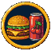 | Обед с Бафе | Задай вопрос Уоррену Бафе за обедом. |
|  | Prime навсегда | Продай свой бизнес через Джеффа Бозоса. |
|  | Виртуальный сосед | Купи землю в метавселенной. |
|  | Филантропия | Отдай десятую часть всего на гала-вечере Билла Вороты. |
|  | Потерянные ключи | Попробуй открыть старый крипто-кошелёк. |
|  | Реклама | Сделай рекламный пост для Ким Кардашьон. |
|  | Случайная слава | Поучаствуй в челлендже Мистера Фиста. |
|  | Сиииу | Вложись в линию белья Криштиану Роналгу. |
|  | Свифти | Достань билеты на тур Тейлор Свифтли. |
|  | Кузен с Уолл-стрит | Купи то, что Джордан Беллфорт продаёт по телефону. |
|  | Встреча с крапивой | Пусть Амансио Ортига откроет магазин напротив тебя. |
