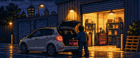
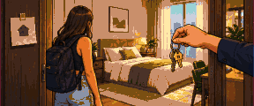
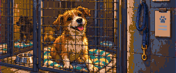

# Catálogo del juego

Todo lo que hay en The Rat Race, con su dibujo y sus números. Generado desde el contenido y los textos del juego (contenido 1.32.0) con `pnpm catalog`: no lo edites a mano.

Los precios son en dólares del inicio de la partida; en el juego suben con la inflación.

| Qué | Cuántos |
| --- | --- |
| [Vidas](#vidas) | 20 |
| [Reto de la semana](#reto-de-la-semana) | 5 reglas |
| [Carreras](#carreras) | 11 |
| [Ciudades](#ciudades) | 10 |
| [Objetos](#objetos) | 67, de ellos 8 coches |
| [Inmuebles](#inmuebles) | 16 |
| [Inversiones](#inversiones) | 22 |
| [Modo de vida, alquiler, seguros y foco](#modo-de-vida-alquiler-seguros-y-foco) | 4 + 2 + 4 + 3 |
| [Cartas](#cartas) | 171 |
| [Crisis](#crisis) | 3 |
| [Insignias](#insignias) | 41 |

## Vidas

Cada vida se dibuja a los 22, 32, 45 y 58 años.

### Enfermera

   

|  |  |
| --- | --- |
| Empieza en | Madrid, con 3.000 $ |
| Trabajo | Enfermera (Sanidad) |
| Experiencia · Finanzas · Foco | 0 · 0/3 · 3 |
| Modo de vida | Normal |
| Empieza con | Nada más |
| Ventaja | No la pueden despedir, y las guardias de noche se pagan bien. |
| Desventaja | El sueldo toca techo pronto. |
| Se desbloquea | Disponible desde el principio. |

### Ingeniero de software

   

|  |  |
| --- | --- |
| Empieza en | Madrid, con 2.000 $ |
| Trabajo | Programador júnior (Tecnología) |
| Experiencia · Finanzas · Foco | 0 · 1/3 · 3 |
| Modo de vida | Normal |
| Empieza con | Préstamo personal de 18.000 $ al 6 % |
| Ventaja | Buen sueldo, plan de acciones y nociones de finanzas. |
| Desventaja | Empieza con un préstamo de estudios. |
| Se desbloquea | Disponible desde el principio. |

### Funcionario

   

|  |  |
| --- | --- |
| Empieza en | Madrid, con 5.000 $ |
| Trabajo | Auxiliar (Función pública) |
| Experiencia · Finanzas · Foco | 0 · 0/3 · 3 |
| Modo de vida | Normal |
| Empieza con | Nada más |
| Ventaja | Trabajo para toda la vida e hipoteca más barata. |
| Desventaja | Las subidas llegan despacio. |
| Se desbloquea | Disponible desde el principio. |

### Repartidor

   

|  |  |
| --- | --- |
| Empieza en | Bangkok, con 0 $ |
| Trabajo | Repartidor (Servicios) |
| Experiencia · Finanzas · Foco | 0 · 0/3 · 4 |
| Modo de vida | Austero |
| Empieza con | Nada más |
| Ventaja | Cuatro puntos de foco por ronda. |
| Desventaja | El sueldo cambia cada ronda, y no hay ahorros. |
| Se desbloquea | Termina una vida. |

### Heredero

   

|  |  |
| --- | --- |
| Empieza en | Dubái, con 60.000 $ |
| Trabajo | Repartidor (Servicios) |
| Experiencia · Finanzas · Foco | 0 · 0/3 · 3 |
| Modo de vida | Cómodo (no puede bajar de Cómodo) |
| Empieza con | Piso en propiedad |
| Ventaja | Empieza con dinero y un piso. |
| Desventaja | No sabe vivir con poco, y no tiene formación. |
| Se desbloquea | Alcanza un patrimonio de un millón. |

### Recién llegado

   

|  |  |
| --- | --- |
| Empieza en | Londres, con 1.500 $ |
| Trabajo | Repartidor (Servicios) |
| Experiencia · Finanzas · Foco | 2 · 0/3 · 4 |
| Modo de vida | Austero |
| Empieza con | Gasto fijo de 2.400 $ al año |
| Ventaja | Cuatro puntos de foco y un segundo idioma. |
| Desventaja | Poco dinero, y cada año manda una parte a casa. |
| Se desbloquea | Vive en tres ciudades en una misma vida. |

### Banquero de inversión

   

|  |  |
| --- | --- |
| Empieza en | Londres, con 4.000 $ |
| Trabajo | Analista (Finanzas) |
| Experiencia · Finanzas · Foco | 0 · 2/3 · 3 |
| Modo de vida | Cómodo (no puede bajar de Cómodo) |
| Empieza con | Préstamo personal de 40.000 $ al 6 % |
| Ventaja | La carrera mejor pagada que hay, y todos los mercados abiertos desde el primer día. |
| Desventaja | No sabe vivir con poco, y empieza con el préstamo de la escuela de negocios. |
| Se desbloquea | Consigue un MBA. |

### Médica

   

|  |  |
| --- | --- |
| Empieza en | Londres, con 1.000 $ |
| Trabajo | Médica residente (Medicina) |
| Experiencia · Finanzas · Foco | 0 · 0/3 · 2 |
| Modo de vida | Normal |
| Empieza con | Préstamo personal de 60.000 $ al 5 % |
| Ventaja | No la pueden despedir, y acaba cobrando muy bien. |
| Desventaja | Dos puntos de foco por ronda, y un préstamo de estudios largo. |
| Se desbloquea | Sal de la rueda. |

### Segunda oportunidad

   

|  |  |
| --- | --- |
| Empieza en | Madrid, con 0 $ |
| Trabajo | Encargado de tienda (Servicios) |
| Experiencia · Finanzas · Foco | 10 · 1/3 · 3 |
| Modo de vida | Austero |
| Empieza con | Préstamo personal de 30.000 $ al 14 % |
| Ventaja | Años de experiencia: empieza dos escalones más arriba. |
| Desventaja | Nada en el banco, y una deuda cara. |
| Se desbloquea | Quiebra en cualquier vida. |

### Fundadora

   

|  |  |
| --- | --- |
| Empieza en | Nueva York, con 3.000 $ |
| Trabajo | Repartidor (Servicios) |
| Experiencia · Finanzas · Foco | 0 · 2/3 · 3 |
| Modo de vida | Austero |
| Empieza con | Nada más |
| Ventaja | Un pequeño negocio que da dinero desde el primer día, y que se puede vender. |
| Desventaja | El trabajo con el que lo mantiene paga poco. |
| Se desbloquea | Monta un negocio y véndelo. |

### Joven cripto

   

|  |  |
| --- | --- |
| Empieza en | Singapur, con 1.000 $ |
| Trabajo | Repartidor (Servicios) |
| Experiencia · Finanzas · Foco | 0 · 2/3 · 3 |
| Modo de vida | Austero |
| Empieza con | 20.000 $ en Bitcoin |
| Ventaja | Empieza con 20.000 $ en Bitcoin, y con todos los mercados abiertos. |
| Desventaja | Casi sin efectivo, y un sueldo bajo en una ciudad cara. |
| Se desbloquea | Mantén tus criptomonedas durante un invierno cripto. |

### Abogada

   

|  |  |
| --- | --- |
| Empieza en | Nueva York, con 1.000 $ |
| Trabajo | Pasante (Derecho) |
| Experiencia · Finanzas · Foco | 0 · 1/3 · 3 |
| Modo de vida | Normal |
| Empieza con | Préstamo personal de 24.000 $ al 6 % |
| Ventaja | La escalera más alta del juego: nadie acaba cobrando más. |
| Desventaja | La subida es la más lenta, y empieza con un préstamo de estudios. |
| Se desbloquea | Compra tu primer reloj de lujo. |

### Profesor

   

|  |  |
| --- | --- |
| Empieza en | Singapur, con 4.000 $ |
| Trabajo | Profesor interino (Educación) |
| Experiencia · Finanzas · Foco | 0 · 0/3 · 3 |
| Modo de vida | Normal |
| Empieza con | Nada más |
| Ventaja | No lo pueden despedir, y tiene un punto de foco más cada ronda. |
| Desventaja | El techo salarial más bajo de todas las carreras. |
| Se desbloquea | Llega al final de una vida teniendo solo fondos indexados. |

### Influencer

   

|  |  |
| --- | --- |
| Empieza en | Bangkok, con 500 $ |
| Trabajo | Creador novato (Influencer) |
| Experiencia · Finanzas · Foco | 0 · 0/3 · 3 |
| Modo de vida | Normal |
| Empieza con | Nada más |
| Ventaja | Estatus desde el primer día, y dinero rápido poco después. |
| Desventaja | Desde los 34 años el público se va, y el sueldo con él. |
| Se desbloquea | Llega a 100 de estatus. |

### Camarero

   

|  |  |
| --- | --- |
| Empieza en | Bangkok, con 800 $ |
| Trabajo | Camarero (Hostelería) |
| Experiencia · Finanzas · Foco | 0 · 0/3 · 4 |
| Modo de vida | Austero |
| Empieza con | Nada más |
| Ventaja | Cuatro de foco por ronda, y las mejores horas extra del juego. |
| Desventaja | El sueldo de entrada más bajo de todos, y un camino largo hasta arriba. |
| Se desbloquea | Compra tu primera acción. |

### Comercial

   

|  |  |
| --- | --- |
| Empieza en | Bangkok, con 2.500 $ |
| Trabajo | Comercial júnior (Ventas) |
| Experiencia · Finanzas · Foco | 0 · 0/3 · 3 |
| Modo de vida | Normal |
| Empieza con | Nada más |
| Ventaja | Un cuarto más de sueldo cuando la economía va en auge. |
| Desventaja | Un cuarto menos cuando se encoge. |
| Se desbloquea | Compra mientras todo cae. |

### Ingeniero de robótica

   

|  |  |
| --- | --- |
| Empieza en | Tokio, con 6.000 $ |
| Trabajo | Programador júnior (Tecnología) |
| Experiencia · Finanzas · Foco | 1 · 1/3 · 3 |
| Modo de vida | Normal |
| Empieza con | Nada más |
| Ventaja | Un trabajo para toda la vida en una empresa de robots, y Finanzas desde el primer día. |
| Desventaja | Un piso del tamaño de una plaza de garaje, y precios de Tokio. |
| Se desbloquea | Vive en tres continentes en una misma vida. |

### Programadora

   

|  |  |
| --- | --- |
| Empieza en | Moscú, con 2.000 $ |
| Trabajo | Programador júnior (Tecnología) |
| Experiencia · Finanzas · Foco | 0 · 1/3 · 3 |
| Modo de vida | Normal |
| Empieza con | Nada más |
| Ventaja | Buen sueldo para una ciudad barata, y un impuesto plano del trece por ciento. |
| Desventaja | Un sueldo que sube y baja con el rublo. |
| Se desbloquea | Ten cinco tipos de inversión a la vez. |

### Chef

   

|  |  |
| --- | --- |
| Empieza en | Ciudad de México, con 1.500 $ |
| Trabajo | Camarero (Hostelería) |
| Experiencia · Finanzas · Foco | 2 · 0/3 · 4 |
| Modo de vida | Normal |
| Empieza con | Nada más |
| Ventaja | Dirige una cocina desde el primer día, con cuatro puntos de foco, en la ciudad más barata del juego. |
| Desventaja | El sueldo más bajo al empezar, y jornadas largas. |
| Se desbloquea | Comparte tu vida con pareja y dos hijos. |

### Banquero privado

   

|  |  |
| --- | --- |
| Empieza en | Zúrich, con 10.000 $ |
| Trabajo | Analista (Finanzas) |
| Experiencia · Finanzas · Foco | 0 · 2/3 · 3 |
| Modo de vida | Cómodo (no puede bajar de Cómodo) |
| Empieza con | Nada más |
| Ventaja | La mesa mejor pagada en la ciudad más cara, con clientes que abren puertas. |
| Desventaja | Un estilo de vida que nunca puede bajar de acomodado, en Zúrich. |
| Se desbloquea | Reúne un millón viviendo en Zúrich. |

## Reto de la semana

La misma vida, los mismos mercados y las mismas cartas para todos durante toda la semana. Un solo intento cuenta para el ranking; practica cuantas veces quieras.

Cada semana ISO va de lunes a domingo en UTC. La semana determina una vida y una regla para todos; el servidor guarda la semilla que hace iguales los mercados y las cartas del intento oficial.

Una práctica se juega en este dispositivo con la misma vida y la misma regla, pero con otras cartas y otros mercados. No cuenta para el ranking.

|  | Regla | Condición |
| --- | --- | --- |
|  | Solo fondos indexados | Solo puedes comprar fondos indexados: nada de acciones sueltas, bonos, cripto ni oro. |
|  | Sin préstamos | Ni préstamos, ni hipotecas, ni margen, ni compras a plazos. La tarjeta cubre los descubiertos igualmente. |
|  | Sin mudanzas | Toda la vida en la misma ciudad. |
|  | Sin inmuebles | No puedes comprar ninguna propiedad: alquilas toda la vida. |
|  | Empiezas con deuda | Empiezas con un préstamo de 30.000 $ que devolver. |

## Carreras

El sueldo es un porcentaje del sueldo medio de la ciudad donde vives. Se asciende al llegar a la experiencia que pide el puesto siguiente.

### Sanidad

Horas extra: +8 % de sueldo esa ronda.

| Puesto | Sueldo | Experiencia | Estatus |
| --- | --- | --- | --- |
| Enfermera | 85 % del sueldo medio | 0 | +2 |
| Enfermera sénior | 97 % del sueldo medio | 5 | +5 |
| Supervisora de enfermería | 110 % del sueldo medio | 12 | +9 |
| Directora de enfermería | 125 % del sueldo medio | 20 | +14 |

### Tecnología

Horas extra: +5 % de sueldo esa ronda.

| Puesto | Sueldo | Experiencia | Estatus |
| --- | --- | --- | --- |
| Programador júnior | 105 % del sueldo medio | 0 | +3 |
| Programador | 120 % del sueldo medio | 4 | +6 |
| Programador sénior | 140 % del sueldo medio | 10 | +11 |
| Jefe de ingeniería | 168 % del sueldo medio | 18 | +18 |
| Director de tecnología | 205 % del sueldo medio | 28 | +28 |

### Función pública

Horas extra: +4 % de sueldo esa ronda.

| Puesto | Sueldo | Experiencia | Estatus |
| --- | --- | --- | --- |
| Auxiliar | 95 % del sueldo medio | 0 | +3 |
| Administrativo | 106 % del sueldo medio | 6 | +6 |
| Técnico superior | 118 % del sueldo medio | 14 | +10 |
| Jefe de unidad | 132 % del sueldo medio | 24 | +16 |

### Servicios

Horas extra: +10 % de sueldo esa ronda.

| Puesto | Sueldo | Experiencia | Estatus |
| --- | --- | --- | --- |
| Repartidor | 65 % del sueldo medio | 0 | 0 |
| Jefe de turno | 80 % del sueldo medio | 4 | +2 |
| Encargado de tienda | 98 % del sueldo medio | 10 | +6 |
| Jefe de zona | 122 % del sueldo medio | 18 | +11 |
| Director de operaciones | 155 % del sueldo medio | 28 | +18 |

### Finanzas

Horas extra: +6 % de sueldo esa ronda.

| Puesto | Sueldo | Experiencia | Estatus |
| --- | --- | --- | --- |
| Analista | 130 % del sueldo medio | 0 | +5 |
| Asociado | 160 % del sueldo medio | 4 | +9 |
| Vicepresidente | 200 % del sueldo medio | 10 | +15 |
| Director | 260 % del sueldo medio | 18 | +23 |
| Director general | 350 % del sueldo medio | 28 | +30 |

### Medicina

Horas extra: +8 % de sueldo esa ronda.

| Puesto | Sueldo | Experiencia | Estatus |
| --- | --- | --- | --- |
| Médica residente | 110 % del sueldo medio | 0 | +5 |
| Médica adjunta | 150 % del sueldo medio | 6 | +10 |
| Especialista | 200 % del sueldo medio | 14 | +17 |
| Jefa de servicio | 260 % del sueldo medio | 24 | +26 |

### Derecho

Horas extra: +6 % de sueldo esa ronda.

| Puesto | Sueldo | Experiencia | Estatus |
| --- | --- | --- | --- |
| Pasante | 90 % del sueldo medio | 0 | +4 |
| Abogado júnior | 115 % del sueldo medio | 6 | +8 |
| Abogado | 160 % del sueldo medio | 14 | +15 |
| Socio | 240 % del sueldo medio | 24 | +24 |
| Socio director | 380 % del sueldo medio | 34 | +32 |

### Educación

Horas extra: +3 % de sueldo esa ronda. Deja tiempo libre: +1 de foco cada ronda.

| Puesto | Sueldo | Experiencia | Estatus |
| --- | --- | --- | --- |
| Profesor interino | 80 % del sueldo medio | 0 | +3 |
| Profesor | 90 % del sueldo medio | 6 | +6 |
| Jefe de departamento | 102 % del sueldo medio | 14 | +10 |
| Director de centro | 115 % del sueldo medio | 24 | +15 |

### Influencer

Horas extra: +12 % de sueldo esa ronda. Oficio de jóvenes: desde los 34 años, 12 % menos de sueldo cada ronda, hasta un 70 % menos.

| Puesto | Sueldo | Experiencia | Estatus |
| --- | --- | --- | --- |
| Creador novato | 70 % del sueldo medio | 0 | +6 |
| Creador | 130 % del sueldo medio | 3 | +14 |
| Influencer | 220 % del sueldo medio | 8 | +24 |
| Estrella | 300 % del sueldo medio | 14 | +34 |

### Hostelería

Horas extra: +14 % de sueldo esa ronda.

| Puesto | Sueldo | Experiencia | Estatus |
| --- | --- | --- | --- |
| Camarero | 60 % del sueldo medio | 0 | +1 |
| Jefe de sala | 78 % del sueldo medio | 4 | +3 |
| Encargado | 100 % del sueldo medio | 10 | +7 |
| Director de hotel | 130 % del sueldo medio | 18 | +12 |
| Director de cadena | 170 % del sueldo medio | 28 | +19 |

### Ventas

Horas extra: +8 % de sueldo esa ronda. El sueldo sigue a la economía: Auge +25 %, Expansión +10 %, Desaceleración -10 %, Recesión -25 %.

| Puesto | Sueldo | Experiencia | Estatus |
| --- | --- | --- | --- |
| Comercial júnior | 75 % del sueldo medio | 0 | +2 |
| Comercial | 100 % del sueldo medio | 4 | +5 |
| Responsable de cuentas | 135 % del sueldo medio | 10 | +10 |
| Director comercial | 180 % del sueldo medio | 18 | +17 |
| Director de ventas | 240 % del sueldo medio | 28 | +25 |

## Negocios

Un negocio rinde sobre el capital que trabaja en él: todo el de uno pequeño, y cada vez menos de cada dólar cuando crece por encima del tamaño para el que está hecho. La economía mueve el beneficio, y una ronda lo bastante mala es una pérdida. Pide 1 de foco cada ronda o un encargado; sin ninguno gana el 50 % y pierde un 8 % de su capital. Se pueden llevar hasta 3. Vendido desde la pestaña vale entre el 70 % y el 100 % de lo que tiene dentro, según la economía; solo una carta paga más.

| Negocio | Capital mínimo | Rinde al año | Hecho para | Con la economía | Encargado | Finanzas |
| --- | --- | --- | --- | --- | --- | --- |
| Tu oficio por tu cuenta | 2.000 $ | hasta 22 % | 30.000 $ | Auge +15 %, Desaceleración -15 %, Recesión -40 % | 50 % del beneficio | 0 |
| Tienda online | 5.000 $ | hasta 20 % | 80.000 $ | Auge +25 %, Expansión +5 %, Desaceleración -25 %, Recesión -70 % | 40 % del beneficio | 2 |
| App | 3.000 $ | hasta 26 % | 120.000 $ | Auge +40 %, Desaceleración -30 %, Recesión -90 %, Recuperación +10 % | 45 % del beneficio | 2 |
| Bar | 30.000 $ | hasta 15 % | 200.000 $ | Auge +30 %, Expansión +10 %, Desaceleración -35 %, Recesión -130 %, Recuperación -10 % | 35 % del beneficio | 2 |
| Franquicia | 80.000 $ | hasta 11 % | 600.000 $ | Auge +10 %, Desaceleración -10 %, Recesión -40 % | 20 % del beneficio | 2 |

## Ciudades

Cada ciudad tiene su perfil de noche, de día, en bonanza y en crisis, y un icono.

Mudarse cuesta el 25 % del coste de vida anual del destino y 1 de foco; con pareja, un 50 % más, y un 25 % más por cada hijo. Quien se muda por su cuenta llega 1 puesto por debajo, hasta su siguiente ascenso, y su pareja pasa 2 años sin sueldo. Un traslado ofrecido por una carta no cuesta nada de eso.

###  Madrid

Un comienzo equilibrado: sueldos justos, precios justos y sobremesas largas.

 

 

|  |  |
| --- | --- |
| Sueldo medio | 32.000 $ al año |
| Coste de vida | 26.000 $ al año |
| Piso de referencia | 280.000 $ |
| Alquiler que rinde un inmueble | 4,2 % de su valor al año |
| Impuesto sobre la renta | 19 % · 30 % · 45 % |
| Impuesto sobre ganancias | 21 % |
| Estatus por vivir aquí | +6 |
| Carreras que paga mejor | Función pública +15 % · Sanidad +10 % · Educación +10 % |

###  Londres

Donde se hacen las carreras en finanzas y se pagan los alquileres.

 

 

|  |  |
| --- | --- |
| Sueldo medio | 58.000 $ al año |
| Coste de vida | 47.000 $ al año |
| Piso de referencia | 620.000 $ |
| Alquiler que rinde un inmueble | 3,6 % de su valor al año |
| Impuesto sobre la renta | 20 % · 40 % · 45 % |
| Impuesto sobre ganancias | 20 % |
| Estatus por vivir aquí | +12 |
| Carreras que paga mejor | Finanzas +20 % · Medicina +10 % · Derecho +15 % · Ventas +10 % |

###  Nueva York

Los sueldos más altos del juego, y los impuestos más altos.

 

 

|  |  |
| --- | --- |
| Sueldo medio | 75.000 $ al año |
| Coste de vida | 60.000 $ al año |
| Piso de referencia | 700.000 $ |
| Alquiler que rinde un inmueble | 4 % de su valor al año |
| Impuesto sobre la renta | 25 % · 38 % · 50 % |
| Impuesto sobre ganancias | 25 % |
| Estatus por vivir aquí | +15 |
| Carreras que paga mejor | Finanzas +25 % · Tecnología +10 % · Derecho +20 % · Ventas +15 % |

###  Dubái

Sin impuesto sobre la renta y con mil maneras de gastar lo que te queda.

 

 

|  |  |
| --- | --- |
| Sueldo medio | 56.000 $ al año |
| Coste de vida | 45.000 $ al año |
| Piso de referencia | 330.000 $ |
| Alquiler que rinde un inmueble | 6,5 % de su valor al año |
| Impuesto sobre la renta | 0 % · 0 % · 0 % |
| Impuesto sobre ganancias | 0 % |
| Estatus por vivir aquí | +15 |
| Carreras que paga mejor | Servicios +20 % · Finanzas +10 % · Influencer +20 % · Hostelería +15 % |

###  Singapur

Impuestos bajos, alquileres altos y ganancias libres de impuestos.

 

 

|  |  |
| --- | --- |
| Sueldo medio | 58.000 $ al año |
| Coste de vida | 47.000 $ al año |
| Piso de referencia | 640.000 $ |
| Alquiler que rinde un inmueble | 3,2 % de su valor al año |
| Impuesto sobre la renta | 5 % · 15 % · 22 % |
| Impuesto sobre ganancias | 0 % |
| Estatus por vivir aquí | +12 |
| Carreras que paga mejor | Tecnología +20 % · Finanzas +10 % · Educación +15 % |

###  Bangkok

Tu dinero cunde cuatro veces más. Tus ahorros también.

 

 

|  |  |
| --- | --- |
| Sueldo medio | 13.000 $ al año |
| Coste de vida | 10.500 $ al año |
| Piso de referencia | 95.000 $ |
| Alquiler que rinde un inmueble | 5 % de su valor al año |
| Impuesto sobre la renta | 5 % · 20 % · 35 % |
| Impuesto sobre ganancias | 10 % |
| Estatus por vivir aquí | +6 |
| Carreras que paga mejor | Servicios +15 % · Tecnología +10 % · Hostelería +20 % · Influencer +10 % |

###  Tokio

Todo funciona, nada baja de precio y los pisos apenas suben.

 

 

|  |  |
| --- | --- |
| Sueldo medio | 42.000 $ al año |
| Coste de vida | 33.000 $ al año |
| Piso de referencia | 450.000 $ |
| Alquiler que rinde un inmueble | 3,8 % de su valor al año |
| Impuesto sobre la renta | 15 % · 33 % · 45 % |
| Impuesto sobre ganancias | 20 % |
| Estatus por vivir aquí | +13 |
| Carreras que paga mejor | Tecnología +15 % · Ventas +10 % · Hostelería +10 % |

###  Moscú

Un impuesto plano del trece por ciento y un mercado que se mueve con los tipos.

 

 

|  |  |
| --- | --- |
| Sueldo medio | 18.000 $ al año |
| Coste de vida | 14.000 $ al año |
| Piso de referencia | 220.000 $ |
| Alquiler que rinde un inmueble | 4,5 % de su valor al año |
| Impuesto sobre la renta | 13 % · 13 % · 15 % |
| Impuesto sobre ganancias | 13 % |
| Estatus por vivir aquí | +9 |
| Carreras que paga mejor | Finanzas +15 % · Tecnología +15 % · Función pública +10 % |

###  Ciudad de México

Barata para vivir, rápida para crecer y tacos en cada esquina.

 

 

|  |  |
| --- | --- |
| Sueldo medio | 12.000 $ al año |
| Coste de vida | 10.000 $ al año |
| Piso de referencia | 140.000 $ |
| Alquiler que rinde un inmueble | 6 % de su valor al año |
| Impuesto sobre la renta | 10 % · 25 % · 35 % |
| Impuesto sobre ganancias | 10 % |
| Estatus por vivir aquí | +7 |
| Carreras que paga mejor | Influencer +15 % · Hostelería +10 % · Ventas +15 % · Derecho +10 % |

###  Zúrich

Los sueldos más altos del juego, los pisos más caros y cero impuestos sobre las ganancias.

 

 

|  |  |
| --- | --- |
| Sueldo medio | 95.000 $ al año |
| Coste de vida | 70.000 $ al año |
| Piso de referencia | 1.400.000 $ |
| Alquiler que rinde un inmueble | 2,8 % de su valor al año |
| Impuesto sobre la renta | 12 % · 22 % · 33 % |
| Impuesto sobre ganancias | 0 % |
| Estatus por vivir aquí | +16 |
| Carreras que paga mejor | Finanzas +25 % · Medicina +15 % · Derecho +15 % · Tecnología +10 % |

## Objetos

Dentro de una misma gama, la mejor cosa da su estatus entero y las demás un cuarto.

«Sirve para» es lo que da además del estatus. Dentro de una gama solo cuenta lo mejor que se tenga; entre gamas, se suma. Con coche se abre además una opción mejor en la carta del encargo por cuenta propia, y siendo socio de algo, en la de trabajar por tu cuenta.

Los objetos de coches y motos y tecnología pierden estatus al envejecer, al mismo ritmo que pierden valor, hasta quedarse en el 25 % de lo que daban nuevos.

«Reventa» es lo que vale el día que se compra, sobre su precio, y lo que cambia cada ronda aparte de la inflación.

A plazos se vende lo que dura y cuesta 5.000 $ o más: un 20 % de entrada y el resto como préstamo personal, dentro del límite de préstamos. Si se vende, la deuda sigue.

De segunda mano se venden algunas gamas, solo al contado. Lo usado tiene ya unos años: si es de una gama que envejece, da menos estatus. El día de la compra vale el mismo porcentaje de lo que costó que uno nuevo, así que comprar y vender en la misma ronda nunca gana. La ronda de la compra la cubre la garantía; después, cada ronda puede necesitar una reparación, pagada con las facturas de la ronda.

| Gama | Precio | Años | Reparación |
| --- | --- | --- | --- |
| Coches y motos | 55 % del nuevo | 4 | 30 % por ronda, un 8 % del precio nuevo |
| Relojes | 70 % del nuevo | 4 | 25 % por ronda, un 6 % del precio nuevo |

### Coches y motos

|  | Objeto | Precio | Mantenimiento | Estatus | Reventa | Sirve para | Notas |
| --- | --- | --- | --- | --- | --- | --- | --- |
|  | SEAT Ibiza | 18.000 $ | 1.500 $/año | +4 | 80 %, -22 % por ronda | Mudarse cuesta un 30 % menos |  |
|  | Ducati Monster | 22.000 $ | 1.200 $/año | +9 | 80 %, -20 % por ronda | Mudarse cuesta un 30 % menos |  |
|  | Toyota Corolla | 26.000 $ | 1.600 $/año | +6 | 82 %, -20 % por ronda | Mudarse cuesta un 30 % menos |  |
|  | VW Golf GTI | 42.000 $ | 2.200 $/año | +10 | 80 %, -22 % por ronda | Mudarse cuesta un 30 % menos |  |
|  | Tesla Model 3 | 48.000 $ | 1.800 $/año | +14 | 78 %, -24 % por ronda | Mudarse cuesta un 30 % menos |  |
|  | BMW M3 | 95.000 $ | 4.000 $/año | +24 | 78 %, -22 % por ronda | Mudarse cuesta un 30 % menos |  |
|  | Porsche 911 | 150.000 $ | 6.000 $/año | +38 | 85 %, -12 % por ronda | Mudarse cuesta un 30 % menos |  |
|  | Lamborghini Aventador | 480.000 $ | 15.000 $/año | +60 | 85 %, -8 % por ronda | Mudarse cuesta un 30 % menos |  |

### Relojes

|  | Objeto | Precio | Mantenimiento | Estatus | Reventa | Sirve para | Notas |
| --- | --- | --- | --- | --- | --- | --- | --- |
|  | Casio F-91W | 20 $ |  | +1 | 50 %, -10 % por ronda |  |  |
|  | Tissot PRX | 750 $ |  | +3 | 60 %, -8 % por ronda | +2 puntos al buscar trabajo |  |
|  | Omega Speedmaster | 7.000 $ | 100 $/año | +10 | 75 %, -3 % por ronda | +4 puntos al buscar trabajo |  |
|  | Rolex Submariner | 11.000 $ | 150 $/año | +18 | 90 %, +2 % por ronda | +6 puntos al buscar trabajo |  |
|  | Audemars Piguet Royal Oak | 38.000 $ | 300 $/año | +32 | 92 %, +3 % por ronda | +8 puntos al buscar trabajo |  |
|  | Patek Philippe Nautilus | 90.000 $ | 400 $/año | +45 | 95 %, +4 % por ronda | +10 puntos al buscar trabajo |  |

### Tecnología

|  | Objeto | Precio | Mantenimiento | Estatus | Reventa | Sirve para | Notas |
| --- | --- | --- | --- | --- | --- | --- | --- |
|  | iPhone | 1.200 $ |  | +2 | 60 %, -50 % por ronda |  |  |
|  | MacBook Pro | 2.600 $ |  | +3 | 65 %, -45 % por ronda | +1 de experiencia al estudiar |  |
|  | PS5 | 550 $ |  | +1 | 60 %, -40 % por ronda |  |  |
|  | Apple Watch | 450 $ |  | +1 | 50 %, -50 % por ronda |  |  |
|  | DJI Mavic | 1.800 $ |  | +2 | 55 %, -50 % por ronda |  |  |
|  | Estación de trabajo de IA | 18.000 $ |  | +4 | 50 %, -40 % por ronda | +2 de experiencia al estudiar |  |

### Moda

|  | Objeto | Precio | Mantenimiento | Estatus | Reventa | Sirve para | Notas |
| --- | --- | --- | --- | --- | --- | --- | --- |
|  | Blazer de Zara | 150 $ |  | +1 | 20 %, -60 % por ronda | +3 puntos al buscar trabajo |  |
|  | Air Jordan 1 | 350 $ |  | +2 | 90 %, +2 % por ronda |  |  |
|  | Gafas Persol | 450 $ |  | +2 | 30 %, -40 % por ronda |  |  |
|  | Polo Ralph Lauren | 600 $ |  | +3 | 25 %, -50 % por ronda |  |  |
|  | Mocasines de Gucci | 950 $ |  | +6 | 40 %, -30 % por ronda | +4 puntos al buscar trabajo |  |
|  | Louis Vuitton Keepall | 2.800 $ |  | +11 | 60 %, -15 % por ronda |  |  |
|  | Traje de Savile Row | 6.000 $ |  | +14 | 20 %, -50 % por ronda | +10 puntos al buscar trabajo | Solo en Londres; se pierde al mudarse |
|  | Hermès Birkin | 14.000 $ |  | +25 | 95 %, +3 % por ronda | +6 puntos al buscar trabajo |  |
|  | Abrigo de alta costura Chanel | 25.000 $ |  | +30 | 40 %, -25 % por ronda | +8 puntos al buscar trabajo |  |

### Arte

|  | Objeto | Precio | Mantenimiento | Estatus | Reventa | Sirve para | Notas |
| --- | --- | --- | --- | --- | --- | --- | --- |
|  | Lámina firmada de artista local | 600 $ |  | +2 | 50 %, -5 % por ronda |  |  |
|  | Fotografía de edición limitada | 5.000 $ |  | +6 | 80 %, 0 % por ronda |  |  |
|  | Serigrafía de Banksy | 28.000 $ |  | +14 | 90 %, +5 % por ronda |  |  |
|  | Litografía de Picasso | 60.000 $ |  | +25 | 92 %, +4 % por ronda |  |  |
|  | Escultura de bronce | 150.000 $ |  | +38 | 92 %, +3 % por ronda |  |  |
|  | Óleo de un maestro antiguo | 900.000 $ |  | +60 | 95 %, +4 % por ronda |  |  |

### Viajes

|  | Objeto | Precio | Mantenimiento | Estatus | Reventa | Sirve para | Notas |
| --- | --- | --- | --- | --- | --- | --- | --- |
|  | Escapada con Ryanair | 300 $ |  | +2 |  |  | El estatus dura 2 años |
|  | Pase de Interrail | 1.200 $ |  | +3 |  |  | El estatus dura 2 años |
|  | Verano en Ibiza | 2.500 $ |  | +5 |  |  | El estatus dura 2 años |
|  | Semana de esquí en Zermatt | 4.500 $ |  | +7 |  |  | El estatus dura 2 años. Solo en Madrid, Londres, Zúrich; se pierde al mudarse |
|  | Business de Emirates | 6.000 $ |  | +9 |  | +1 de foco la ronda siguiente | El estatus dura 4 años |
|  | Safari en el Masái Mara | 9.000 $ |  | +12 |  | +1 de foco la ronda siguiente | El estatus dura 4 años |
|  | Resort en Maldivas | 14.000 $ |  | +15 |  | +1 de foco la ronda siguiente | El estatus dura 4 años |
|  | Vuelta al mundo en primera | 40.000 $ |  | +22 |  | +1 de foco la ronda siguiente | El estatus dura 4 años |

### Aire y mar

|  | Objeto | Precio | Mantenimiento | Estatus | Reventa | Sirve para | Notas |
| --- | --- | --- | --- | --- | --- | --- | --- |
|  | Curso de vela | 2.500 $ |  | +4 |  |  | El estatus dura 4 años |
|  | Vuelo en helicóptero | 6.000 $ |  | +8 |  |  | El estatus dura 2 años |
|  | Semana en yate | 45.000 $ |  | +25 |  |  | El estatus dura 4 años |
|  | Vuelo con NetJets | 80.000 $ |  | +30 |  |  | El estatus dura 4 años |
|  | Velero Beneteau | 180.000 $ | 12.000 $/año | +35 | 75 %, -12 % por ronda |  |  |
|  | Yate Sunseeker | 1.200.000 $ | 90.000 $/año | +70 | 70 %, -15 % por ronda |  | Solo en Dubái, Singapur; se pierde al mudarse |

### Mascotas

|  | Objeto | Precio | Mantenimiento | Estatus | Reventa | Sirve para | Notas |
| --- | --- | --- | --- | --- | --- | --- | --- |
|  | Un perro adoptado | 300 $ | 1.200 $/año | +2 | 0 %, 0 % por ronda |  |  |

### Clubes y abonos

|  | Objeto | Precio | Mantenimiento | Estatus | Reventa | Sirve para | Notas |
| --- | --- | --- | --- | --- | --- | --- | --- |
|  | Gimnasio | 50 $ | 360 $/año | +1 |  |  | Cuota mientras lo tengas |
|  | Amex Platinum | 0 $ | 800 $/año | +5 |  | +2 puntos al buscar trabajo | Cuota mientras lo tengas |
|  | Soho House | 500 $ | 3.000 $/año | +8 |  | +6 puntos al buscar trabajo | Cuota mientras lo tengas |
|  | Abono del Bernabéu | 1.000 $ | 1.800 $/año | +6 |  | +3 puntos al buscar trabajo | Cuota mientras lo tengas. Solo en Madrid; se pierde al mudarse |
|  | Abono del Arsenal | 1.500 $ | 2.600 $/año | +7 |  | +3 puntos al buscar trabajo | Cuota mientras lo tengas. Solo en Londres; se pierde al mudarse |
|  | Abono de los Knicks | 2.500 $ | 4.500 $/año | +9 |  | +4 puntos al buscar trabajo | Cuota mientras lo tengas. Solo en Nueva York; se pierde al mudarse |
|  | Club de playa de Jumeirah | 3.000 $ | 5.000 $/año | +10 |  | +4 puntos al buscar trabajo | Cuota mientras lo tengas. Solo en Dubái; se pierde al mudarse |
|  | Paddock Club del GP de Singapur | 4.000 $ | 6.000 $/año | +11 |  | +5 puntos al buscar trabajo | Cuota mientras lo tengas. Solo en Singapur; se pierde al mudarse |
|  | Pase de ringside en Rajadamnern | 150 $ | 400 $/año | +3 |  | +2 puntos al buscar trabajo | Cuota mientras lo tengas. Solo en Bangkok; se pierde al mudarse |
|  | Palco en el sumo de Ryōgoku | 2.000 $ | 3.500 $/año | +9 |  | +4 puntos al buscar trabajo | Cuota mientras lo tengas. Solo en Tokio; se pierde al mudarse |
|  | Palco de temporada en el Bolshói | 800 $ | 2.000 $/año | +7 |  | +3 puntos al buscar trabajo | Cuota mientras lo tengas. Solo en Moscú; se pierde al mudarse |
|  | Palco en el Estadio Azteca | 6.000 $ | 1.500 $/año | +6 |  | +3 puntos al buscar trabajo | Cuota mientras lo tengas. Solo en Ciudad de México; se pierde al mudarse |
|  | Club de golf de Zumikon | 25.000 $ | 8.000 $/año | +13 |  | +6 puntos al buscar trabajo | Cuota mientras lo tengas. Solo en Zúrich; se pierde al mudarse |

### Formación

|  | Objeto | Precio | Mantenimiento | Estatus | Reventa | Sirve para | Notas |
| --- | --- | --- | --- | --- | --- | --- | --- |
|  | Certificación PMP | 4.000 $ |  | +4 | 0 %, 0 % por ronda | +3 % de sueldo. +8 puntos al buscar trabajo |  |
|  | Coach ejecutivo | 0 $ | 6.000 $/año | +2 |  | +2 % de sueldo | Cuota mientras lo tengas |
|  | Escuela de idiomas en el extranjero | 6.000 $ |  | +4 |  |  | El estatus dura 4 años |
|  | MBA en el IESE | 95.000 $ |  | +15 |  | +10 % de sueldo | Solo lo da una carta |

## Inmuebles

El precio es un porcentaje del piso de referencia de cada ciudad. Como ejemplo va el precio en Madrid.

|  | Inmueble | Precio | En Madrid | Estatus si vives en él | Uso | Alquiler |
| --- | --- | --- | --- | --- | --- | --- |
|  | Plaza de garaje | 12 % del piso | 33.600 $ |  | Solo para alquilar | 90 % de lo que rinde una vivienda |
|  | Estudio | 60 % del piso | 168.000 $ | +8 | Para vivir o alquilar | 100 % de lo que rinde una vivienda |
|  | Piso | 100 % del piso | 280.000 $ | +14 | Para vivir o alquilar | 100 % de lo que rinde una vivienda |
|  | Loft | 125 % del piso | 350.000 $ | +18 | Para vivir o alquilar | 100 % de lo que rinde una vivienda |
|  | Local comercial | 130 % del piso | 364.000 $ |  | Solo para alquilar | 125 % de lo que rinde una vivienda |
|  | Adosado | 150 % del piso | 420.000 $ | +21 | Para vivir o alquilar | 100 % de lo que rinde una vivienda |
|  | Casa familiar | 180 % del piso | 504.000 $ | +24 | Para vivir o alquilar | 100 % de lo que rinde una vivienda |
|  | Oficina | 220 % del piso | 616.000 $ |  | Solo para alquilar | 115 % de lo que rinde una vivienda |
|  | Dúplex | 250 % del piso | 700.000 $ | +31 | Para vivir o alquilar | 100 % de lo que rinde una vivienda |
|  | Nave industrial | 300 % del piso | 840.000 $ |  | Solo para alquilar | 120 % de lo que rinde una vivienda |
|  | Chalet | 320 % del piso | 896.000 $ | +37 | Para vivir o alquilar | 100 % de lo que rinde una vivienda |
|  | Ático | 400 % del piso | 1.120.000 $ | +42 | Para vivir o alquilar | 100 % de lo que rinde una vivienda |
|  | Finca | 550 % del piso | 1.540.000 $ | +50 | Para vivir o alquilar | 100 % de lo que rinde una vivienda |
|  | Villa | 800 % del piso | 2.240.000 $ | +60 | Para vivir o alquilar | 100 % de lo que rinde una vivienda |
|  | Bloque de pisos | 900 % del piso | 2.520.000 $ |  | Solo para alquilar | 110 % de lo que rinde una vivienda |
|  | Mansión | 1500 % del piso | 4.200.000 $ | +80 | Para vivir o alquilar | 100 % de lo que rinde una vivienda |

Quien no tiene casa propia vive de alquiler:

|  | Alquiler | Gasto de vivienda | Estatus |
| --- | --- | --- | --- |
|  | Habitación alquilada | 55 % | 0 |
|  | Piso alquilado | 100 % | +3 |

Con los años, la habitación alquilada y el modo de vida austero restan más estatus: 22 años 0, 26 años -3, 32 años -6, 40 años -10 la habitación; 22 años -2, 26 años -4, 32 años -7, 40 años -11 el modo austero.

## Inversiones

Finanzas dice qué se puede comprar por cuenta propia. Se mide como cualquier habilidad: cada ronda con dinero invertido da +1 punto, y cada nivel pide 3 (a 3, 6, 9 puntos). Un curso o un buen libro sube un nivel, hasta el 2; el 3 solo llega invirtiendo. Una carta puede dar algo de un nivel más alto.

| Inversión | Ticker | Clase | Finanzas | Renta | Qué es |
| --- | --- | --- | --- | --- | --- |
| Letras del Tesoro EE. UU. | TBILL | Bonos | 0 | Cupón según los tipos | Préstamos cortos al Gobierno de EE. UU. que se renuevan cada ronda. Pagan algo menos que el tipo del momento y su precio nunca se mueve. |
| Bono EE. UU. 2 años | UST2 | Bonos | 0 | Cupón según los tipos | Prestas al Gobierno de EE. UU. a dos años. Paga el tipo del momento y apenas se mueve. |
| Bono EE. UU. 10 años | UST10 | Bonos | 0 | Cupón según los tipos | Diez años de cupones del Tesoro de EE. UU. Su precio cae con fuerza cuando suben los tipos. |
| Bund alemán | BUND | Bonos | 0 | Cupón según los tipos | Deuda pública alemana. Paga un poco menos y deja dormir un poco mejor. |
| S&P 500 | SPX | Acciones | 0 | 1,4 % al año | Las 500 mayores empresas de EE. UU. en un solo fondo. |
| MSCI World | MSCI | Acciones | 0 | 1,8 % al año | Empresas de todo el mundo desarrollado en un solo fondo. Tu plan de pensiones lo sigue. |
| Fondo inmobiliario global | REIT | Acciones | 0 | 3,8 % al año | Inmobiliarias de todo el mundo: el alquiler llega como dividendo, sin inquilinos que perseguir. |
| Pequeñas empresas EE. UU. | R2K | Acciones | 0 | 1,2 % al año | Dos mil empresas estadounidenses pequeñas: crecen más en los buenos tiempos y caen más en los malos. |
| Apple | AAPL | Acciones | 0 | 0,5 % al año | Crecimiento, con un cliente fiel en cada bolsillo. |
| Microsoft | MSFT | Acciones | 0 | 0,8 % al año | Crecimiento, con suscripción incluida. |
| Nvidia | NVDA | Acciones | 0 |  | Crecimiento a todo volumen. Vuela en los auges y se hunde en las caídas. |
| Amazon | AMZN | Acciones | 0 |  | Crecimiento que lo reinvierte todo y no reparte dividendo. |
| Tesla | TSLA | Acciones | 0 |  | Mitad fabricante de coches, mitad discusión. Puede perder casi todo su valor en una mala ronda. |
| Inditex | ITX | Acciones | 0 | 3 % al año | Moda que sigue al comprador. Cíclica y con buen dividendo. |
| LVMH | MC | Acciones | 0 | 1,8 % al año | Lujo que sube y baja con el ánimo de los ricos. |
| Ferrari | RACE | Acciones | 0 | 0,8 % al año | Vende menos coches de los que podría, a propósito. |
| Santander | SAN | Acciones | 0 | 5 % al año | Un banco: mucho dividendo y un precio que no va a ninguna parte. |
| Coca-Cola | KO | Acciones | 0 | 3,2 % al año | Defensiva. También se bebe en las recesiones. |
| Bitcoin | BTC | Cripto | 2 |  | La primera criptomoneda. Tiene sus propias estaciones, y sus inviernos son largos. |
| Ethereum | ETH | Cripto | 2 |  | La segunda criptomoneda. Hace lo mismo que bitcoin, pero más fuerte. |
| Dogecoin | DOGE | Cripto | 2 |  | Una broma con precio. A veces la broma es el precio. |
| Oro | XAU | Oro | 1 |  | No paga nada y no se preocupa por nada. Brilla cuando los precios se disparan. |

## Modo de vida, alquiler, seguros y foco

|  | Modo de vida | Coste de vida | Estatus |
| --- | --- | --- | --- |
|  | Austero | 70 % | -2 |
|  | Normal | 100 % | 0 |
|  | Cómodo | 140 % | +3 |
|  | Lujoso | 200 % | +8 |

|  | Seguro | Prima al año |
| --- | --- | --- |
|  | Seguro de salud | 1,5 % del coste de vida de la ciudad |
|  | Seguro de hogar | 0,6 % del coste de vida de la ciudad |
|  | Seguro de vida | 0,6 % del coste de vida de la ciudad |
|  | Seguro de responsabilidad civil | 0,4 % del coste de vida de la ciudad |

|  | En qué poner el foco | Qué da |
| --- | --- | --- |
|  | Hacer horas extra | Más sueldo esa ronda, según la carrera. Desde 2 rondas seguidas, −1 de salud; desde 3, un 35 % de quemarte: −2 de salud más y −1 de foco la ronda siguiente |
|  | Formarte para tu carrera | +1 de experiencia, además del +1 por trabajar; como mucho 3 por puesto, y nada en el último |
|  | Buscar un trabajo mejor | 20 % de probabilidad de un +3 % de sueldo para siempre. Tras una subida, 1 ronda sin buscar; cada búsqueda fallida seguida resta 15 puntos, hasta un mínimo del 5 % |
|  | Hacer un curso de negociación | +3 puntos de Negociación; nada al nivel 3 |
|  | Ir a clases de idiomas | +3 puntos de Idiomas; nada al nivel 3 |
|  | Salir a hacer contactos | +3 puntos de Contactos; nada al nivel 3 |
|  | Hacer deporte | +3 puntos de Salud; nada al nivel 3 |

Habilidades: todas, como Finanzas, van del nivel 0 al 3, a 3, 6, 9 puntos: 3 por nivel. Se ganan 3 por ronda estudiando con foco, y 1 por ronda viviéndola. Gestión solo se aprende llevando un negocio.

|  | Habilidad | Por nivel | Se practica |
| --- | --- | --- | --- |
|  | Negociación | +1 % al buscar trabajo, +2 % por ascenso, negocio vendido un 4 % más caro | Buscando trabajo; Ventas, Derecho, Finanzas |
|  | Idiomas | Mudanza un 15 % más barata; desde 2 sin perder puesto; desde 3 la pareja trabaja al llegar | Fuera de la ciudad de origen; Hostelería |
|  | Contactos | +8 puntos al buscar trabajo, +1 de estatus | Socio de un club; Ventas, Influencer, Hostelería, Función pública |
|  | Gestión | +6 % de beneficio, encargado 4 puntos más barato; desde 3 un negocio más | Llevando un negocio |
|  | Salud | Seguro de salud un 20 % más barato; desde 3 +1 de foco | Gimnasio; Sanidad, Medicina |

Familia: una pareja añade un 45 % del coste de vida, y cada hijo un 22 % durante 20 años.

       

## Lo que no se declara

Cada forma de ocultar algo a Hacienda ahorra impuestos esa ronda y suma sospecha. Al jugar cada ronda, la probabilidad de una inspección es la sospecha misma, hasta un tope. Sin ocultar nada, la sospecha baja.

| Forma | Qué ahorra | Sospecha | Notas |
| --- | --- | --- | --- |
| Sueldo en negro | El IRPF de esa parte del sueldo | 25 %: +6, 50 %: +12 por ronda | Hace falta trabajo |
| Sociedad en un paraíso fiscal | El 80 % del impuesto de las inversiones | +8 por ronda | Finanzas 3; cuota de 6.000 $ al año |
| No declarar la cripto | El impuesto de las ganancias en cripto | +6 por ronda con ganancias; el doble desde los 38 años | Los exchanges informan a Hacienda |
| Comprar sin factura | Un 20 % del precio | +15 al venderlo | Arte y Relojes |

La sospecha baja 5 por ronda sin ocultar nada, y la probabilidad de inspección nunca pasa del 60 %. Una inspección cobra lo ocultado en los últimos 4 años más un 50 % de multa y el 30 % del valor de lo comprado sin factura; resta 8 de estatus y lo cancela todo.

## Cartas

Cada ronda reparte 3. La primera opción de cada carta es la que no cuesta ni compra nada.

### Carrera (29)

|  | Carta | Opciones |
| --- | --- | --- |
|  | **Pedir un aumento** La semana que viene tienes la evaluación y el alquiler te ha subido dos veces desde la última. | 1. No decir nada 2. Pedirlo 3. Preparar bien los argumentos 4. Negociarlo en serio |
|  | **Llama la competencia** La empresa rival te quiere, y ofrece más. | 1. Ser leal 2. Aceptar el puesto 3. Enseñársela a tu jefe |
|  | **Un ascenso con letra pequeña** El ascenso es tuyo. La mesa está en Londres. | 1. Rechazarlo 2. Hacer las maletas |
|  | **Una oficina en el este** La empresa abre mesas en Tokio y Moscú, y busca a alguien que conozca el trabajo. | 1. Quedarte donde estás 2. Irte a Tokio 3. Irte a Moscú |
|  | **Una oficina en el oeste** Dos plazas, con todo pagado: una en Ciudad de México y otra en Zúrich. | 1. Quedarte donde estás 2. Irte a Ciudad de México 3. Irte a Zúrich |
|  | **Semanas de entrega** Han adelantado la fecha. Alguien tiene que quedarse hasta tarde un mes. | 1. Hacer lo justo 2. Echar horas |
|  | **Una ronda de despidos** En tu calendario aparece una reunión general sin orden del día. | 1. Aceptar la indemnización 2. Pelear por tu puesto 3. Formarte mientras buscas |
|  | **Reestructuración** La empresa revisa quién cobra más. Tu nombre está en la lista. | 1. Aceptar un puesto por debajo 2. Aceptar la salida con indemnización 3. Pelear tu puesto |
|  | **El jefe nuevo** Correos a medianoche. Elogios en privado, broncas en público. | 1. Aguantar 2. Denunciarlo a Recursos Humanos 3. Cambiar de equipo |
|  | **Otra escalera** Un amigo que trabaja en banca dice que buscan gente con «experiencia del mundo real». | 1. Quedarte donde estás 2. Empezar desde abajo en finanzas 3. Pagar un curso y presentarte |
|  | **El bufete busca pasantes** Un despacho contrata pasantes. Las horas son largas y la escalera, la más alta de la ciudad. | 1. Quedarte donde estás 2. Empezar desde abajo en derecho 3. Pagar el curso de acceso |
|  | **Sábado en el mercado** Un puesto necesita quien venda. Nadie pide currículum. | 1. Seguir andando 2. Vender en el puesto |
|  | **Se necesita personal** El bar de la esquina no da abasto, y el bote de propinas está lleno. | 1. Pasar de largo 2. Ponerte el delantal |
|  | **Buscan profesor** El colegio del barrio se ha quedado sin profesor a mitad de curso. Tu título vale. | 1. No es lo tuyo 2. Coger la plaza |
|  | **El vídeo que se compartió** Lo grabaste en tu habitación y lo han visto cien mil personas. Te escriben marcas. | 1. Seguir con tu trabajo 2. Dedicarte a esto |
|  | **Una oferta a cuarenta minutos** Una empresa del polígono paga mejor. No hay tren: habría que ir en coche. | 1. Quedarte donde estás 2. Aceptarla 3. Pedir más |
|  | **El gran nombre** Google, Inditex o Goldman Sachs: quien manda en tu sector quiere hablar contigo. | 1. Quedarte 2. Aceptar la oferta 3. Negociar fuerte |
|  | **Acciones o sueldo** Tu subida puede llegar en efectivo cada mes o en acciones que se liberan en dos años. | 1. Coger el efectivo 2. Coger las acciones |
|  | **Teletrabajo aprobado** Puedes trabajar desde casa para siempre, si quieres. | 1. Seguir yendo a la oficina 2. Pasarte al teletrabajo 3. Pedir a cambio un aumento |
|  | **Dirigir el equipo** Tu responsable se va y ha propuesto tu nombre. | 1. Seguir en lo técnico 2. Aceptar el equipo |
|  | **Llama un cazatalentos** «¿Tienes un rato para un café confidencial?» | 1. No me interesa 2. Ir a la reunión 3. Aceptar el puesto en Nueva York |
|  | **Semana de cuatro días** La empresa prueba la jornada de cuatro días: un 20 % menos de sueldo a cambio de un día libre más, para siempre. | 1. Seguir a jornada completa 2. Pasar a cuatro días |
|  | **Huelga de metro** Una semana sin metro, y la oficina sigue abriendo a las nueve. | 1. Ir en taxi toda la semana 2. Trabajar desde casa y retrasarte |
|  | **Cuarenta pisos con un inversor** Un inversor famoso entra en tu ascensor. Tienes unos cuarenta segundos. | 1. Mirar el móvil 2. Contarle tu idea |
|  | **Caduca el visado** Hay que renovar el visado de residencia: reconocimiento médico, formulario y tasa. | 1. Pagar a un gestor 2. Pasar un día haciendo colas |
|  | **Karaoke con el jefe** Tras la cena de fin de año, tu jefe reserva una sala de karaoke y te mira. | 1. Poner una excusa 2. Coger el micrófono |
|  | **Se hunde el rublo** El rublo cae un tercio frente al dólar en una noche, y tu sueldo con él. | 1. Aguantar 2. Negociar el sueldo en dólares |
|  | **Recursos Humanos pregunta** Recursos Humanos quiere una copia de tu título de MBA. Para el viernes. | 1. Tirarte el farol 2. Confesar |
|  | **Un primo en el ministerio** Tu primo puede conseguirte una plaza pública, sin oposición. La familia ayuda a la familia. | 1. Decir que no, gracias 2. Aceptar el favor |

### Formación (9)

|  | Carta | Opciones |
| --- | --- | --- |
|  | **Un máster** Dos años de tardes y fines de semana, y un título en el currículum. | 1. Ahora no 2. Pagarlo 3. Pedir un préstamo para pagarlo |
|  | **Un curso de inversión** Doce semanas, una tarde cada una: bonos, acciones y cómo no perderlo todo. | 1. Pasar 2. Apuntarte |
|  | **Un libro sobre dinero** Una compañera te presta el libro que «le cambió la forma de pensar en el dinero». | 1. Dejarlo en la estantería 2. Leerlo |
|  | **El MBA** Tienes plaza en el MBA en el IESE. Cuesta una fortuna y se come dos años de tardes. | 1. No es para mí 2. Matricularte y pagar 3. Matricularte con un préstamo |
|  | **Bootcamp de programación** Dieciséis semanas para ser programador júnior. Dicen que todos encuentran trabajo. | 1. Pasar 2. Apuntarte y pasarte a tecnología |
|  | **Un idioma nuevo** Una profesora da clases por las tardes a dos calles de casa. | 1. Quizá el año que viene 2. Apuntarte |
|  | **Un curso pagado por la empresa** Te pagan un curso caro. La letra pequeña: dos años de permanencia o lo devuelves. | 1. No, gracias 2. Aceptar, con dos años de permanencia 3. Pagártelo tú, sin ataduras |
|  | **La biblioteca de la cárcel** Tres estanterías, un diccionario y mucho tiempo. | 1. Dormir 2. Aprender un idioma 3. Estudiar para tu oficio |
|  | **Una pequeña mejora** Nadie comprueba un currículum. Un MBA quedaría muy bien en el tuyo. | 1. Dejar el currículum como está 2. Añadir el MBA |

### Negocios (15)

|  | Carta | Opciones |
| --- | --- | --- |
|  | **Un encargo por tu cuenta** Un antiguo cliente necesita un trabajo que te ocupará tres fines de semana. | 1. Pasar 2. Aceptarlo 3. Aceptarlo, y el de su otra sede en coche |
|  | **Trabajar por tu cuenta** Podrías hacer tu trabajo para tres clientes en vez de para un jefe. | 1. Seguir con la nómina 2. Darte de alta por tu cuenta 3. Empezar con gente de donde eres socio |
|  | **Un bar propio** Se traspasa el bar de la esquina. El dueño quiere dejarlo antes de primavera. | 1. Pasar de largo 2. Comprarlo y llevarlo 3. Poner dinero para que lo lleve un amigo |
|  | **Una tienda online** Has encontrado un producto por el que la gente no deja de preguntar. | 1. Dejarlo 2. Lanzarla |
|  | **La habitación que sobra** Esa habitación podría ganarse el sueldo en Airbnb. | 1. Conservar tu intimidad 2. Anunciarla |
|  | **Lanzar una app** Llevas un año con la idea. Te costaría todas las noches de seis meses. | 1. Dejarla en el cajón 2. Hacerla |
|  | **La propuesta del socio** Un excompañero brillante monta una empresa y te quiere dentro. | 1. Desearle suerte 2. Poner dinero 3. Entrar en el equipo fundador |
|  | **Una oferta por el negocio** Una empresa más grande quiere comprarte. La cifra va en serio. | 1. Quedarte con el negocio 2. Vender 3. Pedir más |
|  | **Abre la competencia al lado** Un local idéntico al tuyo acaba de abrir en la misma calle, y con inauguración. | 1. Aguantar y ver 2. Bajar precios 3. Reformar el local |
|  | **Una reseña se hace viral** Alguien ha escrito sobre tu negocio y medio barrio lo ha compartido. Aún no sabes en qué tono. | 1. Dejarlo correr 2. Responder con mimo 3. Comprar reseñas falsas |
|  | **Inspección de trabajo** Un inspector pide los contratos, los horarios y las nóminas de tu negocio. | 1. Que vengan 2. Llamar antes a una asesoría laboral |
|  | **Un bar en la playa** Un amigo en Koh Samui busca un socio más para un bar en la arena. | 1. Quedarte en la ciudad 2. Poner dinero |
|  | **Un socio para la taquería** El taquero de tu esquina busca socio para abrir un segundo puesto. | 1. Desearle suerte 2. Poner dinero |
|  | **Memorias desde la celda** Una editorial cree que tu historia vendería. Un pódcast también. | 1. Guardártela 2. Contarlo todo |
|  | **Dinero limpio** Tu negocio cobra mucho en efectivo. Un amigo te explica cómo podría cobrar un poco más, sobre el papel. | 1. Llevar las cuentas honestas 2. Lavar lo que tienes oculto |

### Inversión (14)

|  | Carta | Opciones |
| --- | --- | --- |
|  | **El chivatazo de tu primo** «Hazme caso. Tesla. Es imposible que baje.» | 1. Cambiar de tema 2. Meter un poco 3. Ir a lo grande |
|  | **El plan de acciones para empleados** Tu empresa te vende acciones de Microsoft con un 15 % de descuento. | 1. Pasar 2. Comprar algunas 3. Comprar el máximo |
|  | **La moneda del perro** Todo el gimnasio tiene Dogecoin. Uno se acaba de comprar un coche con eso. | 1. No entrar 2. Una apuesta pequeña 3. Con todo |
|  | **La startup de un amigo** Un amigo busca dinero entre «gente que cree en nosotros». | 1. Esta vez no 2. Invertir 3. Dar consejos, no dinero |
|  | **La salida a bolsa de moda** Mañana debuta la empresa de la que habla todo el mundo y tu bróker tiene acciones para ti. | 1. Mirar desde la barrera 2. Acudir |
|  | **«Un 20 % al mes, garantizado»** El amigo trajeado de un amigo tiene un fondo que nunca pierde. Te enseña sus extractos. | 1. Marcharte 2. Probar con poco 3. Meterlo todo |
|  | **Retiradas suspendidas** La plataforma que guarda tus monedas ha «pausado las retiradas por mantenimiento». | 1. Esperar 2. Pagar la comisión y salir |
|  | **Sobre plano en Dubái** Un folleto brillante, una torre que aún no existe y un plan de pagos. | 1. Tirar el folleto 2. Reservar una unidad |
|  | **El gurú del trading** Publica desde un deportivo alquilado y su curso está «casi agotado». | 1. Pasar de largo 2. Comprar el curso |
|  | **Crowdfunding inmobiliario** Una plataforma te deja comprar un trozo de un edificio en alquiler. | 1. Pasar 2. Comprar una parte |
|  | **Un producto «garantizado»** Tu banco te ofrece un bono a dos años «sin riesgo». Comisión de entrada incluida, en letra pequeña. | 1. No, gracias 2. Contratarlo 3. Pedir un fondo indexado sin comisión |
|  | **Un fondo que multiplica por tres** Un influencer jura por un ETF apalancado: el triple de lo que haga el mercado. Hacia arriba y hacia abajo. | 1. Pasar 2. Meter 3.000 $ |
|  | **Lanza tu propia moneda** Llámala $RATA, paga a unos influencers y vende antes de que nadie se entere. ¿Qué puede salir mal? | 1. Conservar la dignidad 2. Lanzar $RATA |
|  | **Tu cuñado sabe algo** Trabaja en un banco. El lunes se anuncia una opa, y nadie lo sabe todavía. | 1. Cambiar de tema 2. Comprar antes del lunes |

### Vivienda (16)

|  | Carta | Opciones |
| --- | --- | --- |
|  | **Sube el alquiler** Una carta del casero: «para ajustarlo al mercado». | 1. Pagar 2. Negociar |
|  | **Tu primer piso** Una ayuda para primera vivienda te deja entrar con la décima parte del precio. | 1. Seguir de alquiler 2. Comprar un estudio 3. Comprar un piso, con ayuda de casa |
|  | **El casero vende** Te lo ofrece a ti primero, un poco por debajo del precio. | 1. Mudarte 2. Comprarlo |
|  | **Fija o variable** Tu banco te cambia la hipoteca a cambio de una comisión. | 1. Dejarla como está 2. Pasarla a tipo fijo 3. Pasarla a variable |
|  | **El inquilino deja de pagar** Tres meses de silencio y el buzón lleno. | 1. Esperar y asumir la pérdida 2. Contratar a un abogado |
|  | **Reformar** La cocina es de otro siglo y el baño gotea. | 1. Poner parches 2. Hacerlo bien 3. Reforma de lujo |
|  | **Daños por agua** Revienta una tubería mientras pasas el fin de semana fuera. El piso es tuyo, y la factura también. | 1. Llamar a una empresa 2. Hacerlo casi todo tú |
|  | **Iros a vivir juntos** Dos alquileres, dos neveras, y siempre estás en su casa. | 1. Todavía no 2. Iros a vivir juntos |
|  | **Vecinos ruidosos** Los de arriba ensayan con la batería a la hora de cenar. Y a la de dormir. | 1. Aguantar 2. Insonorizar el piso 3. Buscar otro piso de alquiler |
|  | **Derrama en la comunidad** Hay que cambiar el ascensor y la junta ha votado una derrama. Tu parte, para este mes. | 1. Pagar tu parte 2. Recurrirla |
|  | **Alquilar una habitación** Te sobra una habitación y una amiga busca dónde vivir. Pagaría bien. | 1. Mejor no 2. Alquilársela |
|  | **Agosto en Madrid** En agosto todo el mundo se va. Tu piso podría ganarse el sueldo mientras no estás. | 1. Dejarlo vacío 2. Alquilarlo legal, con papeles 3. Alquilarlo en negro, sin preguntas |
|  | **El alquiler sube un 20 %** Tu casero escribe: el contrato se renueva un veinte por ciento más caro. | 1. Pagarlo 2. Recurrir ante la junta de alquileres |
|  | **Sorteo de vivienda pública** El Estado construye pisos a una fracción del precio de mercado. Hay sorteo. | 1. No apuntarte 2. Apuntarte al sorteo |
|  | **Llegan las lluvias** El monzón inunda tu calle y, con ella, la planta baja. | 1. Que se encargue el seguro 2. Sacos de arena y limpiar tú |
|  | **Tiembla la tierra** Un terremoto fuerte sacude la ciudad. Tu casa sigue en pie, pero no ilesa. | 1. Llamar al seguro 2. Arreglar tú lo que puedas |

### Estilo de vida (17)

|  | Carta | Opciones |
| --- | --- | --- |
|  | **El coche nuevo de un compañero** Lo aparca ocupando dos plazas. Baja todo el mundo a verlo. | 1. Encogerte de hombros 2. Comprarle barato su viejo VW Golf GTI 3. Financiar un BMW M3 |
|  | **Ibiza** En el grupo ya hay villa, fechas y un plazo para pagar la señal. | 1. Quedarte en casa 2. Ir 3. Ir, con mesa en la discoteca |
|  | **El nuevo iPhone** El tuyo funciona. Este tiene mejor cámara. | 1. Seguir con el viejo 2. Comprarlo |
|  | **Una boda en el extranjero** Tu amiga se casa junto a un lago: cuatro días y etiqueta «elegante». | 1. Mandar un regalo 2. Ir 3. Ir a lo grande |
|  | **La lista de espera** Llaman de la joyería. Después de dos años, ha llegado tu Rolex Submariner. | 1. Dejarlo pasar 2. Comprarlo y llevarlo 3. Comprarlo y revenderlo |
|  | **Mejora en la puerta de embarque** Por una fracción del billete, el asiento se convierte en cama. | 1. Quedarte en turista 2. Aceptar la mejora |
|  | **Venta privada** Un cuarenta por ciento menos, solo esta noche y con invitación. | 1. Borrar el correo 2. Mocasines de Gucci 3. La Louis Vuitton Keepall |
|  | **Necesitas coche** El metro cierra a medianoche y tu nuevo trabajo no. | 1. Seguir en metro 2. Comprar un Toyota Corolla al contado 3. Financiar un Tesla Model 3 |
|  | **En la barra del club** Alguien a quien saludas cada semana se inclina hacia ti con una oportunidad. | 1. Cambiar de tema 2. Preguntar si buscan gente 3. Entrar en su negocio 4. Pedir que te presente a quien decide |
|  | **Mesa con botella** Alguien propone coger mesa. El camarero ya tiene la carta en la mano. | 1. Irte pronto a casa 2. Poner tu parte 3. Pagar la mesa con tu tarjeta |
|  | **Black Friday** Tienes la cesta llena desde el martes. | 1. Cerrar la pestaña 2. La PS5 3. El MacBook Pro |
|  | **Una boda en Bali** Tu mejor amigo se casa en Bali. Viaje, hotel, regalo y una semana sin trabajar. | 1. Excusarte 2. Ir a Bali |
|  | **Solo una caña** Un compañero dice de tomar una caña al salir. En Madrid, una caña acaba en cena a medianoche. | 1. Irte a casa 2. Quedarte a cenar |
|  | **Te quieren en un club** Un socio de un club privado de Mayfair se ofrece a proponerte. | 1. Declinarlo con educación 2. Pagar la cuota de entrada |
|  | **Un visado dorado** Con lo que tienes, podrías tener diez años de residencia y el estatus que conlleva. | 1. No hace falta 2. Solicitarlo |
|  | **La economía de los fideos** Dentro, los fideos instantáneos son dinero. Todo el mundo los quiere y nadie tiene bastantes. | 1. Comprar lo que necesitas 2. Montar el negocio de fideos |
|  | **Una maleta llena de jamón** Un amigo pagará bien unos jamones ibéricos traídos en tu equipaje. La aduana puede no estar de acuerdo. | 1. Llevar solo ropa 2. Meter los jamones |

### Familia (13)

|  | Carta | Opciones |
| --- | --- | --- |
|  | **Empezar a salir con alguien** Una amiga quiere presentarte a alguien. Se te han acabado las excusas. | 1. Seguir sin pareja 2. Decir que sí |
|  | **La boda** Te casas. La única duda es cómo. | 1. Juzgado y comida 2. Una boda clásica 3. La gran boda |
|  | **¿Un hijo?** Últimamente pasáis más despacio junto a los carritos. | 1. Todavía no 2. Sí |
|  | **Separación de bienes** Tu notario lo menciona, con cuidado. | 1. No hace falta 2. Firmarla |
|  | **Tu hermano necesita dinero** «Solo hasta el verano.» | 1. Decir que no 2. Prestárselo 3. Regalarle una cantidad menor |
|  | **Avalar un préstamo** Tu amigo de toda la vida necesita un avalista. | 1. Negarte 2. Firmar |
|  | **Tus padres necesitan ayuda** La pensión ya no llega como antes. | 1. Ahora no puedes 2. Mandar dinero cada mes 3. Pagar a una cuidadora |
|  | **Una herencia** Tu abuela te ha dejado algo, y una nota que dice «usa la cabeza». | 1. Coger el dinero 2. Meterlo todo en un fondo indexado 3. Usarlo de entrada para un piso de alquiler |
|  | **Divorcio** Se veía venir desde hace tiempo. | 1. Llegar a un acuerdo discreto 2. Contratar a un buen abogado 3. Probar terapia de pareja |
|  | **Qué colegio** El colegio del barrio está bien. El otro tiene lista de espera y uniforme. | 1. El colegio del barrio 2. Un colegio privado 3. El colegio internacional |
|  | **Un perro en la protectora** Un perro de tres años te mira desde la jaula como si ya te conociera. | 1. Mejor no 2. Adoptarlo |
|  | **Tu pareja quiere emprender** Tu pareja quiere dejar su trabajo para montar algo propio. Necesita tu apoyo, y un tiempo sin sueldo. | 1. Pedirle que no lo haga 2. Apoyarle |
|  | **Una dacha en la familia** Una tía te deja su dacha de madera a una hora de la ciudad. | 1. Venderla 2. Quedártela para los fines de semana |

### Salud (5)

|  | Carta | Opciones |
| --- | --- | --- |
|  | **Una enfermedad grave** Pruebas, un diagnóstico y un tratamiento con precio. | 1. Ir por la pública y esperar 2. Ir por la privada, ya 3. Cobrar tu seguro de vida |
|  | **Agotamiento** Llevas una hora mirando el mismo correo. | 1. Seguir tirando 2. Pedir un permiso sin sueldo 3. Ir a terapia |
|  | **Una urgencia dental** Se te parte una muela con un hueso de aceituna. | 1. Arreglarlo bien 2. Buscar una clínica barata |
|  | **Una lesión deportiva** Una pachanga, el campo mojado, una rodilla. | 1. Fisioterapia 2. Reposo 3. Recuperarte entrenando |
|  | **Apuntarte al gimnasio** Hay un gimnasio abajo y te ahogas subiendo las escaleras. | 1. Quizá el año que viene 2. Apuntarte, e ir de verdad |

### Suerte (12)

|  | Carta | Opciones |
| --- | --- | --- |
|  | **El Gordo** En la oficina se compra lotería de Navidad. Participa todo el mundo. | 1. No jugar 2. Comprar un décimo 3. Comprar diez |
|  | **El coche no arranca** Un clic, un testigo encendido y una grúa. | 1. El taller oficial 2. Un taller barato |
|  | **Hacienda te devuelve** Hacienda te debe dinero. A veces pasa. | 1. Coger el dinero 2. Meterlo en el plan de pensiones |
|  | **Te roban el móvil** Hace un segundo estaba en la mesa de la terraza. | 1. Comprar otro 2. Rescatar uno viejo |
|  | **Un bonus inesperado** Un buen año. Tu jefa te llama, sonriendo. | 1. Coger el bonus 2. Pedir a cambio un aumento |
|  | **Un mensaje de «tu banco»** Parece auténtico. Dice que tu cuenta está bloqueada. | 1. Resolverlo rápido 2. Comprobarlo con calma |
|  | **Una multa por exceso de velocidad** Te llega por correo una foto de tu coche. | 1. Pagarla 2. Recurrirla |
|  | **La app de apuestas** Una apuesta gratis para empezar. Esta noche juega tu equipo. | 1. Borrar la app 2. Una apuesta pequeña 3. Ir a por un premio grande |
|  | **Te pillan con chicle** Un vigilante te ve con chicle en el metro. Singapur es una ciudad de multas. | 1. Pagar la multa 2. Recurrir y recoger basura una mañana |
|  | **Inocente, de verdad** La policía está segura de que hiciste algo que no hiciste. Estabas en el dentista. | 1. Fiarte del abogado de oficio 2. Pagar un buen abogado |
|  | **Tu compañero de celda, banquero** El de la litera de arriba dirigía un fondo de inversión. Tiene opiniones sobre tu cartera. | 1. Hacerte el dormido 2. Tomar apuntes |
|  | **Una apuesta segura** Un señor en un bar jura que el partido de Segunda del domingo ya está decidido. | 1. Verlo gratis 2. Apostar dos mil |

### Mundo (18)

|  | Carta | Opciones |
| --- | --- | --- |
|  | **Recesión** Las fábricas frenan, las tiendas cierran y todos los titulares llevan la misma palabra. | 1. Aguantar 2. Recortar y ahorrar 3. Comprar en la caída |
|  | **Suben los tipos** El banco central sube los tipos. Hipotecas y depósitos se despiertan a la vez. | 1. Tomar nota 2. Pasar tu hipoteca a tipo fijo 3. Comprar bonos a corto plazo |
|  | **Bajan los tipos** El banco central recorta. Pedir prestado vuelve a ser barato. | 1. Tomar nota 2. Pasar tu hipoteca a variable 3. Pedir prestado e invertir |
|  | **Los precios se disparan** La compra de la semana cuesta lo que antes una cena fuera. | 1. Apretarte el cinturón 2. Pedir una subida por el coste de la vida 3. Comprar oro |
|  | **Fiebre cripto** Las criptomonedas salen en portada y tu taxista tiene una opinión. | 1. No entrar 2. Comprar algo de Bitcoin 3. Hacer antes un curso |
|  | **Invierno cripto** Los gráficos están en rojo y los foros en silencio. | 1. Mirar para otro lado 2. Comprar cuando hay miedo |
|  | **Se rompe el mercado de la vivienda** Carteles de «se vende» por toda tu ciudad, y los precios cayendo. | 1. Esperar 2. Comprar un estudio de ocasión para vivir 3. Comprar uno para alquilar |
|  | **Manía tecnológica** De repente todas las empresas son tecnológicas. | 1. Mantener la cartera repartida 2. Subirte con Nvidia |
|  | **El auge de la IA** Herramientas nuevas cada semana. La mitad de tu trabajo podría hacerse de otra manera. | 1. Seguir como siempre 2. Aprender las herramientas 3. Pedir liderar el trabajo de IA |
|  | **Pandemia** Se cierran las fronteras y se vacían las calles. Todo el mundo aprende a hacer pan. | 1. Quedarte en casa 2. Hacer voluntariado 3. Especular desde el sofá |
|  | **Reforma fiscal** Unos presupuestos nuevos cambian los tipos en alguna parte. Mira la pestaña Impuestos: puede ser tu ciudad. | 1. Leer el resumen 2. Ir a un asesor fiscal |
|  | **Lunes negro** Las pantallas están en rojo de Tokio a Nueva York. El móvil no deja de vibrar: todos preguntan qué vas a hacer. | 1. No mirar y aguantar 2. Comprar mientras todos venden 3. Tirar de tu línea de crédito mientras el banco aún presta |
|  | **La segunda ola** Un año después, el crac ha llegado a las nóminas. Tu empresa convoca a toda la plantilla el viernes. | 1. No llamar la atención 2. Ofrecerte a cobrar menos 3. Aprovechar los meses flojos para formarte |
|  | **La factura** La calefacción, la gasolina y la compra han subido a la vez. El sobre del buzón pesa más que de costumbre. | 1. Pagarla 2. Aislar el piso y olvidarte 3. Pagarla, y pasar ahorros a oro |
|  | **Sueldos contra precios** Los precios llevan dos años por delante de los sueldos. Se habla de huelga, y de quién cederá antes. | 1. Esperar 2. Parar con los demás 3. Recortar gastos en casa |
|  | **La prima de riesgo** Los prestamistas piden el doble por la deuda de tu gobierno. Todo préstamo que se calcula sobre ella va detrás. | 1. Esperar a ver 2. Fijar ya el tipo de tu hipoteca 3. Refugiarte en el Bund alemán |
|  | **Recortes** Las cuentas se cuadran por las malas: una derrama, sueldos congelados y gangas para quien tenga efectivo. | 1. Pagar la derrama 2. Pagarla, y hacer el trabajo de dos 3. Pagarla, y comprar un estudio embargado para alquilar |
|  | **Quiebra un banco** Un banco mediano cierra y se forman colas delante de los demás. | 1. Confiar en la garantía 2. Hacer cola y mover tu dinero |

### Impuestos (12)

|  | Carta | Opciones |
| --- | --- | --- |
|  | **¿Te llevas la renta a una gestoría?** Hacerla tú cuesta un programa, un fin de semana y algún error. La gestoría cobra más, pero halla deducciones y te cubre ante Hacienda. | 1. Seguir haciéndola tú 2. Contratar la gestoría |
|  | **Aportación al plan de pensiones** Este año tu empresa iguala lo que aportes a tu plan. | 1. Pasar 2. Aportar un poco 3. Aportar el máximo |
|  | **La declaración de la renta** Una caja de zapatos llena de facturas y una fecha límite. | 1. Presentarla como siempre 2. Repasar todas las facturas |
|  | **Una inspección de Hacienda** Una carta certificada. Quieren tres años de papeles. | 1. Pagar lo que piden 2. Recurrir |
|  | **En negro** Un cliente te ofrece pagar más si no hay factura. | 1. Facturarlo como es debido 2. Coger el sobre |
|  | **Cambiar de residencia fiscal** Un asesor te enseña lo que conservarías si vivieras en Dubái. | 1. Quedarte 2. Mudarte a Dubái 3. Pagar antes un buen asesoramiento |
|  | **¿Sin IVA?** Un cliente te propone pagarte en efectivo y sin factura. Para los dos sale más barato. | 1. Con factura y con IVA 2. Sin IVA, en mano |
|  | **Amnistía fiscal** El Gobierno anuncia una amnistía: quien regularice ahora paga un 10 % de lo que no declaró y queda limpio. | 1. Arriesgarte 2. Regularizar |
|  | **El inspector espera** Un inspector encuentra un problema en tus papeles, y te deja claro que podría desaparecer. | 1. Negarte y arriesgarte 2. Pagar la mordida |
|  | **Una cuenta con número** Un banquero discreto te sugiere una cuenta que solo se conoce por su número. | 1. Darle las gracias e irte 2. Abrir la cuenta |
|  | **Un referéndum sobre impuestos** El cantón vota bajar el impuesto sobre la renta. Podrías hacer campaña. | 1. Solo votar 2. Hacer campaña por la bajada |
|  | **Tu día en el juzgado** Los cargos siguen adelante. Un juzgado, una jueza que ha oído todas las excusas, y tú. | 1. Abogado de oficio 2. Contratar al mejor abogado 3. Pactar y delatar a tu socio |

### Madurez (11)

|  | Carta | Opciones |
| --- | --- | --- |
|  | **Un Porsche 911** Pasas por delante del concesionario todos los días. Hoy entras. | 1. Volver a salir 2. Comprarlo 3. Financiarlo |
|  | **La universidad** A tu hijo lo han admitido en una buena universidad extranjera. | 1. La universidad pública de aquí 2. La buena, en el extranjero 3. Que pida un préstamo de estudios |
|  | **Prejubilación** La empresa ofrece un paquete a quien se vaya este año. | 1. Seguir trabajando 2. Aceptar el paquete |
|  | **Herencia en vida** Tus hijos están en la edad en que más ayuda un empujón. Lo que des paga hoy el impuesto de donaciones. | 1. Que esperen a la herencia 2. Ayudarles con la entrada de un piso 3. Repartir la mitad en vida |
|  | **El futuro del negocio** Llevas años al frente. Un comprador pregunta por él, y en casa alguien querría seguir. | 1. Seguir al frente 2. Vendérselo al comprador 3. Dárselo a tus hijos |
|  | **Tus padres ya no pueden solos** Tu madre se cayó el mes pasado. Alguien tiene que estar pendiente, y no basta con una llamada. | 1. Que se ocupen tus hermanos 2. Pagar una residencia 3. Cuidarlos tú |
|  | **Una casa más pequeña** La casa se ha quedado grande. Bastaría un pisito de alquiler junto al mar. | 1. Quedarte 2. Vender y alquilar junto al mar |
|  | **Hacer testamento** A nadie le apetece la cita. Todo el mundo se alegra después. | 1. Más adelante 2. Hacerlo |
|  | **Una moto, a tu edad** Una Ducati en el escaparate y la sensación de que la vida se pasa. | 1. Ni hablar 2. Comprarla 3. Comprarla a plazos |
|  | **Ser mentor** Una asociación busca jubilados que guíen a jóvenes que empiezan. Unas horas a la semana. | 1. Prefieres tu huerto 2. Ser mentor |
|  | **Un mensaje urgente** «Mamá, papá, se me ha roto el móvil. Este es mi número nuevo. Necesito 3.000 $ hoy.» | 1. Ignorarlo 2. Hacer la transferencia 3. Llamar al número de siempre 4. Reconocer la estafa al vuelo |

## Crisis

Una partida de cada tres, más o menos (30 %), tiene una crisis: unas rondas seguidas en las que el mundo se sale de su curso. Nunca antes de los 30 años, y nunca más de una por vida.

Cada ronda de una crisis cambia primero el mundo en el que se despierta el jugador (economía, tipos, inflación) y luego pesa sobre lo que rinden las inversiones de esa ronda.

### El Gran Crac

Los mercados caen en picado y la vivienda va detrás. Los bancos centrales bajan tipos. Quien tiene que vender es quien más pierde.

| Año | Qué pasa | Al llegar | Sobre lo que rinde la ronda |
| --- | --- | --- | --- |
| 1 | Bolsa y vivienda caen con fuerza. | Recesión; cripto: Invierno; tipos −1 % | bolsa −15 %; vivienda −6 % |
| 2 | Llegan los despidos y los precios siguen bajando. | Recesión; tipos −1 % | bolsa −6 %; vivienda −5 % |
| 3 | Lo peor ha pasado: los mercados se dan la vuelta. | Recuperación | bolsa +9 % |

### La Crisis Energética

Falta combustible y todos los precios suben tras él. Los tipos suben para frenar la inflación. Pierden el efectivo y los bonos; gana el oro.

| Año | Qué pasa | Al llegar | Sobre lo que rinde la ronda |
| --- | --- | --- | --- |
| 1 | Los precios saltan y los tipos van detrás. | Desaceleración; tipos +1 %; inflación +3,5 % | bolsa −5 %; oro +7 % |
| 2 | Siguen subiendo: la economía se para. | Desaceleración; tipos +1 %; inflación +2,5 % | bolsa −4 %; vivienda −3 %; oro +5 % |
| 3 | Los precios se calman y el oro devuelve parte. | Recuperación; inflación −1 % | oro −3 % |

### La Crisis de Deuda

Los prestamistas han dejado de fiarse de los gobiernos. Pedir prestado se encarece de golpe y cae todo lo que se compró a crédito.

| Año | Qué pasa | Al llegar | Sobre lo que rinde la ronda |
| --- | --- | --- | --- |
| 1 | Saltan los tipos; caen bolsa y vivienda. | Recesión; tipos +2 % | bolsa −7 %; vivienda −7 % |
| 2 | El crédito sigue caro y la vivienda sigue cayendo. | Desaceleración; tipos +1 % | bolsa −2 %; vivienda −5 % |

## Insignias

### Riqueza

|  | Insignia | Cómo se consigue |
| --- | --- | --- |
|  | Primeros 100.000 | Ten un patrimonio de 100.000 $, descontando la inflación. |
|  | Millonario | Ten un patrimonio de un millón, descontando la inflación. |
|  | Millonario a los 35 | Ten un patrimonio de un millón a los 35 años o antes, descontando la inflación. |
|  | Diez millones | Ten un patrimonio de diez millones, descontando la inflación. |
|  | Banquero suizo | Ten un patrimonio de 1.000.000 $ viviendo en Zúrich. |
|  | Fiscalmente creativo | Oculta 100.000 $ a Hacienda sin que te inspeccionen nunca. |
|  | Sin deudas a los 40 | No debas nada de nada el día que cumplas 40, sin haber quebrado nunca. |
|  | Ni una vez la tarjeta | Vive una vida entera sin que nada acabe cargado a la tarjeta de crédito. |

### Salida

|  | Insignia | Cómo se consigue |
| --- | --- | --- |
|  | Fuera de la rueda | Paga lo que cuesta tu vida con ingresos pasivos, dos rondas seguidas. |
|  | Fuera antes de los 40 | Sal de la rueda antes de cumplir 40. |
|  | Fuera antes de los 35 | Sal de la rueda antes de cumplir 35. |
|  | El doble | Gana en ingresos pasivos, después de impuestos, el doble de lo que cuesta tu vida. |

### Inversión

|  | Insignia | Cómo se consigue |
| --- | --- | --- |
|  | Primera acción | Ten una acción de una empresa concreta. |
|  | Cinco a la vez | Ten a la vez cinco de estos: fondos indexados, bonos, acciones, cripto, oro, vivienda. |
|  | Comprar en la caída | Compra un fondo indexado o una acción en plena recesión. |
|  | Aguantar el invierno | Mantén tus criptomonedas durante un invierno cripto sin vender ni una. |
|  | Tres alquileres | Ten tres inmuebles alquilados a la vez. Las plazas de garaje no cuentan. |
|  | Escalera de bonos | Ten a la vez todos los bonos del Estado, de las letras al de diez años. |
|  | Solo indexados | Sal de la rueda sin haber tenido nunca otra inversión que fondos indexados, y sin ninguna vivienda. |
|  | Compraste en máximos | Ten una inversión que valga la mitad o menos de lo que pagaste. |

### Estatus

|  | Insignia | Cómo se consigue |
| --- | --- | --- |
|  | Primer reloj de lujo | Ten un Omega Speedmaster o algo mejor. |
|  | Superdeportivo | Ten un Lamborghini Aventador. |
|  | Armador | Ten barco propio: el Velero Beneteau o el Yate Sunseeker. |
|  | Ático | Ten un ático en propiedad. |
|  | Estatus 100 | Llega a 100 de estatus. |
|  | Veinte cosas | Ten veinte cosas distintas, contando todas tus vidas. |
|  | Todos los coches | Ten en algún momento todos los coches del juego, contando todas tus vidas. |
|  | Más coches que plazas | Ten una plaza de garaje y más coches que plazas. |

### Vida

|  | Insignia | Cómo se consigue |
| --- | --- | --- |
|  | Tres ciudades | Vive en tres ciudades en una misma vida. |
|  | Mudanza a Dubái | Múdate a Dubái. |
|  | La vuelta al mundo | Vive en tres continentes en una misma vida. |
|  | Familia de cuatro | Comparte tu vida con una pareja y dos hijos. |
|  | MBA | Consigue el MBA en el IESE. |
|  | Negocio vendido | Monta un negocio y véndelo. |
|  | Aguantar la recesión | Mantén tus inversiones durante una recesión sin vender ninguna. |

### Mala suerte

|  | Insignia | Cómo se consigue |
| --- | --- | --- |
|  | Quiebra | Quiebra. Les pasa a los mejores. |
|  | Una habitación a los 40 | Cumple 40 años viviendo aún en una habitación alquilada. |
|  | Rōnin | Pierde tu trabajo en Tokio. |
|  | Expresidiario | Cumple condena en la cárcel y sal. |
|  | Inocente de verdad | Que te acusen de algo que no hiciste, y quedar absuelto. |
|  | Hacienda somos todos | Que te pille una inspección de Hacienda. |
