# Catálogo del juego

Todo lo que hay en The Rat Race, con su dibujo y sus números. Generado desde `packages/content` (contenido 1.10.0) con `pnpm catalog`: no lo edites a mano.

Los precios son en dólares del inicio de la partida; en el juego suben con la inflación.

| Qué | Cuántos |
| --- | --- |
| [Vidas](#vidas) | 11 |
| [Carreras](#carreras) | 6 |
| [Ciudades](#ciudades) | 6 |
| [Objetos](#objetos) | 55, de ellos 7 coches |
| [Inmuebles](#inmuebles) | 16 |
| [Inversiones](#inversiones) | 19 |
| [Modo de vida, alquiler, seguros y foco](#modo-de-vida-alquiler-seguros-y-foco) | 4 + 2 + 4 + 3 |
| [Cartas](#cartas) | 106 |
| [Crisis](#crisis) | 3 |
| [Insignias](#insignias) | 31 |

## Vidas

Cada vida se dibuja a los 22, 32, 45 y 58 años.

### Enfermera

   

|  |  |
| --- | --- |
| Empieza en | Madrid, con 3.000 $ |
| Trabajo | Enfermera (Sanidad) |
| Experiencia · Finanzas · Foco | 0 · 0/2 · 3 |
| Modo de vida | Normal |
| Empieza con | Nada más |
| Ventaja | No la pueden despedir, y las guardias de noche se pagan bien. |
| Desventaja | El sueldo toca techo pronto. |
| Se desbloquea | Disponible desde el principio. |

### Ingeniero de software

   

|  |  |
| --- | --- |
| Empieza en | Madrid, con 2.000 $ |
| Trabajo | Programador júnior (Tecnología) |
| Experiencia · Finanzas · Foco | 0 · 1/2 · 3 |
| Modo de vida | Normal |
| Empieza con | Préstamo personal de 18.000 $ al 6 % |
| Ventaja | Buen sueldo, plan de acciones y nociones de finanzas. |
| Desventaja | Empieza con un préstamo de estudios. |
| Se desbloquea | Disponible desde el principio. |

### Funcionario

   

|  |  |
| --- | --- |
| Empieza en | Madrid, con 5.000 $ |
| Trabajo | Auxiliar (Función pública) |
| Experiencia · Finanzas · Foco | 0 · 0/2 · 3 |
| Modo de vida | Normal |
| Empieza con | Nada más |
| Ventaja | Trabajo para toda la vida e hipoteca más barata. |
| Desventaja | Las subidas llegan despacio. |
| Se desbloquea | Disponible desde el principio. |

### Repartidor

   

|  |  |
| --- | --- |
| Empieza en | Madrid, con 0 $ |
| Trabajo | Repartidor (Servicios) |
| Experiencia · Finanzas · Foco | 0 · 0/2 · 4 |
| Modo de vida | Austero |
| Empieza con | Nada más |
| Ventaja | Cuatro puntos de foco por ronda. |
| Desventaja | El sueldo cambia cada ronda, y no hay ahorros. |
| Se desbloquea | Termina una vida. |

### Heredero

   

|  |  |
| --- | --- |
| Empieza en | Madrid, con 60.000 $ |
| Trabajo | Repartidor (Servicios) |
| Experiencia · Finanzas · Foco | 0 · 0/2 · 3 |
| Modo de vida | Cómodo (no puede bajar de Cómodo) |
| Empieza con | Piso en propiedad |
| Ventaja | Empieza con dinero y un piso. |
| Desventaja | No sabe vivir con poco, y no tiene formación. |
| Se desbloquea | Alcanza un patrimonio de un millón. |

### Recién llegado

   

|  |  |
| --- | --- |
| Empieza en | Londres, con 1.500 $ |
| Trabajo | Repartidor (Servicios) |
| Experiencia · Finanzas · Foco | 2 · 0/2 · 4 |
| Modo de vida | Austero |
| Empieza con | Gasto fijo de 2.400 $ al año |
| Ventaja | Cuatro puntos de foco y un segundo idioma. |
| Desventaja | Poco dinero, y cada año manda una parte a casa. |
| Se desbloquea | Vive en tres ciudades en una misma vida. |

### Banquero de inversión

   

|  |  |
| --- | --- |
| Empieza en | Londres, con 4.000 $ |
| Trabajo | Analista (Finanzas) |
| Experiencia · Finanzas · Foco | 0 · 2/2 · 3 |
| Modo de vida | Cómodo (no puede bajar de Cómodo) |
| Empieza con | Préstamo personal de 40.000 $ al 6 % |
| Ventaja | La carrera mejor pagada que hay, y todos los mercados abiertos desde el primer día. |
| Desventaja | No sabe vivir con poco, y empieza con el préstamo de la escuela de negocios. |
| Se desbloquea | Consigue un MBA. |

### Médica

   

|  |  |
| --- | --- |
| Empieza en | Madrid, con 1.000 $ |
| Trabajo | Médica residente (Medicina) |
| Experiencia · Finanzas · Foco | 0 · 0/2 · 2 |
| Modo de vida | Normal |
| Empieza con | Préstamo personal de 60.000 $ al 5 % |
| Ventaja | No la pueden despedir, y acaba cobrando muy bien. |
| Desventaja | Dos puntos de foco por ronda, y un préstamo de estudios largo. |
| Se desbloquea | Sal de la rueda. |

### Segunda oportunidad

   

|  |  |
| --- | --- |
| Empieza en | Madrid, con 0 $ |
| Trabajo | Encargado de tienda (Servicios) |
| Experiencia · Finanzas · Foco | 10 · 1/2 · 3 |
| Modo de vida | Austero |
| Empieza con | Préstamo personal de 30.000 $ al 14 % |
| Ventaja | Años de experiencia: empieza dos escalones más arriba. |
| Desventaja | Nada en el banco, y una deuda cara. |
| Se desbloquea | Quiebra en cualquier vida. |

### Fundadora

   

|  |  |
| --- | --- |
| Empieza en | Madrid, con 3.000 $ |
| Trabajo | Repartidor (Servicios) |
| Experiencia · Finanzas · Foco | 0 · 2/2 · 3 |
| Modo de vida | Austero |
| Empieza con | Ingreso fijo de 6.000 $ al año |
| Ventaja | Un pequeño negocio que da dinero desde el primer día, y que se puede vender. |
| Desventaja | El trabajo con el que lo mantiene paga poco. |
| Se desbloquea | Monta un negocio y véndelo. |

### Joven cripto

   

|  |  |
| --- | --- |
| Empieza en | Singapur, con 1.000 $ |
| Trabajo | Repartidor (Servicios) |
| Experiencia · Finanzas · Foco | 0 · 2/2 · 3 |
| Modo de vida | Austero |
| Empieza con | 20.000 $ en Bitcoin |
| Ventaja | Empieza con 20.000 $ en Bitcoin, y con todos los mercados abiertos. |
| Desventaja | Casi sin efectivo, y un sueldo bajo en una ciudad cara. |
| Se desbloquea | Mantén tus criptomonedas durante un invierno cripto. |

## Carreras

El sueldo es un porcentaje del sueldo medio de la ciudad donde vives. Se asciende al llegar a la experiencia que pide el puesto siguiente.

### Sanidad

Horas extra: +8 % de sueldo esa ronda.

| Puesto | Sueldo | Experiencia | Estatus |
| --- | --- | --- | --- |
| Enfermera | 85 % del sueldo medio | 0 | +2 |
| Enfermera sénior | 97 % del sueldo medio | 5 | +5 |
| Supervisora de enfermería | 110 % del sueldo medio | 12 | +9 |
| Directora de enfermería | 125 % del sueldo medio | 20 | +14 |

### Tecnología

Horas extra: +5 % de sueldo esa ronda.

| Puesto | Sueldo | Experiencia | Estatus |
| --- | --- | --- | --- |
| Programador júnior | 105 % del sueldo medio | 0 | +3 |
| Programador | 120 % del sueldo medio | 4 | +6 |
| Programador sénior | 140 % del sueldo medio | 10 | +11 |
| Jefe de ingeniería | 168 % del sueldo medio | 18 | +18 |
| Director de tecnología | 205 % del sueldo medio | 28 | +28 |

### Función pública

Horas extra: +4 % de sueldo esa ronda.

| Puesto | Sueldo | Experiencia | Estatus |
| --- | --- | --- | --- |
| Auxiliar | 95 % del sueldo medio | 0 | +3 |
| Administrativo | 106 % del sueldo medio | 6 | +6 |
| Técnico superior | 118 % del sueldo medio | 14 | +10 |
| Jefe de unidad | 132 % del sueldo medio | 24 | +16 |

### Servicios

Horas extra: +10 % de sueldo esa ronda.

| Puesto | Sueldo | Experiencia | Estatus |
| --- | --- | --- | --- |
| Repartidor | 65 % del sueldo medio | 0 | 0 |
| Jefe de turno | 80 % del sueldo medio | 4 | +2 |
| Encargado de tienda | 98 % del sueldo medio | 10 | +6 |
| Jefe de zona | 122 % del sueldo medio | 18 | +11 |
| Director de operaciones | 155 % del sueldo medio | 28 | +18 |

### Finanzas

Horas extra: +6 % de sueldo esa ronda.

| Puesto | Sueldo | Experiencia | Estatus |
| --- | --- | --- | --- |
| Analista | 130 % del sueldo medio | 0 | +5 |
| Asociado | 160 % del sueldo medio | 4 | +9 |
| Vicepresidente | 200 % del sueldo medio | 10 | +15 |
| Director | 260 % del sueldo medio | 18 | +23 |
| Director general | 350 % del sueldo medio | 28 | +30 |

### Medicina

Horas extra: +8 % de sueldo esa ronda.

| Puesto | Sueldo | Experiencia | Estatus |
| --- | --- | --- | --- |
| Médica residente | 110 % del sueldo medio | 0 | +5 |
| Médica adjunta | 150 % del sueldo medio | 6 | +10 |
| Especialista | 200 % del sueldo medio | 14 | +17 |
| Jefa de servicio | 260 % del sueldo medio | 24 | +26 |

## Ciudades

Cada ciudad tiene su perfil de noche y de día, y un icono.

Mudarse cuesta el 25 % del coste de vida anual del destino y 1 de foco; con pareja, un 50 % más, y un 25 % más por cada hijo. Quien se muda por su cuenta llega 1 puesto por debajo, hasta su siguiente ascenso, y su pareja pasa 2 años sin sueldo. Un traslado ofrecido por una carta no cuesta nada de eso.

###  Madrid

Un comienzo equilibrado: sueldos justos, precios justos y sobremesas largas.

 

|  |  |
| --- | --- |
| Sueldo medio | 32.000 $ al año |
| Coste de vida | 26.000 $ al año |
| Piso de referencia | 280.000 $ |
| Alquiler que rinde un inmueble | 4,2 % de su valor al año |
| Impuesto sobre la renta | 19 % · 30 % · 45 % |
| Impuesto sobre ganancias | 21 % |
| Estatus por vivir aquí | +6 |
| Carreras que paga mejor | Función pública +15 % · Sanidad +10 % |

###  Londres

Donde se hacen las carreras en finanzas y se pagan los alquileres.

 

|  |  |
| --- | --- |
| Sueldo medio | 58.000 $ al año |
| Coste de vida | 47.000 $ al año |
| Piso de referencia | 620.000 $ |
| Alquiler que rinde un inmueble | 3,6 % de su valor al año |
| Impuesto sobre la renta | 20 % · 40 % · 45 % |
| Impuesto sobre ganancias | 20 % |
| Estatus por vivir aquí | +12 |
| Carreras que paga mejor | Finanzas +20 % · Medicina +10 % |

###  Nueva York

Los sueldos más altos del juego, y los impuestos más altos.

 

|  |  |
| --- | --- |
| Sueldo medio | 75.000 $ al año |
| Coste de vida | 60.000 $ al año |
| Piso de referencia | 700.000 $ |
| Alquiler que rinde un inmueble | 4 % de su valor al año |
| Impuesto sobre la renta | 25 % · 38 % · 50 % |
| Impuesto sobre ganancias | 25 % |
| Estatus por vivir aquí | +15 |
| Carreras que paga mejor | Finanzas +25 % · Tecnología +10 % |

###  Dubái

Sin impuesto sobre la renta y con mil maneras de gastar lo que te queda.

 

|  |  |
| --- | --- |
| Sueldo medio | 56.000 $ al año |
| Coste de vida | 45.000 $ al año |
| Piso de referencia | 330.000 $ |
| Alquiler que rinde un inmueble | 6,5 % de su valor al año |
| Impuesto sobre la renta | 0 % · 0 % · 0 % |
| Impuesto sobre ganancias | 0 % |
| Estatus por vivir aquí | +15 |
| Carreras que paga mejor | Servicios +20 % · Finanzas +10 % |

###  Singapur

Impuestos bajos, alquileres altos y ganancias libres de impuestos.

 

|  |  |
| --- | --- |
| Sueldo medio | 58.000 $ al año |
| Coste de vida | 47.000 $ al año |
| Piso de referencia | 640.000 $ |
| Alquiler que rinde un inmueble | 3,2 % de su valor al año |
| Impuesto sobre la renta | 5 % · 15 % · 22 % |
| Impuesto sobre ganancias | 0 % |
| Estatus por vivir aquí | +12 |
| Carreras que paga mejor | Tecnología +20 % · Finanzas +10 % |

###  Bangkok

Tu dinero cunde cuatro veces más. Tus ahorros también.

 

|  |  |
| --- | --- |
| Sueldo medio | 13.000 $ al año |
| Coste de vida | 10.500 $ al año |
| Piso de referencia | 95.000 $ |
| Alquiler que rinde un inmueble | 5 % de su valor al año |
| Impuesto sobre la renta | 5 % · 20 % · 35 % |
| Impuesto sobre ganancias | 10 % |
| Estatus por vivir aquí | +6 |
| Carreras que paga mejor | Servicios +15 % · Tecnología +10 % |

## Objetos

Dentro de una misma gama, la mejor cosa da su estatus entero y las demás un cuarto.

«Sirve para» es lo que da además del estatus. Dentro de una gama solo cuenta lo mejor que se tenga; entre gamas, se suma. Con coche se abre además una opción mejor en la carta del encargo por cuenta propia, y siendo socio de algo, en la de trabajar por tu cuenta.

«Reventa» es lo que vale el día que se compra, sobre su precio, y lo que cambia cada ronda aparte de la inflación.

A plazos se vende lo que dura y cuesta 5.000 $ o más: un 20 % de entrada y el resto como préstamo personal, dentro del límite de préstamos. Si se vende, la deuda sigue.

### Coches

|  | Objeto | Precio | Mantenimiento | Estatus | Reventa | Sirve para | Notas |
| --- | --- | --- | --- | --- | --- | --- | --- |
|  | SEAT Ibiza | 18.000 $ | 1.500 $/año | +4 | 80 %, -22 % por ronda | Mudarse cuesta un 30 % menos |  |
|  | Toyota Corolla | 26.000 $ | 1.600 $/año | +6 | 82 %, -20 % por ronda | Mudarse cuesta un 30 % menos |  |
|  | VW Golf GTI | 42.000 $ | 2.200 $/año | +10 | 80 %, -22 % por ronda | Mudarse cuesta un 30 % menos |  |
|  | Tesla Model 3 | 48.000 $ | 1.800 $/año | +14 | 78 %, -24 % por ronda | Mudarse cuesta un 30 % menos |  |
|  | BMW M3 | 95.000 $ | 4.000 $/año | +24 | 78 %, -22 % por ronda | Mudarse cuesta un 30 % menos |  |
|  | Porsche 911 | 150.000 $ | 6.000 $/año | +38 | 85 %, -12 % por ronda | Mudarse cuesta un 30 % menos |  |
|  | Lamborghini Aventador | 480.000 $ | 15.000 $/año | +60 | 85 %, -8 % por ronda | Mudarse cuesta un 30 % menos |  |

### Relojes

|  | Objeto | Precio | Mantenimiento | Estatus | Reventa | Sirve para | Notas |
| --- | --- | --- | --- | --- | --- | --- | --- |
| 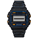 | Casio F-91W | 20 $ |  | +1 | 50 %, -10 % por ronda |  |  |
| 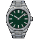 | Tissot PRX | 750 $ |  | +3 | 60 %, -8 % por ronda | +2 puntos al buscar trabajo |  |
| 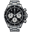 | Omega Speedmaster | 7.000 $ | 100 $/año | +10 | 75 %, -3 % por ronda | +4 puntos al buscar trabajo |  |
| 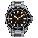 | Rolex Submariner | 11.000 $ | 150 $/año | +18 | 90 %, +2 % por ronda | +6 puntos al buscar trabajo |  |
| 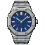 | Audemars Piguet Royal Oak | 38.000 $ | 300 $/año | +32 | 92 %, +3 % por ronda | +8 puntos al buscar trabajo |  |
|  | Patek Philippe Nautilus | 90.000 $ | 400 $/año | +45 | 95 %, +4 % por ronda | +10 puntos al buscar trabajo |  |

### Tecnología

|  | Objeto | Precio | Mantenimiento | Estatus | Reventa | Sirve para | Notas |
| --- | --- | --- | --- | --- | --- | --- | --- |
|  | iPhone | 1.200 $ |  | +2 | 60 %, -50 % por ronda |  |  |
|  | MacBook Pro | 2.600 $ |  | +3 | 65 %, -45 % por ronda | +1 de experiencia al estudiar |  |
|  | PS5 | 550 $ |  | +1 | 60 %, -40 % por ronda |  |  |

### Moda

|  | Objeto | Precio | Mantenimiento | Estatus | Reventa | Sirve para | Notas |
| --- | --- | --- | --- | --- | --- | --- | --- |
|  | Blazer de Zara | 150 $ |  | +1 | 20 %, -60 % por ronda | +3 puntos al buscar trabajo |  |
| 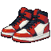 | Air Jordan 1 | 350 $ |  | +2 | 90 %, +2 % por ronda |  |  |
|  | Gafas Persol | 450 $ |  | +2 | 30 %, -40 % por ronda |  |  |
| 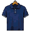 | Polo Ralph Lauren | 600 $ |  | +3 | 25 %, -50 % por ronda |  |  |
| 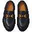 | Mocasines de Gucci | 950 $ |  | +6 | 40 %, -30 % por ronda | +4 puntos al buscar trabajo |  |
|  | Louis Vuitton Keepall | 2.800 $ |  | +11 | 60 %, -15 % por ronda |  |  |
|  | Traje de Savile Row | 6.000 $ |  | +14 | 20 %, -50 % por ronda | +10 puntos al buscar trabajo | Solo en Londres; se pierde al mudarse |
|  | Hermès Birkin | 14.000 $ |  | +25 | 95 %, +3 % por ronda | +6 puntos al buscar trabajo |  |
|  | Abrigo de alta costura Chanel | 25.000 $ |  | +30 | 40 %, -25 % por ronda | +8 puntos al buscar trabajo |  |

### Arte

|  | Objeto | Precio | Mantenimiento | Estatus | Reventa | Sirve para | Notas |
| --- | --- | --- | --- | --- | --- | --- | --- |
|  | Lámina firmada de artista local | 600 $ |  | +2 | 50 %, -5 % por ronda |  |  |
|  | Fotografía de edición limitada | 5.000 $ |  | +6 | 80 %, 0 % por ronda |  |  |
| 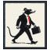 | Serigrafía de Banksy | 28.000 $ |  | +14 | 90 %, +5 % por ronda |  |  |
|  | Litografía de Picasso | 60.000 $ |  | +25 | 92 %, +4 % por ronda |  |  |
|  | Escultura de bronce | 150.000 $ |  | +38 | 92 %, +3 % por ronda |  |  |
|  | Óleo de un maestro antiguo | 900.000 $ |  | +60 | 95 %, +4 % por ronda |  |  |

### Viajes

|  | Objeto | Precio | Mantenimiento | Estatus | Reventa | Sirve para | Notas |
| --- | --- | --- | --- | --- | --- | --- | --- |
|  | Escapada con Ryanair | 300 $ |  | +2 |  |  | El estatus dura 2 años |
| 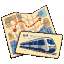 | Pase de Interrail | 1.200 $ |  | +3 |  |  | El estatus dura 2 años |
|  | Verano en Ibiza | 2.500 $ |  | +5 |  |  | El estatus dura 2 años |
|  | Semana de esquí en Zermatt | 4.500 $ |  | +7 |  |  | El estatus dura 2 años. Solo en Madrid, Londres; se pierde al mudarse |
|  | Business de Emirates | 6.000 $ |  | +9 |  | +1 de foco la ronda siguiente | El estatus dura 4 años |
|  | Safari en el Masái Mara | 9.000 $ |  | +12 |  | +1 de foco la ronda siguiente | El estatus dura 4 años |
|  | Resort en Maldivas | 14.000 $ |  | +15 |  | +1 de foco la ronda siguiente | El estatus dura 4 años |
|  | Vuelta al mundo en primera | 40.000 $ |  | +22 |  | +1 de foco la ronda siguiente | El estatus dura 4 años |

### Aire y mar

|  | Objeto | Precio | Mantenimiento | Estatus | Reventa | Sirve para | Notas |
| --- | --- | --- | --- | --- | --- | --- | --- |
|  | Curso de vela | 2.500 $ |  | +4 |  |  | El estatus dura 4 años |
|  | Vuelo en helicóptero | 6.000 $ |  | +8 |  |  | El estatus dura 2 años |
|  | Semana en yate | 45.000 $ |  | +25 |  |  | El estatus dura 4 años |
|  | Vuelo con NetJets | 80.000 $ |  | +30 |  |  | El estatus dura 4 años |
|  | Velero Beneteau | 180.000 $ | 12.000 $/año | +35 | 75 %, -12 % por ronda |  |  |
|  | Yate Sunseeker | 1.200.000 $ | 90.000 $/año | +70 | 70 %, -15 % por ronda |  | Solo en Dubái, Singapur; se pierde al mudarse |

### Clubes y abonos

|  | Objeto | Precio | Mantenimiento | Estatus | Reventa | Sirve para | Notas |
| --- | --- | --- | --- | --- | --- | --- | --- |
| 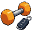 | Basic-Fit | 50 $ | 360 $/año | +1 |  |  | Cuota mientras lo tengas |
|  | Amex Platinum | 0 $ | 800 $/año | +5 |  | +2 puntos al buscar trabajo | Cuota mientras lo tengas |
|  | Soho House | 500 $ | 3.000 $/año | +8 |  | +6 puntos al buscar trabajo | Cuota mientras lo tengas |
|  | Abono del Bernabéu | 1.000 $ | 1.800 $/año | +6 |  | +3 puntos al buscar trabajo | Cuota mientras lo tengas. Solo en Madrid; se pierde al mudarse |
|  | Abono del Arsenal | 1.500 $ | 2.600 $/año | +7 |  | +3 puntos al buscar trabajo | Cuota mientras lo tengas. Solo en Londres; se pierde al mudarse |
|  | Abono de los Knicks | 2.500 $ | 4.500 $/año | +9 |  | +4 puntos al buscar trabajo | Cuota mientras lo tengas. Solo en Nueva York; se pierde al mudarse |
|  | Club de playa de Jumeirah | 3.000 $ | 5.000 $/año | +10 |  | +4 puntos al buscar trabajo | Cuota mientras lo tengas. Solo en Dubái; se pierde al mudarse |
|  | Paddock Club del GP de Singapur | 4.000 $ | 6.000 $/año | +11 |  | +5 puntos al buscar trabajo | Cuota mientras lo tengas. Solo en Singapur; se pierde al mudarse |
|  | Pase de ringside en Rajadamnern | 150 $ | 400 $/año | +3 |  | +2 puntos al buscar trabajo | Cuota mientras lo tengas. Solo en Bangkok; se pierde al mudarse |

### Formación

|  | Objeto | Precio | Mantenimiento | Estatus | Reventa | Sirve para | Notas |
| --- | --- | --- | --- | --- | --- | --- | --- |
|  | MBA en el IESE | 95.000 $ |  | +15 |  | +10 % de sueldo | Solo lo da una carta |

## Inmuebles

El precio es un porcentaje del piso de referencia de cada ciudad. Como ejemplo va el precio en Madrid.

|  | Inmueble | Precio | En Madrid | Estatus si vives en él | Uso | Alquiler |
| --- | --- | --- | --- | --- | --- | --- |
| 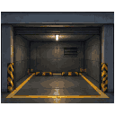 | Plaza de garaje | 12 % del piso | 33.600 $ |  | Solo para alquilar | 90 % de lo que rinde una vivienda |
|  | Estudio | 60 % del piso | 168.000 $ | +8 | Para vivir o alquilar | 100 % de lo que rinde una vivienda |
|  | Piso | 100 % del piso | 280.000 $ | +14 | Para vivir o alquilar | 100 % de lo que rinde una vivienda |
|  | Loft | 125 % del piso | 350.000 $ | +18 | Para vivir o alquilar | 100 % de lo que rinde una vivienda |
|  | Local comercial | 130 % del piso | 364.000 $ |  | Solo para alquilar | 125 % de lo que rinde una vivienda |
|  | Adosado | 150 % del piso | 420.000 $ | +21 | Para vivir o alquilar | 100 % de lo que rinde una vivienda |
|  | Casa familiar | 180 % del piso | 504.000 $ | +24 | Para vivir o alquilar | 100 % de lo que rinde una vivienda |
|  | Oficina | 220 % del piso | 616.000 $ |  | Solo para alquilar | 115 % de lo que rinde una vivienda |
|  | Dúplex | 250 % del piso | 700.000 $ | +31 | Para vivir o alquilar | 100 % de lo que rinde una vivienda |
|  | Nave industrial | 300 % del piso | 840.000 $ |  | Solo para alquilar | 120 % de lo que rinde una vivienda |
| 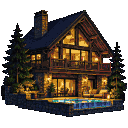 | Chalet | 320 % del piso | 896.000 $ | +37 | Para vivir o alquilar | 100 % de lo que rinde una vivienda |
|  | Ático | 400 % del piso | 1.120.000 $ | +42 | Para vivir o alquilar | 100 % de lo que rinde una vivienda |
|  | Finca | 550 % del piso | 1.540.000 $ | +50 | Para vivir o alquilar | 100 % de lo que rinde una vivienda |
|  | Villa | 800 % del piso | 2.240.000 $ | +60 | Para vivir o alquilar | 100 % de lo que rinde una vivienda |
|  | Bloque de pisos | 900 % del piso | 2.520.000 $ |  | Solo para alquilar | 110 % de lo que rinde una vivienda |
|  | Mansión | 1500 % del piso | 4.200.000 $ | +80 | Para vivir o alquilar | 100 % de lo que rinde una vivienda |

Quien no tiene casa propia vive de alquiler:

|  | Alquiler | Gasto de vivienda | Estatus |
| --- | --- | --- | --- |
|  | Habitación alquilada | 55 % | 0 |
|  | Piso alquilado | 100 % | +3 |

Desde los 26 años, la habitación alquilada pasa a dar -3 de estatus.

## Inversiones

El nivel de finanzas dice qué se puede comprar por cuenta propia. Una carta puede dar algo de un nivel más alto.

| Inversión | Ticker | Clase | Finanzas | Renta | Qué es |
| --- | --- | --- | --- | --- | --- |
| Bono EE. UU. 2 años | UST2 | Bonos | 1 | Cupón según los tipos | Prestas al Gobierno de EE. UU. a dos años. Paga el tipo del momento y apenas se mueve. |
| Bono EE. UU. 10 años | UST10 | Bonos | 1 | Cupón según los tipos | Diez años de cupones del Tesoro de EE. UU. Su precio cae con fuerza cuando suben los tipos. |
| Bund alemán | BUND | Bonos | 1 | Cupón según los tipos | Deuda pública alemana. Paga un poco menos y deja dormir un poco mejor. |
| S&P 500 | SPX | Acciones | 0 | 1,4 % al año | Las 500 mayores empresas de EE. UU. en un solo fondo. |
| MSCI World | MSCI | Acciones | 0 | 1,8 % al año | Empresas de todo el mundo desarrollado en un solo fondo. Tu plan de pensiones lo sigue. |
| Apple | AAPL | Acciones | 1 | 0,5 % al año | Crecimiento, con un cliente fiel en cada bolsillo. |
| Microsoft | MSFT | Acciones | 1 | 0,8 % al año | Crecimiento, con suscripción incluida. |
| Nvidia | NVDA | Acciones | 1 |  | Crecimiento a todo volumen. Vuela en los auges y se hunde en las caídas. |
| Amazon | AMZN | Acciones | 1 |  | Crecimiento que lo reinvierte todo y no reparte dividendo. |
| Tesla | TSLA | Acciones | 1 |  | Mitad fabricante de coches, mitad discusión. Puede perder casi todo su valor en una mala ronda. |
| Inditex | ITX | Acciones | 1 | 3 % al año | Moda que sigue al comprador. Cíclica y con buen dividendo. |
| LVMH | MC | Acciones | 1 | 1,8 % al año | Lujo que sube y baja con el ánimo de los ricos. |
| Ferrari | RACE | Acciones | 1 | 0,8 % al año | Vende menos coches de los que podría, a propósito. |
| Santander | SAN | Acciones | 1 | 5 % al año | Un banco: mucho dividendo y un precio que no va a ninguna parte. |
| Coca-Cola | KO | Acciones | 1 | 3,2 % al año | Defensiva. También se bebe en las recesiones. |
| Bitcoin | BTC | Cripto | 2 |  | La primera criptomoneda. Tiene sus propias estaciones, y sus inviernos son largos. |
| Ethereum | ETH | Cripto | 2 |  | La segunda criptomoneda. Hace lo mismo que bitcoin, pero más fuerte. |
| Dogecoin | DOGE | Cripto | 2 |  | Una broma con precio. A veces la broma es el precio. |
| Oro | XAU | Oro | 1 |  | No paga nada y no se preocupa por nada. Brilla cuando los precios se disparan. |

## Modo de vida, alquiler, seguros y foco

|  | Modo de vida | Coste de vida | Estatus |
| --- | --- | --- | --- |
|  | Austero | 70 % | -3 |
|  | Normal | 100 % | 0 |
|  | Cómodo | 140 % | +3 |
|  | Lujoso | 200 % | +8 |

|  | Seguro | Prima al año |
| --- | --- | --- |
|  | Seguro de salud | 1,5 % del coste de vida de la ciudad |
|  | Seguro de hogar | 0,6 % del coste de vida de la ciudad |
|  | Seguro de vida | 0,6 % del coste de vida de la ciudad |
|  | Seguro de responsabilidad civil | 0,4 % del coste de vida de la ciudad |

|  | En qué poner el foco | Qué da |
| --- | --- | --- |
|  | Hacer horas extra | Más sueldo esa ronda, según la carrera |
|  | Formarte para tu carrera | +1 de experiencia, además del +1 por trabajar |
|  | Buscar un trabajo mejor | 20 % de probabilidad de un +3 % de sueldo para siempre |

Familia: una pareja añade un 45 % del coste de vida, y cada hijo un 22 % durante 20 años.

       

## Cartas

Cada ronda reparte 3. La primera opción de cada carta es la que no cuesta ni compra nada.

### Carrera (12)

|  | Carta | Opciones |
| --- | --- | --- |
|  | **Pedir un aumento** La semana que viene tienes la evaluación y el alquiler te ha subido dos veces desde la última. | 1. No decir nada 2. Pedirlo 3. Preparar bien los argumentos |
|  | **Llama la competencia** La empresa rival te quiere, y ofrece más. | 1. Ser leal 2. Aceptar el puesto 3. Enseñársela a tu jefe |
|  | **Un ascenso con letra pequeña** El ascenso es tuyo. La mesa está en Londres. | 1. Rechazarlo 2. Hacer las maletas |
|  | **Semanas de entrega** Han adelantado la fecha. Alguien tiene que quedarse hasta tarde un mes. | 1. Hacer lo justo 2. Echar horas |
|  | **Una ronda de despidos** En tu calendario aparece una reunión general sin orden del día. | 1. Aceptar la indemnización 2. Pelear por tu puesto 3. Formarte mientras buscas |
|  | **El jefe nuevo** Correos a medianoche. Elogios en privado, broncas en público. | 1. Aguantar 2. Denunciarlo a Recursos Humanos 3. Cambiar de equipo |
|  | **Otra escalera** Un amigo que trabaja en banca dice que buscan gente con «experiencia del mundo real». | 1. Quedarte donde estás 2. Empezar desde abajo en finanzas 3. Pagar un curso y presentarte |
|  | **El gran nombre** Google, Inditex o Goldman Sachs: quien manda en tu sector quiere hablar contigo. | 1. Quedarte 2. Aceptar la oferta 3. Negociar fuerte |
|  | **Acciones o sueldo** Tu subida puede llegar en efectivo cada mes o en acciones que se liberan en dos años. | 1. Coger el efectivo 2. Coger las acciones |
|  | **Teletrabajo aprobado** Puedes trabajar desde casa para siempre, si quieres. | 1. Seguir yendo a la oficina 2. Pasarte al teletrabajo 3. Pedir a cambio un aumento |
|  | **Dirigir el equipo** Tu responsable se va y ha propuesto tu nombre. | 1. Seguir en lo técnico 2. Aceptar el equipo |
|  | **Llama un cazatalentos** «¿Tienes un rato para un café confidencial?» | 1. No me interesa 2. Ir a la reunión 3. Aceptar el puesto en Nueva York |

### Formación (6)

|  | Carta | Opciones |
| --- | --- | --- |
|  | **Un máster** Dos años de tardes y fines de semana, y un título en el currículum. | 1. Ahora no 2. Pagarlo 3. Pedir un préstamo para pagarlo |
|  | **Un curso de inversión** Doce semanas, una tarde cada una: bonos, acciones y cómo no perderlo todo. | 1. Pasar 2. Apuntarte |
|  | **Un libro sobre dinero** Una compañera te presta el libro que «le cambió la forma de pensar en el dinero». | 1. Dejarlo en la estantería 2. Leerlo |
|  | **El MBA** Tienes plaza en el MBA en el IESE. Cuesta una fortuna y se come dos años de tardes. | 1. No es para mí 2. Matricularte y pagar 3. Matricularte con un préstamo |
|  | **Bootcamp de programación** Dieciséis semanas para ser programador júnior. Dicen que todos encuentran trabajo. | 1. Pasar 2. Apuntarte y pasarte a tecnología |
|  | **Un idioma nuevo** Una profesora da clases por las tardes a dos calles de casa. | 1. Quizá el año que viene 2. Apuntarte |

### Negocios (8)

|  | Carta | Opciones |
| --- | --- | --- |
|  | **Un encargo por tu cuenta** Un antiguo cliente necesita un trabajo que te ocupará tres fines de semana. | 1. Pasar 2. Aceptarlo 3. Aceptarlo, y el de su otra sede en coche |
|  | **Trabajar por tu cuenta** Podrías hacer tu trabajo para tres clientes en vez de para un jefe. | 1. Seguir con la nómina 2. Darte de alta por tu cuenta 3. Empezar con gente de donde eres socio |
|  | **Un bar propio** Se traspasa el bar de la esquina. El dueño quiere dejarlo antes de primavera. | 1. Pasar de largo 2. Comprarlo y llevarlo 3. Poner dinero para que lo lleve un amigo |
|  | **Una tienda online** Has encontrado un producto por el que la gente no deja de preguntar. | 1. Dejarlo 2. Lanzarla |
|  | **La habitación que sobra** Esa habitación podría ganarse el sueldo en Airbnb. | 1. Conservar tu intimidad 2. Anunciarla |
|  | **Lanzar una app** Llevas un año con la idea. Te costaría todas las noches de seis meses. | 1. Dejarla en el cajón 2. Hacerla |
|  | **La propuesta del socio** Un excompañero brillante monta una empresa y te quiere dentro. | 1. Desearle suerte 2. Poner dinero 3. Entrar en el equipo fundador |
|  | **Una oferta por el negocio** Una empresa más grande quiere comprarte. La cifra va en serio. | 1. Quedarte con el negocio 2. Vender 3. Pedir más |

### Inversión (10)

|  | Carta | Opciones |
| --- | --- | --- |
|  | **El chivatazo de tu primo** «Hazme caso. Tesla. Es imposible que baje.» | 1. Cambiar de tema 2. Meter un poco 3. Ir a lo grande |
|  | **El plan de acciones para empleados** Tu empresa te vende acciones de Microsoft con un 15 % de descuento. | 1. Pasar 2. Comprar algunas 3. Comprar el máximo |
|  | **La moneda del perro** Todo el gimnasio tiene Dogecoin. Uno se acaba de comprar un coche con eso. | 1. No entrar 2. Una apuesta pequeña 3. Con todo |
|  | **La startup de un amigo** Un amigo busca dinero entre «gente que cree en nosotros». | 1. Esta vez no 2. Invertir 3. Dar consejos, no dinero |
|  | **La salida a bolsa de moda** Mañana debuta la empresa de la que habla todo el mundo y tu bróker tiene acciones para ti. | 1. Mirar desde la barrera 2. Acudir |
|  | **«Un 20 % al mes, garantizado»** El amigo trajeado de un amigo tiene un fondo que nunca pierde. Te enseña sus extractos. | 1. Marcharte 2. Probar con poco 3. Meterlo todo |
|  | **Retiradas suspendidas** La plataforma que guarda tus monedas ha «pausado las retiradas por mantenimiento». | 1. Esperar 2. Pagar la comisión y salir |
|  | **Sobre plano en Dubái** Un folleto brillante, una torre que aún no existe y un plan de pagos. | 1. Tirar el folleto 2. Reservar una unidad |
| 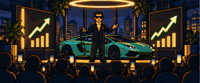 | **El gurú del trading** Publica desde un deportivo alquilado y su curso está «casi agotado». | 1. Pasar de largo 2. Comprar el curso |
|  | **Crowdfunding inmobiliario** Una plataforma te deja comprar un trozo de un edificio en alquiler. | 1. Pasar 2. Comprar una parte |

### Vivienda (8)

|  | Carta | Opciones |
| --- | --- | --- |
| 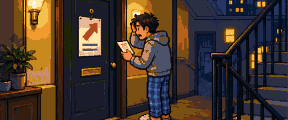 | **Sube el alquiler** Una carta del casero: «para ajustarlo al mercado». | 1. Pagar 2. Negociar |
| 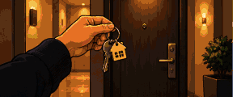 | **Tu primer piso** Una ayuda para primera vivienda te deja entrar con la décima parte del precio. | 1. Seguir de alquiler 2. Comprar un estudio 3. Comprar un piso, con ayuda de casa |
|  | **El casero vende** Te lo ofrece a ti primero, un poco por debajo del precio. | 1. Mudarte 2. Comprarlo |
|  | **Fija o variable** Tu banco te cambia la hipoteca a cambio de una comisión. | 1. Dejarla como está 2. Pasarla a tipo fijo 3. Pasarla a variable |
| 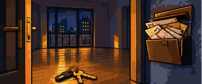 | **El inquilino deja de pagar** Tres meses de silencio y el buzón lleno. | 1. Esperar y asumir la pérdida 2. Contratar a un abogado |
|  | **Reformar** La cocina es de otro siglo y el baño gotea. | 1. Poner parches 2. Hacerlo bien 3. Reforma de lujo |
|  | **Daños por agua** Revienta una tubería mientras pasas el fin de semana fuera. El piso es tuyo, y la factura también. | 1. Llamar a una empresa 2. Hacerlo casi todo tú |
|  | **Iros a vivir juntos** Dos alquileres, dos neveras, y siempre estás en su casa. | 1. Todavía no 2. Iros a vivir juntos |

### Estilo de vida (10)

|  | Carta | Opciones |
| --- | --- | --- |
|  | **El coche nuevo de un compañero** Lo aparca ocupando dos plazas. Baja todo el mundo a verlo. | 1. Encogerte de hombros 2. Comprarle barato su viejo VW Golf GTI 3. Financiar un BMW M3 |
|  | **Ibiza** En el grupo ya hay villa, fechas y un plazo para pagar la señal. | 1. Quedarte en casa 2. Ir 3. Ir, con mesa en la discoteca |
| 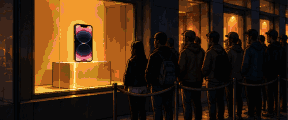 | **El nuevo iPhone** El tuyo funciona. Este tiene mejor cámara. | 1. Seguir con el viejo 2. Comprarlo |
|  | **Una boda en el extranjero** Tu amiga se casa junto a un lago: cuatro días y etiqueta «elegante». | 1. Mandar un regalo 2. Ir 3. Ir a lo grande |
|  | **La lista de espera** Llaman de la joyería. Después de dos años, ha llegado tu Rolex Submariner. | 1. Dejarlo pasar 2. Comprarlo y llevarlo 3. Comprarlo y revenderlo |
|  | **Mejora en la puerta de embarque** Por una fracción del billete, el asiento se convierte en cama. | 1. Quedarte en turista 2. Aceptar la mejora |
|  | **Venta privada** Un cuarenta por ciento menos, solo esta noche y con invitación. | 1. Borrar el correo 2. Mocasines de Gucci 3. La Louis Vuitton Keepall |
|  | **Necesitas coche** El metro cierra a medianoche y tu nuevo trabajo no. | 1. Seguir en metro 2. Comprar un Toyota Corolla al contado 3. Financiar un Tesla Model 3 |
|  | **Mesa con botella** Alguien propone coger mesa. El camarero ya tiene la carta en la mano. | 1. Irte pronto a casa 2. Poner tu parte 3. Pagar la mesa con tu tarjeta |
|  | **Black Friday** Tienes la cesta llena desde el martes. | 1. Cerrar la pestaña 2. La PS5 3. El MacBook Pro |

### Familia (10)

|  | Carta | Opciones |
| --- | --- | --- |
|  | **Empezar a salir con alguien** Una amiga quiere presentarte a alguien. Se te han acabado las excusas. | 1. Seguir sin pareja 2. Decir que sí |
|  | **La boda** Te casas. La única duda es cómo. | 1. Juzgado y comida 2. Una boda clásica 3. La gran boda |
|  | **¿Un hijo?** Últimamente pasáis más despacio junto a los carritos. | 1. Todavía no 2. Sí |
|  | **Separación de bienes** Tu notario lo menciona, con cuidado. | 1. No hace falta 2. Firmarla |
|  | **Tu hermano necesita dinero** «Solo hasta el verano.» | 1. Decir que no 2. Prestárselo 3. Regalarle una cantidad menor |
|  | **Avalar un préstamo** Tu amigo de toda la vida necesita un avalista. | 1. Negarte 2. Firmar |
|  | **Tus padres necesitan ayuda** La pensión ya no llega como antes. | 1. Ahora no puedes 2. Mandar dinero cada mes 3. Pagar a una cuidadora |
|  | **Una herencia** Tu abuela te ha dejado algo, y una nota que dice «usa la cabeza». | 1. Coger el dinero 2. Meterlo todo en un fondo indexado 3. Usarlo de entrada para un piso de alquiler |
| 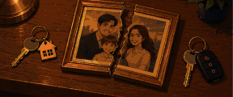 | **Divorcio** Se veía venir desde hace tiempo. | 1. Llegar a un acuerdo discreto 2. Contratar a un buen abogado 3. Probar terapia de pareja |
|  | **Qué colegio** El colegio del barrio está bien. El otro tiene lista de espera y uniforme. | 1. El colegio del barrio 2. Un colegio privado 3. El colegio internacional |

### Salud (5)

|  | Carta | Opciones |
| --- | --- | --- |
|  | **Una enfermedad grave** Pruebas, un diagnóstico y un tratamiento con precio. | 1. Ir por la pública y esperar 2. Ir por la privada, ya 3. Cobrar tu seguro de vida |
|  | **Agotamiento** Llevas una hora mirando el mismo correo. | 1. Seguir tirando 2. Pedir un permiso sin sueldo 3. Ir a terapia |
|  | **Una urgencia dental** Se te parte una muela con un hueso de aceituna. | 1. Arreglarlo bien 2. Buscar una clínica barata |
|  | **Una lesión deportiva** Una pachanga, el campo mojado, una rodilla. | 1. Fisioterapia 2. Reposo |
|  | **Apuntarte al gimnasio** Hay un Basic-Fit abajo y te ahogas subiendo las escaleras. | 1. Quizá el año que viene 2. Apuntarte, e ir de verdad |

### Suerte (8)

|  | Carta | Opciones |
| --- | --- | --- |
|  | **El Gordo** En la oficina se compra lotería de Navidad. Participa todo el mundo. | 1. No jugar 2. Comprar un décimo 3. Comprar diez |
|  | **El coche no arranca** Un clic, un testigo encendido y una grúa. | 1. El taller oficial 2. Un taller barato |
| 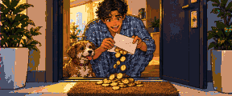 | **Hacienda te devuelve** Hacienda te debe dinero. A veces pasa. | 1. Coger el dinero 2. Meterlo en el plan de pensiones |
|  | **Te roban el móvil** Hace un segundo estaba en la mesa de la terraza. | 1. Comprar otro 2. Rescatar uno viejo |
|  | **Un bonus inesperado** Un buen año. Tu jefa te llama, sonriendo. | 1. Coger el bonus 2. Pedir a cambio un aumento |
|  | **Un mensaje de «tu banco»** Parece auténtico. Dice que tu cuenta está bloqueada. | 1. Resolverlo rápido 2. Comprobarlo con calma |
|  | **Una multa por exceso de velocidad** Te llega por correo una foto de tu coche. | 1. Pagarla 2. Recurrirla |
|  | **La app de apuestas** Una apuesta gratis para empezar. Esta noche juega tu equipo. | 1. Borrar la app 2. Una apuesta pequeña 3. Ir a por un premio grande |

### Mundo (18)

|  | Carta | Opciones |
| --- | --- | --- |
|  | **Recesión** Las fábricas frenan, las tiendas cierran y todos los titulares llevan la misma palabra. | 1. Aguantar 2. Recortar y ahorrar 3. Comprar en la caída |
|  | **Suben los tipos** El banco central sube los tipos. Hipotecas y depósitos se despiertan a la vez. | 1. Tomar nota 2. Pasar tu hipoteca a tipo fijo 3. Comprar bonos a corto plazo |
|  | **Bajan los tipos** El banco central recorta. Pedir prestado vuelve a ser barato. | 1. Tomar nota 2. Pasar tu hipoteca a variable 3. Pedir prestado e invertir |
|  | **Los precios se disparan** La compra de la semana cuesta lo que antes una cena fuera. | 1. Apretarte el cinturón 2. Pedir una subida por el coste de la vida 3. Comprar oro |
|  | **Fiebre cripto** Las criptomonedas salen en portada y tu taxista tiene una opinión. | 1. No entrar 2. Comprar algo de Bitcoin 3. Hacer antes un curso |
|  | **Invierno cripto** Los gráficos están en rojo y los foros en silencio. | 1. Mirar para otro lado 2. Comprar cuando hay miedo |
| 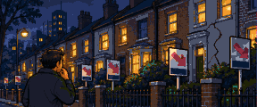 | **Se rompe el mercado de la vivienda** Carteles de «se vende» por toda tu ciudad, y los precios cayendo. | 1. Esperar 2. Comprar un estudio de ocasión para vivir 3. Comprar uno para alquilar |
|  | **Manía tecnológica** De repente todas las empresas son tecnológicas. | 1. Mantener la cartera repartida 2. Subirte con Nvidia |
|  | **El auge de la IA** Herramientas nuevas cada semana. La mitad de tu trabajo podría hacerse de otra manera. | 1. Seguir como siempre 2. Aprender las herramientas 3. Pedir liderar el trabajo de IA |
|  | **Pandemia** Se cierran las fronteras y se vacían las calles. Todo el mundo aprende a hacer pan. | 1. Quedarte en casa 2. Hacer voluntariado 3. Especular desde el sofá |
|  | **Reforma fiscal** Unos presupuestos nuevos cambian los tipos en alguna parte. Mira la pestaña Impuestos: puede ser tu ciudad. | 1. Leer el resumen 2. Ir a un asesor fiscal |
|  | **Lunes negro** Las pantallas están en rojo de Tokio a Nueva York. El móvil no deja de vibrar: todos preguntan qué vas a hacer. | 1. No mirar y aguantar 2. Comprar mientras todos venden 3. Tirar de tu línea de crédito mientras el banco aún presta |
|  | **La segunda ola** Un año después, el crac ha llegado a las nóminas. Tu empresa convoca a toda la plantilla el viernes. | 1. No llamar la atención 2. Ofrecerte a cobrar menos 3. Aprovechar los meses flojos para formarte |
|  | **La factura** La calefacción, la gasolina y la compra han subido a la vez. El sobre del buzón pesa más que de costumbre. | 1. Pagarla 2. Aislar el piso y olvidarte 3. Pagarla, y pasar ahorros a oro |
|  | **Sueldos contra precios** Los precios llevan dos años por delante de los sueldos. Se habla de huelga, y de quién cederá antes. | 1. Esperar 2. Parar con los demás 3. Recortar gastos en casa |
|  | **La prima de riesgo** Los prestamistas piden el doble por la deuda de tu gobierno. Todo préstamo que se calcula sobre ella va detrás. | 1. Esperar a ver 2. Fijar ya el tipo de tu hipoteca 3. Refugiarte en el Bund alemán |
|  | **Recortes** Las cuentas se cuadran por las malas: una derrama, sueldos congelados y gangas para quien tenga efectivo. | 1. Pagar la derrama 2. Pagarla, y hacer el trabajo de dos 3. Pagarla, y comprar un estudio embargado para alquilar |
|  | **Quiebra un banco** Un banco mediano cierra y se forman colas delante de los demás. | 1. Confiar en la garantía 2. Hacer cola y mover tu dinero |

### Impuestos (6)

|  | Carta | Opciones |
| --- | --- | --- |
|  | **Contratar a un asesor fiscal** Una amiga jura que la suya se pagó sola el primer año. | 1. Hacerlo tú 2. Contratar a una |
|  | **Aportación al plan de pensiones** Este año tu empresa iguala lo que aportes a tu plan. | 1. Pasar 2. Aportar un poco 3. Aportar el máximo |
|  | **La declaración de la renta** Una caja de zapatos llena de facturas y una fecha límite. | 1. Presentarla como siempre 2. Repasar todas las facturas |
|  | **Una inspección de Hacienda** Una carta certificada. Quieren tres años de papeles. | 1. Pagar lo que piden 2. Recurrir |
| 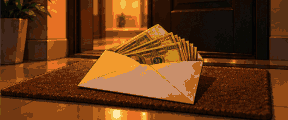 | **En negro** Un cliente te ofrece pagar más si no hay factura. | 1. Facturarlo como es debido 2. Coger el sobre |
|  | **Cambiar de residencia fiscal** Un asesor te enseña lo que conservarías si vivieras en Dubái. | 1. Quedarte 2. Mudarte a Dubái 3. Pagar antes un buen asesoramiento |

### Madurez (5)

|  | Carta | Opciones |
| --- | --- | --- |
| 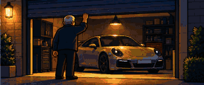 | **Un Porsche 911** Pasas por delante del concesionario todos los días. Hoy entras. | 1. Volver a salir 2. Comprarlo 3. Financiarlo |
|  | **La universidad** A tu hijo lo han admitido en una buena universidad extranjera. | 1. La universidad pública de aquí 2. La buena, en el extranjero 3. Que pida un préstamo de estudios |
|  | **Prejubilación** La empresa ofrece un paquete a quien se vaya este año. | 1. Seguir trabajando 2. Aceptar el paquete |
|  | **Una casa más pequeña** La casa se ha quedado grande. Bastaría un pisito de alquiler junto al mar. | 1. Quedarte 2. Vender y alquilar junto al mar |
|  | **Hacer testamento** A nadie le apetece la cita. Todo el mundo se alegra después. | 1. Más adelante 2. Hacerlo |

## Crisis

Una partida de cada tres, más o menos (30 %), tiene una crisis: unas rondas seguidas en las que el mundo se sale de su curso. Nunca antes de los 30 años, y nunca más de una por vida.

Cada ronda de una crisis cambia primero el mundo en el que se despierta el jugador (economía, tipos, inflación) y luego pesa sobre lo que rinden las inversiones de esa ronda.

### El Gran Crac

Los mercados caen en picado y la vivienda va detrás. Los bancos centrales bajan tipos. Quien tiene que vender es quien más pierde.

| Año | Qué pasa | Al llegar | Sobre lo que rinde la ronda |
| --- | --- | --- | --- |
| 1 | Bolsa y vivienda caen con fuerza. | Recesión; cripto: Invierno; tipos −1 % | bolsa −15 %; vivienda −6 % |
| 2 | Llegan los despidos y los precios siguen bajando. | Recesión; tipos −1 % | bolsa −6 %; vivienda −5 % |
| 3 | Lo peor ha pasado: los mercados se dan la vuelta. | Recuperación | bolsa +9 % |

### La Crisis Energética

Falta combustible y todos los precios suben tras él. Los tipos suben para frenar la inflación. Pierden el efectivo y los bonos; gana el oro.

| Año | Qué pasa | Al llegar | Sobre lo que rinde la ronda |
| --- | --- | --- | --- |
| 1 | Los precios saltan y los tipos van detrás. | Desaceleración; tipos +1 %; inflación +3,5 % | bolsa −5 %; oro +7 % |
| 2 | Siguen subiendo: la economía se para. | Desaceleración; tipos +1 %; inflación +2,5 % | bolsa −4 %; vivienda −3 %; oro +5 % |
| 3 | Los precios se calman y el oro devuelve parte. | Recuperación; inflación −1 % | oro −3 % |

### La Crisis de Deuda

Los prestamistas han dejado de fiarse de los gobiernos. Pedir prestado se encarece de golpe y cae todo lo que se compró a crédito.

| Año | Qué pasa | Al llegar | Sobre lo que rinde la ronda |
| --- | --- | --- | --- |
| 1 | Saltan los tipos; caen bolsa y vivienda. | Recesión; tipos +2 % | bolsa −7 %; vivienda −7 % |
| 2 | El crédito sigue caro y la vivienda sigue cayendo. | Desaceleración; tipos +1 % | bolsa −2 %; vivienda −5 % |

## Insignias

### Riqueza

|  | Insignia | Cómo se consigue |
| --- | --- | --- |
|  | Primeros 100.000 | Ten un patrimonio de 100.000 $, descontando la inflación. |
|  | Millonario | Ten un patrimonio de un millón, descontando la inflación. |
|  | Millonario a los 35 | Ten un patrimonio de un millón a los 35 años o antes, descontando la inflación. |
|  | Diez millones | Ten un patrimonio de diez millones, descontando la inflación. |
|  | Sin deudas a los 40 | No debas nada de nada el día que cumplas 40, sin haber quebrado nunca. |
|  | Ni una vez la tarjeta | Vive una vida entera sin que nada acabe cargado a la tarjeta de crédito. |

### Salida

|  | Insignia | Cómo se consigue |
| --- | --- | --- |
|  | Fuera de la rueda | Paga lo que cuesta tu vida con ingresos pasivos, dos rondas seguidas. |
|  | Fuera antes de los 40 | Sal de la rueda antes de cumplir 40. |
|  | Fuera antes de los 35 | Sal de la rueda antes de cumplir 35. |
|  | El doble | Gana en ingresos pasivos, después de impuestos, el doble de lo que cuesta tu vida. |

### Inversión

|  | Insignia | Cómo se consigue |
| --- | --- | --- |
|  | Primera acción | Ten una acción de una empresa concreta. |
|  | Cinco a la vez | Ten a la vez cinco de estos: fondos indexados, bonos, acciones, cripto, oro, vivienda. |
|  | Comprar en la caída | Compra un fondo indexado o una acción en plena recesión. |
|  | Aguantar el invierno | Mantén tus criptomonedas durante un invierno cripto sin vender ni una. |
|  | Tres alquileres | Ten tres inmuebles alquilados a la vez. Las plazas de garaje no cuentan. |
|  | Escalera de bonos | Ten los tres bonos del Estado a la vez. |
|  | Solo indexados | Sal de la rueda sin haber tenido nunca otra inversión que fondos indexados, y sin ninguna vivienda. |

### Estatus

|  | Insignia | Cómo se consigue |
| --- | --- | --- |
|  | Primer reloj de lujo | Ten un Omega Speedmaster o algo mejor. |
|  | Superdeportivo | Ten un Lamborghini Aventador. |
|  | Armador | Ten barco propio: el Velero Beneteau o el Yate Sunseeker. |
|  | Ático | Ten un ático en propiedad. |
|  | Estatus 100 | Llega a 100 de estatus. |
|  | Veinte cosas | Ten veinte cosas distintas, contando todas tus vidas. |
|  | Todos los coches | Ten en algún momento todos los coches del juego, contando todas tus vidas. |

### Vida

|  | Insignia | Cómo se consigue |
| --- | --- | --- |
|  | Tres ciudades | Vive en tres ciudades en una misma vida. |
|  | Mudanza a Dubái | Múdate a Dubái. |
|  | Familia de cuatro | Comparte tu vida con una pareja y dos hijos. |
|  | MBA | Consigue el MBA en el IESE. |
|  | Negocio vendido | Monta un negocio y véndelo. |
|  | Aguantar la recesión | Mantén tus inversiones durante una recesión sin vender ninguna. |

### Mala suerte

|  | Insignia | Cómo se consigue |
| --- | --- | --- |
|  | Quiebra | Quiebra. Les pasa a los mejores. |
